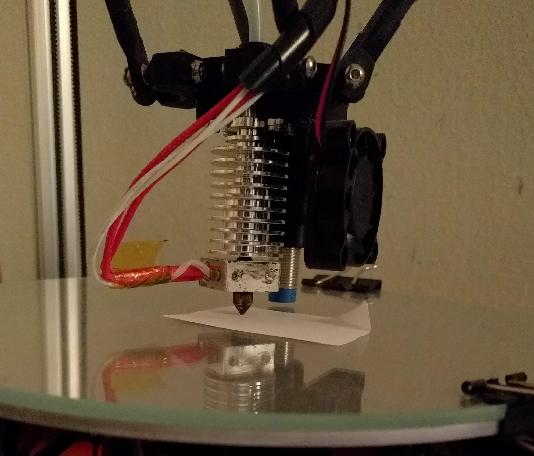

<a id="bed-leveling"></a>
# Nivelamento da Mesa

[English](../Bed_Level.md) | **Português brasileiro**

O nivelamento da mesa(às vezes também referido como "bed tramming") é fundamental para obter impressões de alta qualidade. Se uma mesa não for devidamente "nivelada", pode levar a uma fraca aderência à mesa, "deformação" e problemas sutis em toda a impressão. Este documento serve como um guia para realizar o nivelamento da mesa no Klipper.

É importante entender o objetivo do nivelamento da mesa. Se a impressora receber o comando para uma posição `X0 Y0 Z10` durante uma impressão, então o objetivo é que o bico da impressora esteja exatamente a 10mm da mesa da impressora. Além disso, se a impressora receber em seguida o comando para uma posição de `X50 Z10`, o objetivo é que o bico mantenha uma distância exata de 10mm da mesa durante todo esse movimento horizontal.

Para obter impressões de boa qualidade, a impressora deve ser calibrada de modo que as distâncias Z sejam precisas dentro de cerca de 25 mícrons (.025mm). Essa é uma distância pequena - significativamente menor que a largura de um fio de cabelo humano típico. Essa escala não pode ser medida "a olho". Efeitos sutis (como a expansão térmica) afetam as medições nessa escala. O segredo para obter alta precisão é usar um processo repetível e um método de nivelamento que aproveite a alta precisão do próprio sistema de movimentação da impressora.

<a id="choose-the-appropriate-calibration-mechanism"></a>
## Escolha o mecanismo de calibração apropriado

Diferentes tipos de impressoras usam diferentes métodos para realizar o nivelamento da mesa. Todos eles dependem do "teste do papel" (descrito abaixo). No entanto, o processo real para um tipo específico de impressora é descrito em outros documentos.

Antes de executar qualquer uma dessas ferramentas de calibração, certifique-se de executar as verificações descritas no [documento de verificação de configuração](Config_checks.md). É necessário verificar o movimento básico da impressora antes de realizar o nivelamento da mesa.

Para impressoras com uma "sonda Z automática", certifique-se de calibrar a sonda seguindo as instruções no documento [Calibrar Sonda](Probe_Calibrate.md). Para impressoras delta, consulte o documento [Calibrar Delta](Delta_Calibrate.md). Para impressoras com parafusos de mesa e chave de fim de curso de Z tradicionais, consulte o documento [Nivelamento Manual](Manual_Level.md).

Durante a calibração, pode ser necessário definir a `position_min` do eixo Z da impressora para um número negativo (por exemplo, `position_min = -2`). A impressora impõe verificações de limites mesmo durante rotinas de calibração. Definir um número negativo permite que a impressora se mova abaixo da posição nominal da mesa, o que pode ajudar ao tentar determinar a posição real da mesa.

<a id="the-paper-test"></a>
## O teste do papel""

O principal mecanismo de calibração da mesa é o 'teste do papel'. Ele envolve colocar um pedaço regular de 'papel de máquina de cópia' entre a mesa da impressora e o bico e, em seguida, comandar o bico para diferentes alturas Z até que se sinta uma pequena quantidade de atrito ao empurrar o papel para frente e para trás.

É importante entender o "teste do papel", mesmo que se tenha uma "sonda Z automática". A sonda em si muitas vezes precisa ser calibrada para obter bons resultados. Essa calibração da sonda é feita usando este "teste do papel".

Para executar o teste do papel, corte um pequeno pedaço retangular de papel usando uma tesoura (por exemplo, 5x3 cm). O papel geralmente tem uma espessura de cerca de 100 microns (0,100mm). (A espessura exata do papel não é crucial.)

O primeiro passo do teste do papel é inspecionar o bico e a mesa da impressora. Certifique-se de que não há plástico (ou outros detritos) no bico ou na mesa.

**Inspeccione o bico e a mesa para garantir que não há plástico presente!**

Se você sempre imprime em uma determinada fita ou superfície de impressão, então você pode realizar o teste do papel com essa fita/superfície no lugar. No entanto, observe que a fita em si tem uma espessura e diferentes fitas (ou qualquer outra superfície de impressão) irão impactar as medidas Z. Certifique-se de refazer o teste do papel para medir cada tipo de superfície que está em uso.

Se houver plástico no bico, aqueça o extrusor e use uma pinça de metal para remover esse plástico. Espere o extrusor esfriar completamente até a temperatura ambiente antes de continuar com o teste do papel. Enquanto o bico está esfriando, use a pinça de metal para remover qualquer plástico que possa escorrer.

**Sempre realize o teste do papel quando o bico e a mesa estiverem à temperatura ambiente!**

Quando o bico é aquecido, sua posição (em relação à mesa) muda devido à expansão térmica. Essa expansão térmica é tipicamente de cerca de 100 mícrons, que é aproximadamente a mesma espessura de um pedaço típico de papel para impressora. A quantidade exata de expansão térmica não é crucial, assim como a espessura exata do papel não é crucial. Comece com a suposição de que os dois são iguais (veja abaixo um método para determinar a diferença entre as duas distâncias).

Pode parecer estranho calibrar a distância à temperatura ambiente quando o objetivo é ter uma distância consistente quando aquecido. No entanto, se calibrar quando o bico estiver aquecido, tende a transferir pequenas quantidades de plástico derretido para o papel, o que altera a quantidade de atrito sentida. Isso torna mais difícil obter uma boa calibração. Calibrar enquanto a mesa/bico está quente também aumenta muito o risco de se queimar. A quantidade de expansão térmica é estável, por isso é facilmente contabilizada posteriormente no processo de calibração.

**Use uma ferramenta automatizada para determinar as alturas Z precisas!**

Klipper tem vários scripts auxiliares disponíveis (por exemplo, MANUAL_PROBE, Z_ENDSTOP_CALIBRATE, PROBE_CALIBRATE, DELTA_CALIBRATE). Veja os documentos [descritos acima](#choose-the-appropriate-calibration-mechanism) para escolher um deles.

Execute o comando apropriado na janela do terminal OctoPrint. O script solicitará a interação do usuário na saída do terminal OctoPrint. Parecerá algo como:

```
Recv: // Starting manual Z probe. Use TESTZ to adjust position.
Recv: // Finish with ACCEPT or ABORT command.
Recv: // Z position: ?????? --> 5.000 <-- ??????
```

A altura atual do bico (conforme a impressora entende atualmente) é mostrada entre as aspas "--> <--". O número à direita é a altura da última tentativa de sonda apenas maior que a altura atual, e à esquerda é a última tentativa de sonda menor que a altura atual (ou ?????? se nenhuma tentativa tiver sido feita).

Coloque o papel entre o bico e a mesa. Pode ser útil dobrar um canto do papel para que seja mais fácil de pegar. (Tente não empurrar a mesa ao mover o papel para frente e para trás.)



Use o comando TESTZ para solicitar que o bico se mova mais perto do papel. Por exemplo:

```
TESTZ Z=-.1
```

O comando TESTZ moverá o bico uma distância relativa à posição atual do bico. (Então, `Z=-.1` solicita que o bico se mova mais perto da mesa em .1mm.) Depois que o bico parar de se mover, empurre o papel para frente e para trás para verificar se o bico está em contato com o papel e para sentir a quantidade de atrito. Continue emitindo comandos TESTZ até sentir uma pequena quantidade de atrito ao testar com o papel.

Se for encontrado muito atrito, então se pode usar um valor Z positivo para mover o bico para cima. Também é possível usar `TESTZ Z=+` ou `TESTZ Z=-` para "bissectar" a última posição - isto é, para mover para uma posição no meio do caminho entre duas posições. Por exemplo, se você recebeu o seguinte aviso de um comando TESTZ:

```
Recv: // Z position: 0.130 --> 0.230 <-- 0.280
```
Então um `TESTZ Z=-` moveria o bico para uma posição Z de 0,180 (a meio caminho entre 0,130 e 0,230). Pode-se usar este recurso para ajudar a reduzir rapidamente a um atrito consistente. Também é possível usar `Z=++` e `Z=--` para retornar diretamente a uma medição passada - por exemplo, após o aviso acima um comando `TESTZ Z=--` moveria o bico para uma posição Z de 0,130.

Depois de encontrar uma pequena quantidade de atrito, execute o comando ACCEPT:

```
ACCEPT
```
Isso aceitará a altura Z dada e prosseguirá com a ferramenta de calibração dada.

A quantidade exata de atrito sentida não é crucial, assim como a quantidade de expansão térmica e a largura exata do papel não são cruciais. Apenas tente obter a mesma quantidade de atrito cada vez que realizar o teste.

Se algo der errado durante o teste, pode-se usar o comando `ABORT` para sair da ferramenta de calibração.

<a id="determining-thermal-expansion"></a>
## Determinando a Expansão Térmica

Após o sucesso no nivelamento da mesa, pode-se calcular um valor mais preciso para o impacto combinado da "expansão térmica", "espessura do papel" e "quantidade de atrito sentida durante o teste do papel".

Este tipo de cálculo geralmente não é necessário, pois a maioria dos usuários descobre que o simples "teste do papel" fornece bons resultados.

A maneira mais fácil de fazer este cálculo é imprimir um objeto de teste que tem paredes retas em todos os lados. O grande quadrado oco encontrado em [docs/prints/square.stl](../prints/square.stl) pode ser usado para isso. Ao fatiar o objeto, certifique-se de que o fatiador usa a mesma altura de camada e larguras de extrusão para o primeiro nível que faz para todas as camadas subsequentes. Use uma altura de camada grosseira (a altura da camada deve ser cerca de 75% do diâmetro do bico) e não use um brim ou raft.

Imprima o objeto de teste, aguarde esfriar e remova-o da mesa. Inspecione a camada mais baixa do objeto. (Também pode ser útil passar um dedo ou unha ao longo da borda inferior.) Se a camada inferior estiver ligeiramente abaulada para fora em todos os lados do objeto, isso indica que o bico estava ligeiramente mais próximo da mesa do que deveria. É possível emitir um comando `SET_GCODE_OFFSET Z=+.010` para aumentar a altura. Nas impressões seguintes, é possível inspecionar esse comportamento e fazer ajustes adicionais conforme necessário. Ajustes desse tipo são tipicamente na casa de dezenas de mícrons (.010mm).

Se a camada inferior parecer consistentemente mais estreita do que as camadas subsequentes, então pode-se usar o comando SET_GCODE_OFFSET para fazer um ajuste Z negativo. Se não tiver certeza, pode-se diminuir o ajuste Z até que a camada inferior das impressões exiba um pequeno abaulamento, e então recuar até que desapareça.

A maneira mais fácil de aplicar o ajuste Z desejado é criar uma macro de g-code START_PRINT, organizar para que o fatiador chame essa macro no início de cada impressão, e adicionar um comando SET_GCODE_OFFSET a essa macro. Consulte o documento [slicers](Slicers.md) para mais detalhes.
