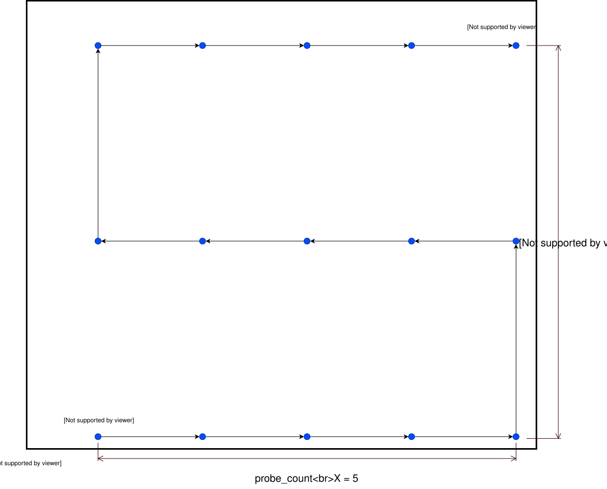
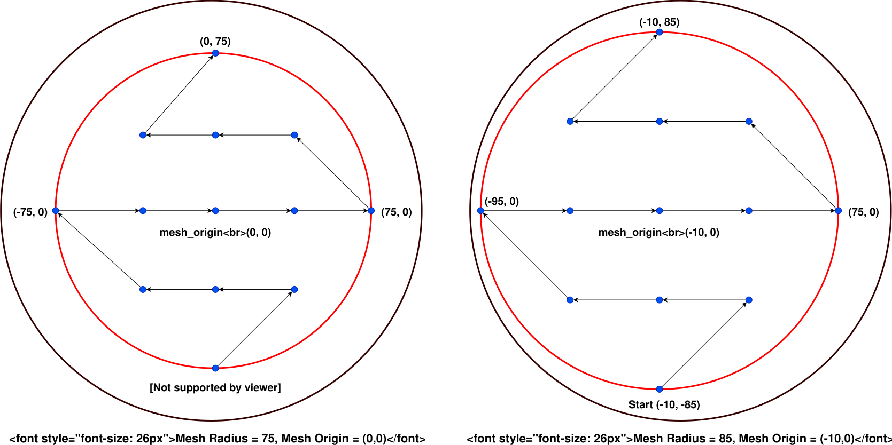
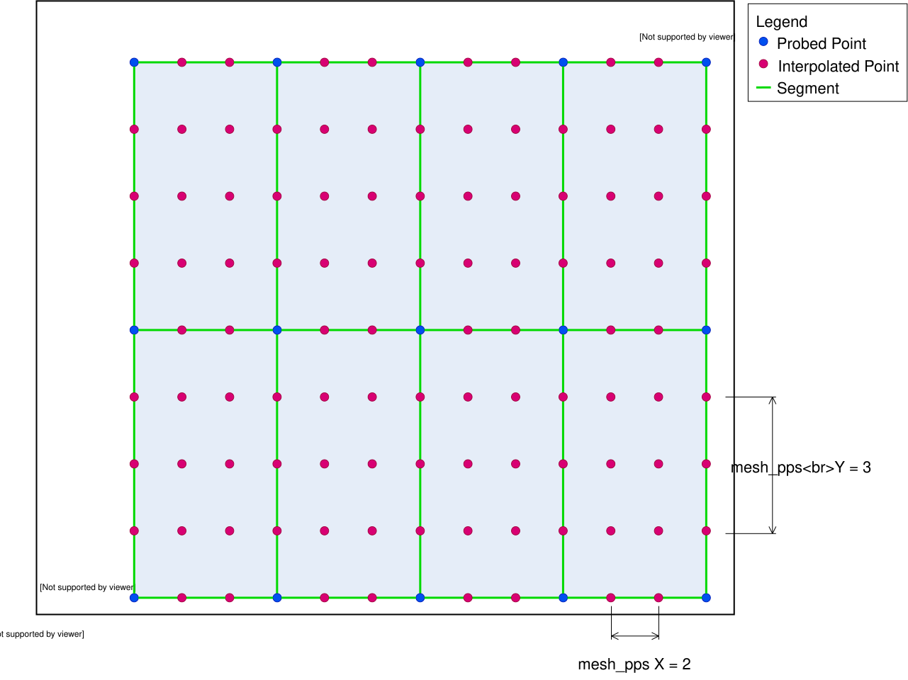
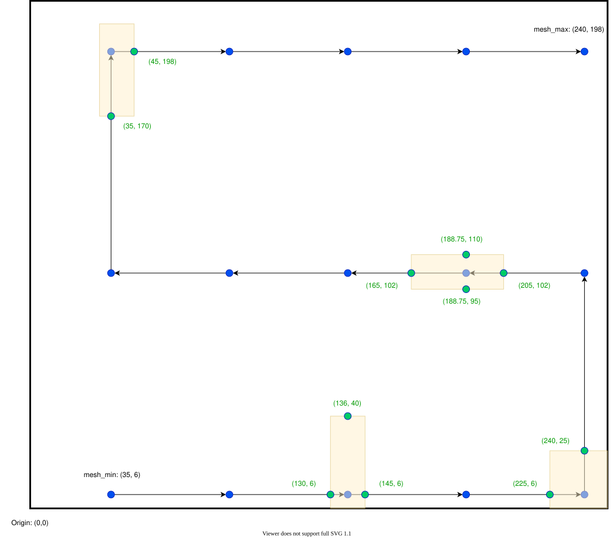
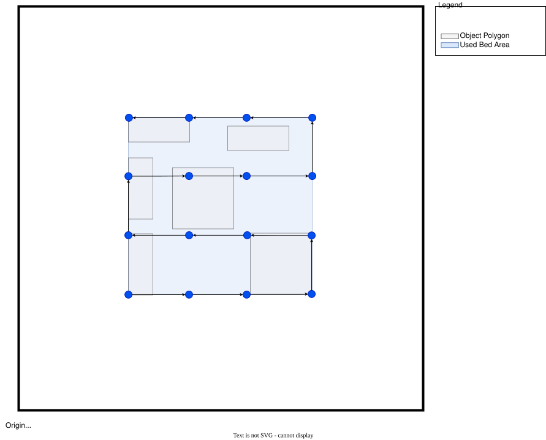
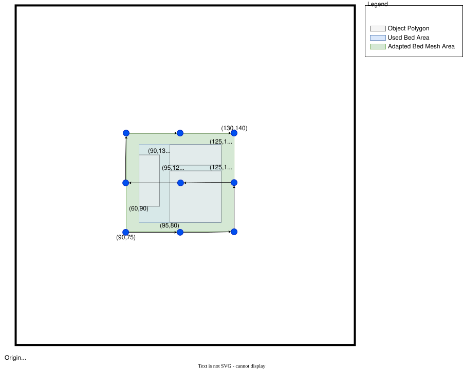

<a id="bed-mesh"></a>
# Malha da Base

[English](../Bed_Mesh.md) | **Português brasileiro**

O módulo "Bed Mesh" pode ser usado para compensar irregularidades na superfície da cama a fim de obter uma primeira camada consistente em toda cama. Deve-se observar que a correção baseada em software não alcançará um resultado perfeito, podendo apenas se aproximar da forma da cama. Além disso, o "Bed Mesh" não pode corrigir problemas mecânicos e/ou elétricos. Se um eixo estiver desalinhado ou uma sonda não for precisa, o módulo "bed_mesh" não receberá resultados precisos do processo de sondagem da superfície.

Antes de realizar a Calibração da Malha (Mesh Calibration), é necessário garantir que o Z-Offset da sua sonda esteja calibrado. Se estiver usando um fim de curso (endstop) para o homing do eixo Z, ele também precisará ser calibrado. Para mais informações, consulte [Calibraçao de Sonda](Probe_Calibrate.md) e "Z_ENDSTOP_CALIBRATE" em [Nivelamento Manual](Manual_Level.md).

<a id="basic-configuration"></a>
## Configuração básica

<a id="rectangular-beds"></a>
### Camas Retangulares

Este exemplo pressupõe uma impressora com uma cama retangular de 250 mm x 220 mm e uma sonda com um deslocamento (offset) de x de 24 mm e um deslocamento (offset) de y de 5 mm.

```
[bed_mesh]
speed: 120
horizontal_move_z: 5
mesh_min: 35, 6
mesh_max: 240, 198
probe_count: 5, 3
```

- `speed: 120` *Valor padrão: 50* A velocidade com a qual a ferramenta (bico ou cabeça de impressão) se move entre os pontos.
- `horizontal_move_z: 5` *Valor padrão: 5* A coordenada Z para a qual a sonda é elevada antes de se deslocar entre os pontos de sondagem.
- `mesh_min: 35, 6` *Obrigatório* A primeira coordenada sondada, mais próxima à origem. Esta coordenada é relativa à localização da sonda.
- `mesh_max: 240, 198` *Obrigatório* A coordenada sondada mais distante da origem. Este não é necessariamente o último ponto sondado, pois o processo de sondagem ocorre em zigue-zague. Assim como com `mesh_min`, esta coordenada é relativa à localização da sonda.
- `probe_count: 5, 3` *Valor padrão: 3, 3* O número de pontos a sondar em cada eixo, especificado como valores inteiros X, Y. Neste exemplo, 5 pontos serão sondados ao longo do eixo X, com 3 pontos ao longo do eixo Y, totalizando 15 pontos sondados. Observe que, se desejar uma grade quadrada, por exemplo 3x3, isso pode ser especificado como um único valor inteiro usado para ambos os eixos, ou seja, `probe_count: 3`. Observe que uma malha requer um probe_count mínimo de 3 ao longo de cada eixo.

A ilustração abaixo demonstra como as opções `mesh_min`, `mesh_max` e `probe_count` são utilizadas para gerar os pontos de sondagem. As setas indicam a direção do procedimento de sondagem, começando em `mesh_min`. Para referência, quando a sonda está em `mesh_min`, o bico (nozzle) estará em (11, 1), e quando a sonda estiver em `mesh_max`, o bico estará em (206, 193).



<a id="round-beds"></a>
### Camas circulares

Este exemplo pressupõe uma impressora equipada com mesa redonda de raio de 100mm. Usaremos os mesmos deslocamentos da sonda do exemplo retangular, 24 mm em X e 5 mm em Y.

```
[bed_mesh]
speed: 120
horizontal_move_z: 5
mesh_radius: 75
mesh_origin: 0, 0
round_probe_count: 5
```

- `mesh_radius: 75` *Requerido* O raio da malha sondada em milímetros (mm), relativo à `mesh_origin` (origem da malha). É importante notar que os deslocamentos da sonda limitam o tamanho do raio da malha. Neste exemplo, um raio maior que 76 moveria a ferramenta para além do alcance da impressora.
- `mesh_origin: 0, 0` *Valor padrão: 0, 0* O ponto central da malha. Esta coordenada é relativa à localização da sonda. Embora o padrão seja 0, 0, pode ser útil ajustar a origem para sondar uma porção maior da cama. Veja a ilustração abaixo.
- `round_probe_count: 5` *Valor padrão: 5* Este é um valor inteiro que define o número máximo de pontos sondados ao longo dos eixos X e Y. Por "máximo", entendemos o número de pontos sondados ao longo da origem da malha. Esse valor deve ser um número ímpar, pois é necessário que o centro da malha seja sondado.

A ilustração abaixo mostra como os pontos sondados são gerados. Como você pode ver, definir `mesh_origin` com (-10, 0) nos permite especificar um raio maior para a malha de 85.



<a id="advanced-configuration"></a>
## Configuração avançada

Abaixo, as opções de configuração mais avançadas são explicadas em detalhes. Cada exemplo será baseado na configuração básica de cama retangular mostrada acima. Todas as opções avançadas também se aplicam a camas redondas da mesma maneira.

<a id="mesh-interpolation"></a>
### Interpolação de malha (Mesh Interpolation)

Embora seja possível amostrar diretamente a matriz sondada usando interpolação bilinear simples para determinar os valores Z entre os pontos sondados, muitas vezes é útil interpolar pontos extras usando algoritmos de interpolação mais avançados para aumentar a densidade da malha. Esses algoritmos adicionam curvatura à malha, tentando simular as propriedades do material da cama. A Malha da Cama oferece interpolação de Lagrange e bicúbica para realizar esse objetivo.

```
[bed_mesh]
speed: 120
horizontal_move_z: 5
mesh_min: 35, 6
mesh_max: 240, 198
probe_count: 5, 3
mesh_pps: 2, 3
algorithm: bicubic
bicubic_tension: 0.2
```

- `mesh_pps: 2, 3` *Valor padrão: 2, 2* A opção `mesh_pps` é a abreviação de Mesh Points Per Segment (pontos de malha por segmento). Esta opção especifica quantos pontos interpolar para cada segmento ao longo dos eixos X e Y. Considere um 'segmento' como o espaço entre cada ponto sondado. Como `probe_count`, `mesh_pps` é especificado como um par inteiro X, Y, e também pode ser especificado como um único inteiro aplicado a ambos os eixos. Neste exemplo há 4 segmentos ao longo do eixo X e 2 segmentos ao longo do eixo Y. Isso resulta em 8 pontos interpolados ao longo de X, 6 pontos interpolados ao longo de Y, o que resulta em uma malha de 13x9. Observe que se mesh_pps for definido como 0, a interpolação da malha é desabilitada e a matriz sondada será amostrada diretamente.
- `algorithm: lagrange` *Valor padrão: lagrange* O algoritmo usado para interpolar a malha. Pode ser `lagrange` ou `bicubic`. A interpolação de Lagrange é limitada a 6 pontos sondados, pois tende a ocorrer oscilação com um número maior de amostras. A interpolação bicúbica exige um mínimo de 4 pontos sondados ao longo de cada eixo; se menos de 4 pontos forem especificados, a amostragem de Lagrange é forçada. Se `mesh_pps` for definido como 0, este valor é ignorado, pois nenhuma interpolação de malha é feita.
- `bicubic_tension: 0.2` *Valor padrão: 0.2* Se a opção `algorithm` for definida como bicubic, é possível especificar o valor de tensão (tension). Quanto maior a tensão, mais inclinação é interpolada. Tome cuidado ao ajustar esse valor, pois valores mais altos também criam mais overshoot (sobressinal), o que resultará em valores interpolados mais altos ou mais baixos do que seus pontos sondados.

A ilustração abaixo mostra como as opções acima são usadas para gerar uma malha interpolada.



<a id="move-splitting"></a>
### Divisão de Movimento

A Malha da Cama funciona interceptando comandos de movimento gcode e aplicando uma transformação em suas coordenadas Z. Movimentos longos devem ser divididos em movimentos menores para seguir corretamente a forma da cama. As opções abaixo controlam o comportamento de divisão.

```
[bed_mesh]
speed: 120
horizontal_move_z: 5
mesh_min: 35, 6
mesh_max: 240, 198
probe_count: 5, 3
move_check_distance: 5
split_delta_z: .025
```

- `move_check_distance: 5` *Valor padrão: 5* A distância mínima para verificar a mudança desejada em Z antes de executar uma divisão. Neste exemplo, um movimento maior que 5mm será percorrido pelo algoritmo. A cada 5mm ocorrerá uma consulta de Z da malha, comparando-a com o valor Z do movimento anterior. Se o delta atingir o limite definido por `split_delta_z`, o movimento será dividido e o percurso continuará. Este processo se repete até que o fim do movimento seja alcançado, onde um ajuste final será aplicado. Movimentos mais curtos que `move_check_distance` têm o ajuste Z correto aplicado diretamente ao movimento, sem percurso ou divisão.
- `split_delta_z: .025` *Valor padrão: .025* Como mencionado acima, este é o desvio mínimo necessário para acionar uma divisão de movimento. Neste exemplo, qualquer valor Z com desvio de +/- .025mm acionará uma divisão.

Geralmente os valores padrão para essas opções são suficientes, na verdade o valor padrão de 5mm para `move_check_distance` pode ser exagerado. No entanto, um usuário avançado pode querer experimentar essas opções na tentativa de obter a primeira camada ideal.

<a id="mesh-fade"></a>
### Desvanecimento de Malha (Mesh Fade)

Quando a opção "fade" está habilitada, o ajuste em Z é gradualmente reduzido ao longo de uma distância específica, conforme definido pela configuração. Isso é alcançado aplicando pequenos ajustes à altura da camada, seja aumentando ou diminuindo, dependendo da forma da mesa de impressão. Quando o fade termina, nenhum ajuste Z é aplicado, permitindo que o topo da impressão fique plano em vez de espelhar a forma da mesa. O fade também pode ter efeitos indesejados: se ocorrer rápido demais, pode gerar artefatos visíveis na impressão. Se a mesa estiver significativamente deformada, o fade pode encolher ou esticar a altura Z da impressão. Por isso, o fade vem desabilitado por padrão.

```
[bed_mesh]
speed: 120
horizontal_move_z: 5
mesh_min: 35, 6
mesh_max: 240, 198
probe_count: 5, 3
fade_start: 1
fade_end: 10
fade_target: 0
```

- `fade_start: 1` *Valor padrão: 1* A altura em Z na qual começar a reduzir gradualmente o ajuste. É uma boa ideia aguardar algumas camadas antes de iniciar o processo de "fade".
- `fade_end: 10` *Valor padrão: 0* A altura em Z em que o processo de "fade" deve ser concluído. Se esse valor for menor que `fade_start`, o "fade" será desabilitado. Esse valor pode ser ajustado dependendo do quão deformada é a superfície de impressão. Uma superfície significativamente deformada deve ter o "fade" concluído ao longo de uma distância maior. Uma superfície quase plana pode reduzir esse valor para que o "fade" seja concluído mais rapidamente. Um valor de 10mm é uma escolha razoável para começar, se o valor padrão de 1 para `fade_start` for usado.
- `fade_target: 0` *Valor padrão: o valor Z médio da malha* O `fade_target` pode ser entendido como um deslocamento Z adicional aplicado a toda a mesa após a conclusão do fade. De modo geral, gostaríamos que esse valor fosse 0, porém há circunstâncias em que ele não deveria ser. Por exemplo, suponha que sua posição de homing na mesa seja um ponto atípico, .2 mm mais baixa que a altura média sondada da mesa. Se o `fade_target` for 0, o fade reduzirá a impressão em média .2 mm em toda a mesa. Ao definir o `fade_target` como .2, a área do homing expandirá em .2 mm, porém o restante da mesa terá dimensionamento preciso. Geralmente é uma boa ideia deixar o `fade_target` fora da configuração para que a altura média da malha seja usada, porém pode ser desejável ajustar manualmente o alvo do fade se quiser imprimir em uma parte específica da mesa.

<a id="the-deprecated-relative_reference_index"></a>

<a id="configuring-the-zero-reference-position"></a>
### Configurando a posição de referência zero

Muitas sondas são suscetíveis a deriva ("drift"), ou seja, imprecisões na sondagem introduzidas por calor ou interferência. Isso pode dificultar o cálculo do deslocamento Z da sonda, principalmente em diferentes temperaturas da mesa. Por isso, algumas impressoras usam um fim de curso para o homing do eixo Z e uma sonda para calibrar a malha. Nessa configuração, é possível deslocar a malha de modo que a posição de referência (X, Y), `reference position`, aplique ajuste zero. A `reference position` deve ser o local na mesa onde um teste de papel [Z_ENDSTOP_CALIBRATE](Manual_Level.md#calibrating-a-z-endstop) é realizado. O módulo bed_mesh fornece a opção `zero_reference_position` para especificar essa coordenada:

```
[bed_mesh]
speed: 120
horizontal_move_z: 5
mesh_min: 35, 6
mesh_max: 240, 198
zero_reference_position: 125, 110
probe_count: 5, 3
```
- `zero_reference_position: ` *Valor padrão: Nenhum (desabilitado)* A `zero_reference_position` espera uma coordenada (X, Y) correspondente à `reference position` descrita acima. Se a coordenada estiver dentro da malha, então a malha será deslocada para que a posição de referência aplique ajuste zero. Se a coordenada estiver fora da malha, então a coordenada será sondada após a calibração, com o valor Z resultante usado como deslocamento Z. Observe que esta coordenada NÃO deve estar em um local especificado como `faulty_region` se uma sonda for necessária.

<a id="faulty-regions"></a>
### Regiões defeituosas

É possível que algumas áreas da cama relatem resultados imprecisos durante a sondagem devido a uma "falha" em locais específicos. O melhor exemplo disso são camas com séries de ímãs integrados usados para manter folhas de aço removíveis. O campo magnético nos arredores desses ímãs pode fazer com que uma sonda indutiva seja acionada a uma distância maior ou menor do que o normal, resultando em uma malha que não representa com precisão a superfície nessas áreas. **Observação: Isso não deve ser confundido com o viés de localização da sonda, que produz resultados imprecisos em toda a cama.**

As opções `faulty_region` podem ser configuradas para compensar esse efeito. Se um ponto gerado estiver localizado dentro de uma região com falha, a malha da cama tentará sondar até 4 pontos nas bordas dessa região. Esses valores sondados serão calculados em uma média e inseridos na malha como o valor Z na coordenada gerada (X, Y).

```
[bed_mesh]
speed: 120
horizontal_move_z: 5
mesh_min: 35, 6
mesh_max: 240, 198
probe_count: 5, 3
faulty_region_1_min: 130.0, 0.0
faulty_region_1_max: 145.0, 40.0
faulty_region_2_min: 225.0, 0.0
faulty_region_2_max: 250.0, 25.0
faulty_region_3_min: 165.0, 95.0
faulty_region_3_max: 205.0, 110.0
faulty_region_4_min: 30.0, 170.0
faulty_region_4_max: 45.0, 210.0
```

- `faulty_region_{1...99}_min` `faulty_region_{1..99}_max` * Valor padrão: Nenhum (desativado)* As Regiões com Falha (Faulty Regions) são definidas de maneira semelhante à própria malha, onde as coordenadas mínimas e máximas (X, Y) devem ser especificadas para cada região. Uma região com falha pode se estender para fora da malha, mas os pontos alternativos gerados sempre estarão dentro do limite da malha. Nenhuma região pode sobrepor-se a outra.

A imagem abaixo ilustra como os pontos de substituição são gerados quando um ponto gerado está localizado dentro de uma região com falha. As regiões mostradas correspondem às mostradas na configuração de exemplo acima. Os pontos de substituição e suas coordenadas são identificados em verde.



<a id="adaptive-meshes"></a>
### Malhas Adaptativas

A malha adaptativa da mesa é uma forma de acelerar a geração da malha da mesa sondando apenas a área da mesa usada pelos objetos em impressão. Quando usado, o método ajustará automaticamente os parâmetros da malha com base na área ocupada pelos objetos de impressão definidos.

A área adaptada da malha será calculada a partir da área definida pelos limites de todos os objetos de impressão definidos, de modo que cubra cada objeto, incluindo quaisquer margens definidas na configuração. Após o cálculo da área, o número de pontos de sondagem será reduzido com base na proporção entre a área padrão da malha e a área adaptada da malha. Para ilustrar isso, considere o seguinte exemplo:

Para uma mesa de 150mmx150mm com `mesh_min` definido como `25,25` e `mesh_max` definido como `125,125`, a área padrão da malha é um quadrado de 100mmx100mm. Uma área adaptada de malha de `50,50` significa uma proporção de `0.5x0.5` entre a área adaptada e a área padrão da malha.

Se a configuração `bed_mesh` especificou `probe_count` como `7x7`, a malha adaptada da mesa usará pontos de sondagem 4x4 (7 * 0.5 arredondado para cima).



```
[bed_mesh]
speed: 120
horizontal_move_z: 5
mesh_min: 35, 6
mesh_max: 240, 198
probe_count: 5, 3
adaptive_margin: 5
```

- `adaptive_margin` *Valor padrão: 0* Margem (em mm) a adicionar ao redor da área da mesa usada pelos objetos definidos. O diagrama abaixo mostra a área adaptada da malha da mesa com um `adaptive_margin` de 5mm. A área adaptada da malha (área em verde) é calculada como a área usada da mesa (área em azul) mais a margem definida.

   

Por natureza, as malhas adaptativas da mesa usam os objetos definidos pelo arquivo Gcode em impressão. Portanto, espera-se que cada arquivo Gcode gere uma malha que sonda uma área diferente da mesa de impressão. Portanto, malhas adaptadas da mesa não devem ser reutilizadas. A expectativa é que uma nova malha seja gerada para cada impressão se a malhagem adaptativa for usada.

Também é importante considerar que a malha adaptativa da mesa é mais adequada para máquinas que normalmente conseguem sondar toda a mesa e alcançar uma variação máxima menor ou igual a 1 altura de camada. Máquinas com problemas mecânicos que uma malha completa da mesa normalmente compensa podem apresentar resultados indesejáveis ao tentar movimentos de impressão **fora** da área sondada. Se uma malha completa da mesa tiver uma variação maior que 1 altura de camada, deve-se ter cautela ao usar malhas adaptativas da mesa e ao tentar movimentos de impressão fora da área com malha.

<a id="surface-scans"></a>
## Varreduras de superfície

Algumas sondas, como a [sonda de corrente parasita](Eddy_Probe.md), são capazes de "varrer" a superfície da mesa. Ou seja, essas sondas podem amostrar uma malha sem levantar a ferramenta entre as amostras. Para ativar o modo de varredura, o parâmetro de sondagem `METHOD=scan` ou `METHOD=rapid_scan` deve ser passado no comando gcode `BED_MESH_CALIBRATE`.

<a id="scan-height"></a>
### Altura de varredura

A altura de varredura é definida pela opção `horizontal_move_z` em `[bed_mesh]`. Além disso, ela pode ser fornecida com o comando gcode `BED_MESH_CALIBRATE` por meio do parâmetro `HORIZONTAL_MOVE_Z`.

A altura de varredura deve ser suficientemente baixa para evitar erros de varredura. Normalmente uma altura de 2mm (ou seja: `HORIZONTAL_MOVE_Z=2`) deve funcionar bem, presumindo que a sonda esteja montada corretamente.

Deve-se observar que se a sonda estiver a mais de 4mm acima da superfície, os resultados serão inválidos. Assim, a varredura não é possível em mesas com desvio severo de superfície ou mesas com inclinação extrema que não tenha sido corrigida.

<a id="rapid-continuous-scanning"></a>
### Varredura rápida (contínua)

Ao executar uma `rapid_scan`, deve-se ter em mente que os resultados terão certa quantidade de erro. Esse erro deve ser baixo o suficiente para ser útil em grandes áreas de impressão com alturas de camada razoavelmente espessas. Algumas sondas podem ser mais propensas a erro do que outras.

Não é recomendado usar o modo rápido para varrer uma malha "densa". Parte do erro introduzido durante uma varredura rápida pode ser ruído gaussiano do sensor, e uma malha densa refletirá esse ruído (ou seja: haverá picos e vales).

A malha da mesa tentará otimizar o trajeto de deslocamento para fornecer o melhor resultado possível com base na configuração. Isso inclui evitar regiões defeituosas ao coletar amostras e "ultrapassar" a malha ao mudar de direção. Essa ultrapassagem melhora a amostragem nas bordas da malha, porém exige que a malha seja configurada de forma a permitir que a ferramenta se desloque para fora da malha.

```
[bed_mesh]
speed: 120
horizontal_move_z: 5
mesh_min: 35, 6
mesh_max: 240, 198
probe_count: 5
scan_overshoot: 8
```

- `scan_overshoot` *Valor padrão: 0 (desabilitado)* A quantidade máxima de deslocamento (em mm) disponível fora da malha. Para mesas retangulares isso se aplica ao deslocamento no eixo X, e para mesas redondas aplica-se a todo o raio. A ferramenta deve ser capaz de se deslocar pela quantidade especificada para fora da malha. Este valor é usado para otimizar o caminho de deslocamento ao executar uma "varredura rápida". O valor mínimo que pode ser especificado é 1. O padrão é sem overshoot.

Se nenhuma ultrapassagem de varredura estiver configurada, a otimização do trajeto não será aplicada às mudanças de direção.

<a id="bed-mesh-gcodes"></a>
## Gcode para Malha da Cama

<a id="calibration"></a>
### Calibração

`BED_MESH_CALIBRATE PROFILE=<name> METHOD=[manual | automatic | scan | rapid_scan] \ [<probe_parameter>=<value>] [<mesh_parameter>=<value>] [ADAPTIVE=[0|1] \ [ADAPTIVE_MARGIN=<value>]` *Perfil padrão: default* *Método padrão: automatic se uma sonda for detectada, caso contrário manual* *Adaptativo padrão: 0* *Margem adaptativa padrão: 0*

Inicia o procedimento de sondagem para a Calibração da Malha da Cama (Bed Mesh Calibration).

A malha estará imediatamente pronta para uso quando o comando for concluído e será salva em um perfil especificado pelo parâmetro `PROFILE`, ou em `default` se não especificado. O parâmetro `METHOD` aceita um dos seguintes valores:

- `METHOD=manual`: permite sondagem manual usando o bico e o teste do papel
- `METHOD=automatic`: sondagem automática (padrão). Este é o padrão.
- `METHOD=scan`: ativa a varredura de superfície. A ferramenta pausará sobre cada posição para coletar uma amostra.
- `METHOD=rapid_scan`: ativa a varredura contínua de superfície.

As posições XY são ajustadas automaticamente para incluir os deslocamentos de X e/ou Y quando um método de sondagem diferente de `manual` é selecionado.

É possível especificar os parâmetros da malha para modificar a área sondada. Os seguintes parâmetros estão disponíveis:

- Camas retangulares (cartesianas):
   - `MESH_MIN`
   - `MESH_MAX`
   - `PROBE_COUNT`
- Camas circulares (delta):
   - `MESH_RADIUS`
   - `MESH_ORIGIN`
   - `ROUND_PROBE_COUNT`
- Todas as camas:
   - `MESH_PPS`
   - `ALGORITHM`
   - `ADAPTIVE`
   - `ADAPTIVE_MARGIN`

Consulte a documentação de configuração acima para obter detalhes sobre como cada parâmetro se aplica à malha.

<a id="profiles"></a>
### Perfis

`BED_MESH_PROFILE SAVE=<name> LOAD=<name> REMOVE=<name>`

Após um BED_MESH_CALIBRATE ter sido executado, é possível salvar o estado atual da malha em um perfil nomeado. Isso possibilita carregar uma malha sem sondar novamente a mesa. Após um perfil ter sido salvo usando `BED_MESH_PROFILE SAVE=<name>`, o gcode `SAVE_CONFIG` pode ser executado para gravar o perfil no printer.cfg.

Perfis podem ser carregados executando `BED_MESH_PROFILE LOAD=<name>`.

Deve ser observado que cada vez que ocorre um BED_MESH_CALIBRATE, o estado atual é automaticamente salvo no perfil *default*. O perfil *default* pode ser removido da seguinte forma:

`BED_MESH_PROFILE REMOVE=default`

Qualquer outro perfil salvo pode ser removido da mesma maneira, substituindo *default* pelo nome do perfil que você deseja remover.

<a id="loading-the-default-profile"></a>
#### Carregando o perfil padrão

Versões anteriores do `bed_mesh` sempre carregavam o perfil chamado *default* na inicialização, caso estivesse presente. Esse comportamento foi removido para permitir que o usuário determine quando um perfil é carregado. Se o usuário desejar carregar o perfil `default`, é recomendado adicionar `BED_MESH_PROFILE LOAD=default` no macro `START_PRINT` ou na configuração de "Start G-Code" do slicer, dependendo do que for aplicável.

Observe que isso não é necessário se uma nova malha for gerada com `BED_MESH_CALIBRATE` na macro `START_PRINT` ou no "Start G-Code" do fatiador e pode produzir resultados inesperados, especialmente com malha adaptativa.

Alternativamente, o antigo comportamento de carregar um perfil na inicialização pode ser restaurado com `[delayed_gcode]`:

```ini
[delayed_gcode bed_mesh_init]
initial_duration: .01
gcode:
  BED_MESH_PROFILE LOAD=default
```

<a id="output"></a>
### Saída

`BED_MESH_OUTPUT PGP=[0 | 1]`

Mostra o estado atual da malha no terminal. Observe que a malha em si é exibida

O parâmetro PGP é uma abreviação para "Print Generated Points" (Exibir Pontos Gerados). Se `PGP=1` for definido, os pontos sondados gerados serão exibidos no terminal:

```
// bed_mesh: generated points
// Index | Tool Adjusted | Probe
// 0 | (11.0, 1.0) | (35.0, 6.0)
// 1 | (62.2, 1.0) | (86.2, 6.0)
// 2 | (113.5, 1.0) | (137.5, 6.0)
// 3 | (164.8, 1.0) | (188.8, 6.0)
// 4 | (216.0, 1.0) | (240.0, 6.0)
// 5 | (216.0, 97.0) | (240.0, 102.0)
// 6 | (164.8, 97.0) | (188.8, 102.0)
// 7 | (113.5, 97.0) | (137.5, 102.0)
// 8 | (62.2, 97.0) | (86.2, 102.0)
// 9 | (11.0, 97.0) | (35.0, 102.0)
// 10 | (11.0, 193.0) | (35.0, 198.0)
// 11 | (62.2, 193.0) | (86.2, 198.0)
// 12 | (113.5, 193.0) | (137.5, 198.0)
// 13 | (164.8, 193.0) | (188.8, 198.0)
// 14 | (216.0, 193.0) | (240.0, 198.0)
```

Os pontos "Ajustados pela Ferramenta" se referem à localização da ponta da extrusora (bico) para cada ponto, enquanto os pontos "Sondados" (Probe) se referem à localização da sonda. Observe que, ao realizar a sondagem manualmente, os pontos "Sondados" (Probe) se referirão tanto à localização da ferramenta quanto à localização da ponta da extrusora (bico).

<a id="clear-mesh-state"></a>
### Limpar Estado da Malha

`BED_MESH_CLEAR`

Este gcode pode ser usado para limpar o estado interno da malha.

<a id="apply-xy-offsets"></a>
### Aplicar deslocamentos em X/Y

`BED_MESH_OFFSET [X=<value>] [Y=<value>] [ZFADE=<value>]`

Isso é útil para impressoras com várias extrusoras independentes, pois um deslocamento é necessário para produzir o ajuste correto de Z após uma troca de ferramenta. Os deslocamentos devem ser especificados em relação à extrusora primária. Ou seja, um deslocamento positivo em X deve ser especificado se a extrusora secundária estiver montada à direita da extrusora primária, um deslocamento positivo em Y deve ser especificado se a extrusora secundária estiver montada "atrás" da extrusora primária, e um deslocamento positivo de ZFADE deve ser especificado se o bico da extrusora secundária estiver acima do bico da extrusora primária.

Observe que um deslocamento de ZFADE *NÃO* aplica diretamente ajuste adicional. Ele destina-se a compensar um `gcode offset` quando o [esmaecimento da malha](#mesh-fade) está ativado. Por exemplo, se uma extrusora secundária estiver mais alta que a primária e precisar de um gcode offset negativo, ou seja: `SET_GCODE_OFFSET Z=-.2`, isso pode ser considerado em `bed_mesh` com `BED_MESH_OFFSET ZFADE=.2`.

<a id="bed-mesh-webhooks-apis"></a>
## APIs de webhooks da malha da mesa

<a id="dumping-mesh-data"></a>
### Despejo dos dados da malha

`{"id": 123, "method": "bed_mesh/dump_mesh"}`

Despeja a configuração e o estado da malha atual e de todos os perfis salvos.

O endpoint `dump_mesh` aceita um parâmetro opcional, `mesh_args`. Esse parâmetro deve ser um objeto, em que as chaves e os valores são parâmetros disponíveis para [BED_MESH_CALIBRATE](G-Codes.md#bed_mesh_calibrate). Isso atualizará a configuração da malha e os pontos de sondagem usando os parâmetros fornecidos antes de retornar o resultado. Recomenda-se omitir os parâmetros de malha, a menos que se deseje visualizar os pontos de sondagem e/ou o trajeto antes de executar `BED_MESH_CALIBRATE`.

<a id="visualization-and-analysis"></a>
## Visualização e análise

A maioria dos usuários provavelmente achará que os visualizadores incluídos em aplicativos como Mainsail, Fluidd e Octoprint são suficientes para análise básica. No entanto, a pasta `scripts` do Klipper contém o script `graph_mesh.py`, que pode ser usado para realizar visualizações adicionais e análises mais detalhadas, particularmente úteis para depurar o hardware ou os resultados produzidos por `bed_mesh`:

```
usage: graph_mesh.py [-h] {list,plot,analyze,dump} ...

Graph Bed Mesh Data

positional arguments:
  {list,plot,analyze,dump}
    list                List available plot types
    plot                Plot a specified type
    analyze             Perform analysis on mesh data
    dump                Dump API response to json file

options:
  -h, --help            show this help message and exit
```

<a id="pre-requisites"></a>
### Pré-requisitos

Como a maioria das ferramentas de gráficos fornecidas pelo Klipper, o `graph_mesh.py` requer as dependências python `matplotlib` e `numpy`. Além disso, conectar-se ao Klipper via websocket do Moonraker requer a dependência python `websockets`. Embora todas as visualizações possam ser geradas em um arquivo `svg`, a maioria das visualizações oferecidas pelo `graph_mesh.py` é melhor visualizada no modo de visualização ao vivo em um PC de classe desktop. Por exemplo, as visualizações 3D podem ser giradas e ampliadas no modo de visualização, e as visualizações de trajeto podem opcionalmente ser animadas no modo de visualização.

<a id="plotting-mesh-data"></a>
### Plotagem dos dados da malha

A ferramenta `graph_mesh.py` pode plotar vários tipos de visualizações. Os tipos disponíveis podem ser mostrados executando `graph_mesh.py list`:

```
graph_mesh.py list
points    Plot original generated points
path      Plot probe travel path
rapid     Plot rapid scan travel path
probedz   Plot probed Z values
meshz     Plot mesh Z values
overlay   Plots the current probed mesh overlaid with a profile
delta     Plots the delta between current probed mesh and a profile
```

Várias opções estão disponíveis ao plotar visualizações:

```
usage: graph_mesh.py plot [-h] [-a] [-s] [-p PROFILE_NAME] [-o OUTPUT] <plot type> <input>

positional arguments:
  <plot type>           Type of data to graph
  <input>               Path/url to Klipper Socket or path to json file

options:
  -h, --help            show this help message and exit
  -a, --animate         Animate paths in live preview
  -s, --scale-plot      Use axis limits reported by Klipper to scale plot X/Y
  -p PROFILE_NAME, --profile-name PROFILE_NAME
                        Optional name of a profile to plot for 'probedz'
  -o OUTPUT, --output OUTPUT
                        Output file path
```

Abaixo está uma descrição de cada argumento:

- `plot type`: argumento posicional obrigatório que designa o tipo de visualização a gerar. Deve ser um dos tipos exibidos pelo comando `graph_mesh.py list`.
- `input`: argumento posicional obrigatório contendo um caminho ou URL para a fonte de entrada. Deve ser um dos seguintes:
   - Um caminho para o Unix Domain Socket do Klipper
   - Uma URL para uma instância do Moonraker
   - Um caminho para um arquivo json produzido por `graph_mesh.py dump <input>`
- `-a`: animação opcional para os tipos de visualização `path` e `rapid`. Animações aplicam-se somente a uma visualização ao vivo.
- `-s`: opcionalmente dimensiona um gráfico usando os valores `axis_minimum` e `axis_maximum` relatados pelo objeto `toolhead` do Klipper quando o arquivo de despejo foi gerado.
- `-p`: nome de perfil que pode ser especificado ao gerar a visualização 3D de malha `probedz`. Ao gerar uma visualização `overlay` ou `delta`, este argumento deve ser fornecido.
- `-o`: caminho de arquivo opcional indicando que o script deve salvar a visualização neste local em vez de executar em modo de visualização. As imagens são salvas em formato `svg`.

Por exemplo, para plotar um trajeto rápido animado, conectando-se via unix socket do Klipper:

```
graph_mesh.py plot -a rapid ~/printer_data/comms/klippy.sock
```

Ou para plotar uma visualização 3D da malha, conectando-se via Moonraker:

```
graph_mesh.py plot meshz http://my-printer.local
```

<a id="bed-mesh-analysis"></a>
### Análise da malha da mesa

A ferramenta `graph_mesh.py` também pode ser usada para realizar uma análise dos dados fornecidos pela API [bed_mesh/dump_mesh](#dumping-mesh-data):

```
graph_mesh.py analyze <input>
```

Assim como no comando `plot`, o `<input>` deve ser um caminho para o unix socket do Klipper, uma URL para uma instância do Moonraker ou um caminho para um arquivo json gerado pelo comando dump.

Para começar, a análise realizará várias verificações nos pontos e trajetos de sondagem gerados por `bed_mesh` no momento do despejo. Isso inclui o seguinte:

- O número de pontos de sondagem gerados, sem quaisquer acréscimos
- O número de pontos de sondagem gerados incluindo quaisquer pontos gerados como resultado de regiões defeituosas e/ou uma posição de referência zero configurada.
- O número de pontos de sondagem gerados ao realizar uma varredura rápida.
- O número total de movimentos gerados para uma varredura rápida.
- Uma validação de que os pontos de sondagem gerados para uma varredura rápida são idênticos aos pontos de sondagem gerados para um procedimento de sondagem padrão.
- Uma verificação de "retrocesso" tanto para o trajeto de sondagem padrão quanto para um trajeto de varredura rápida. Retrocesso pode ser definido como deslocar-se para a mesma posição mais de uma vez durante o procedimento de sondagem. O retrocesso nunca deve ocorrer durante uma sondagem padrão. Regiões defeituosas *podem* resultar em retrocesso durante uma varredura rápida na tentativa de evitar entrar em uma região defeituosa ao se aproximar ou sair de um local de sondagem, porém nunca deve ocorrer de outra forma.

Em seguida, cada malha sondada presente no despejo será analisada, começando pela malha carregada no momento do despejo (se presente) seguida por quaisquer perfis salvos. Os seguintes dados são extraídos:

- Formato da malha (X,Y mín., X,Y máx., contagem de sondagem)
- Faixa Z da malha (Z mínimo, Z máximo)
- Valor médio de Z na malha
- Desvio padrão dos valores Z na malha

Além do acima, uma análise de delta é executada entre malhas com o mesmo formato, relatando o seguinte:

- O intervalo do delta entre duas malhas (mínimo e máximo)
- O delta médio
- Desvio padrão do delta
- A diferença máxima absoluta
- A média absoluta

<a id="save-mesh-data-to-a-file"></a>
### Salvar dados da malha em arquivo

O comando `dump` pode ser usado para salvar a resposta em um arquivo que pode ser compartilhado para análise ao solucionar problemas:

```
graph_mesh.py dump -o <output file name> <input>
```

O `<input>` deve ser um caminho para o unix socket do Klipper ou uma URL para uma instância do Moonraker. A opção `-o` pode ser usada para especificar o caminho do arquivo de saída. Se omitida, o arquivo será salvo no diretório de trabalho, com nome de arquivo no seguinte formato:

`klipper-bedmesh-{year}{month}{day}{hour}{minute}{second}.json`
