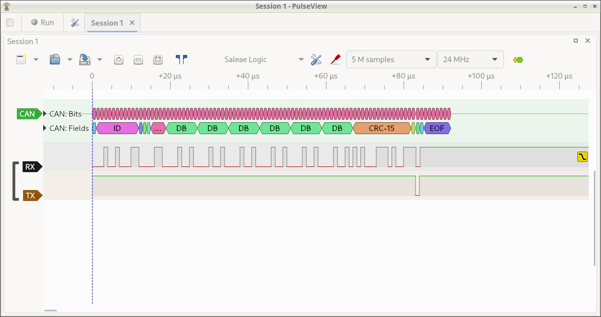

<a id="canbus-troubleshooting"></a>
# Solução de problemas para CANBUS

[English](../CANBUS_Troubleshooting.md) | **Português brasileiro**

Este documento fornece informações sobre solução de problemas de comunicação ao usar [Klipper com barramento CAN](CANBUS.md).

<a id="verify-can-bus-wiring"></a>
## Verificando a fiação do barramento CAN

O primeiro passo na solução de problemas de comunicação é verificar a fiação do barramento CAN.

Certifique-se de que existam exatamente dois resistores de [resistores de terminação](CANBUS.md#terminating-resistors) de 120 Ohm no barramento CAN. Se os resistores não estiverem instalados corretamente, as mensagens podem não conseguir ser enviadas ou a conexão pode apresentar instabilidade esporádica.

A fiação CANH e CANL do barramento deve ser trançada entre si. No mínimo, a fiação deve ter uma trança a cada poucos centímetros. Evite trançar a fiação CANH e CANL em torno de fios de energia e assegure que fios de energia que corram paralelos aos fios CANH e CANL não tenham a mesma quantidade de tranças.

Verifique se todos os plugues e crimpagens de fios na fiação do barramento CAN estão totalmente fixados. O movimento do cabeçote da impressora pode sacudir a fiação do barramento CAN, fazendo com que uma crimpagem ruim ou plugue solto resulte em erros intermitentes de comunicação.

<a id="check-for-incrementing-bytes_invalid-counter"></a>
## Verificando incremento do contador bytes_invalid

O arquivo de log do Klipper relatará uma linha `Stats` uma vez por segundo quando a impressora estiver ativa. Essas linhas "Stats" terão um contador `bytes_invalid` para cada microcontrolador. Este contador não deve incrementar durante a operação normal da impressora (é normal que o contador seja diferente de zero após um RESTART e não é preocupante se o contador incrementar uma vez por mês ou assim). Se este contador incrementar em um microcontrolador do barramento CAN durante impressão normal (incrementa a cada poucas horas ou com mais frequência), então é indicação de um problema grave.

O incremento de `bytes_invalid` em uma conexão de barramento CAN é um sintoma de mensagens reordenadas no barramento CAN. Se observado, certifique-se de:

* Use a versão 6.6.0 ou posterior do kernel Linux.
* Se estiver usando um adaptador USB para CANBUS executando firmware candlelight, use a v2.0 ou posterior do candleLight_fw.
* Se estiver usando o modo de ponte USB para CANBUS do Klipper, certifique-se de que o nó da ponte esteja gravado com o Klipper v0.12.0 ou posterior.

Mensagens reordenadas são um problema grave que deve ser corrigido. Isso resultará em comportamento instável e pode levar a erros confusos em qualquer parte de uma impressão. Um `bytes_invalid` em incremento não é causado por fiação ou problemas de hardware semelhantes e só pode ser corrigido identificando e atualizando o software defeituoso.

Versões antigas do kernel Linux tinham um bug no código do driver canbus gs_usb que podia causar pacotes canbus reordenados. Acredita-se que o problema esteja corrigido no [commit 24bc41b4 do Linux](https://github.com/torvalds/linux/commit/24bc41b4558347672a3db61009c339b1f5692169) lançado na v6.6.0. Em alguns casos, versões antigas do Linux podem não mostrar o problema (devido a como interrupções de hardware são configuradas), porém se problemas forem observados a solução recomendada é atualizar para um kernel mais novo.

Versões antigas do firmware candlelight podiam reordenar pacotes canbus, e acredita-se que o problema esteja corrigido no [commit 8b3a7b45 do candlelight_fw](https://github.com/candle-usb/candleLight_fw/commit/8b3a7b4565a3c9521b762b154c94c72c5acb2bcf).

Versões antigas do código de ponte USB-para-CANBUS do Klipper podiam descartar incorretamente mensagens canbus. Isso não é tão grave quanto reordenar mensagens, mas ainda deve ser corrigido. Acredita-se que esteja corrigido com o [PR #6175 do Klipper](https://github.com/Klipper3d/klipper/pull/6175).

<a id="use-an-appropriate-txqueuelen-setting"></a>
## Use uma configuração txqueuelen apropriada

O código do Klipper usa o kernel Linux para gerenciar o tráfego do barramento CAN. Por padrão, o kernel enfileirará apenas 10 pacotes de transmissão CAN. Recomenda-se [configurar o dispositivo can0](CANBUS.md#host-hardware) com `txqueuelen 128` para aumentar esse tamanho.

Se o Klipper transmitir um pacote e o Linux tiver preenchido todo o espaço de sua fila de transmissão, o Linux descartará esse pacote e mensagens como as seguintes aparecerão no log do Klipper:

```
Got error -1 in can write: (105)No buffer space available
```
O Klipper retransmitirá automaticamente as mensagens perdidas como parte de seu sistema normal de retransmissão de mensagens em nível de aplicativo. Assim, esta mensagem de log é um aviso e não indica um erro irrecuperável.

Se ocorrer uma falha completa do barramento CAN (como rompimento de um fio CAN), o Linux não conseguirá transmitir nenhuma mensagem no barramento CAN e é comum encontrar a mensagem acima no log do Klipper. Neste caso, a mensagem de log é sintoma de um problema maior (a incapacidade de transmitir quaisquer mensagens) e não está diretamente relacionada ao `txqueuelen` do Linux.

Pode-se verificar o tamanho atual da fila executando o comando Linux `ip link show can0`. Ele deve relatar vários textos incluindo o trecho `qlen 128`. Se vir algo como `qlen 10`, isso indica que o dispositivo CAN não foi configurado corretamente.

Não se recomenda usar um `txqueuelen` significativamente maior que 128. Um barramento CAN rodando a frequência de 1000000 normalmente levará cerca de 120us para transmitir um pacote CAN. Assim, uma fila de 128 pacotes provavelmente levará cerca de 15-20ms para esvaziar. Uma fila substancialmente maior poderia causar picos excessivos no tempo de ida e volta das mensagens, o que poderia levar a erros irrecuperáveis. Em outras palavras, o sistema de retransmissão de aplicativo do Klipper é mais robusto se não tiver que esperar o Linux esvaziar uma fila excessivamente grande de dados possivelmente obsoletos. Isso é análogo ao problema de [bufferbloat](https://en.wikipedia.org/wiki/Bufferbloat) em roteadores de internet.

Em circunstâncias normais o Klipper pode utilizar ~25 slots de fila por MCU - normalmente utilizando mais slots apenas durante retransmissões. (Especificamente, o host do Klipper pode transmitir até 192 bytes para cada MCU do Klipper antes de receber uma confirmação desse MCU.) Se um único barramento CAN tiver 5 ou mais MCUs do Klipper nele, pode ser necessário aumentar o `txqueuelen` acima do valor recomendado de 128. Porém, como acima, deve-se ter cuidado ao selecionar um novo valor para evitar latência excessiva de tempo de ida e volta.

<a id="use-canbus_querypy-only-to-identify-nodes-never-previously-seen"></a>
## Use `canbus_query.py` apenas para identificar nós nunca vistos anteriormente

Só é válido usar a [ferramenta `canbus_query.py`](CANBUS.md#finding-the-canbus_uuid-for-new-micro-controllers) para identificar microcontroladores que nunca foram identificados anteriormente. Uma vez que todos os nós em um barramento sejam identificados, registre os uuids resultantes no printer.cfg e evite executar a ferramenta desnecessariamente.

A ferramenta é implementada usando um mecanismo de baixo nível que pode fazer os nós observarem internamente erros de barramento. Esses erros internos podem resultar em interrupções de comunicação e podem fazer com que alguns nós se desconectem do barramento.

Não é válido usar a ferramenta para fazer "ping" se um nó estiver conectado. Não execute a ferramenta durante uma impressão ativa.

<a id="obtaining-candump-logs"></a>
## Obtendo registros do candump

As mensagens do barramento CAN enviadas para o microcontrolador e recebidas dele são tratadas pelo kernel do Linux. É possível capturar essas mensagens do kernel para fins de depuração. Um registro dessas mensagens pode ser útil no diagnóstico.

A ferramenta [can-utils](https://github.com/linux-can/can-utils) do Linux fornece o software de captura. Ela normalmente é instalada em uma máquina executando:

```
sudo apt-get update && sudo apt-get install can-utils
```

Uma vez instalada, pode-se obter uma captura de todas as mensagens do barramento CAN em uma interface com o seguinte comando:

```
candump -tz -Ddex can0,#FFFFFFFF > mycanlog
```

Pode-se ver o arquivo de registro resultante (`mycanlog` no exemplo acima) para ver cada mensagem bruta do barramento CAN que foi enviada e recebida pelo Klipper. Entender o conteúdo dessas mensagens provavelmente exigirá conhecimento de baixo nível do [protocolo CANBUS](CANBUS_protocol.md) do Klipper e dos [comandos do MCU](MCU_Commands.md) do Klipper.

<a id="parsing-klipper-messages-in-a-candump-log"></a>
### Analisando mensagens do Klipper em um registro do candump

Pode-se usar a ferramenta `parsecandump.py` para analisar as mensagens de baixo nível do microcontrolador do Klipper contidas em um registro do candump. Usar essa ferramenta é um tópico avançado que exige conhecimento dos [comandos do MCU](MCU_Commands.md) do Klipper. Por exemplo:

```
./scripts/parsecandump.py mycanlog 108 ./out/klipper.dict
```

Essa ferramenta produz uma saída semelhante à [ferramenta parsedump](Debugging.md#translating-gcode-files-to-micro-controller-commands). Consulte a documentação dessa ferramenta para obter informações sobre como gerar o dicionário de dados do microcontrolador do Klipper.

No exemplo acima, `108` é o [id do barramento CAN](CANBUS_protocol.md#micro-controller-id-assignment). É um número hexadecimal. O id `108` é atribuído pelo Klipper ao primeiro microcontrolador. Se o barramento CAN tiver vários microcontroladores, então o segundo microcontrolador seria `10a`, o terceiro seria `10c`, e assim por diante.

O registro do candump deve ser produzido usando os argumentos de linha de comando `-tz -Ddex` (por exemplo: `candump -tz -Ddex can0,#FFFFFFFF`) para poder usar a ferramenta `parsecandump.py`.

<a id="using-a-logic-analyzer-on-the-canbus-wiring"></a>
## Usando um analisador lógico na fiação do canbus

O software [Sigrok Pulseview](https://sigrok.org/wiki/PulseView) junto com um [analisador lógico](https://en.wikipedia.org/wiki/Logic_analyzer) de baixo custo pode ser útil para diagnosticar a sinalização do barramento CAN. Este é um tópico avançado provavelmente de interesse apenas para especialistas.

É comum encontrar "USB logic analyzers" por menos de $15 (preço nos EUA em 2023). Esses dispositivos costumam ser anunciados como "Saleae logic clones" ou como "24MHz 8 channel USB logic analyzers".



A imagem acima foi tirada usando o Pulseview com um analisador lógico "clone de Saleae". O software Sigrok e Pulseview foi instalado em um computador de mesa (instale também o firmware "fx2lafw" se ele for empacotado separadamente). O pino CH0 do analisador lógico foi ligado à linha CAN Rx, o pino CH1 foi ligado ao pino CAN Tx, e o GND foi ligado ao GND. O Pulseview foi configurado para exibir apenas as linhas D0 e D1 (ícone de "sonda" vermelho na barra de ferramentas superior central). O número de amostras foi definido como 5 milhões (barra de ferramentas superior) e a taxa de amostragem foi definida como 24Mhz (barra de ferramentas superior). O decodificador CAN foi adicionado (ícone de "balão" amarelo e verde na barra de ferramentas superior direita). O canal D0 foi rotulado como RX e configurado para disparar na borda de descida (clique no rótulo D0 preto à esquerda). O canal D1 foi rotulado como TX (clique no rótulo D1 marrom à esquerda). O decodificador CAN foi configurado para taxa de 1Mbit (clique no rótulo CAN verde à esquerda). O decodificador CAN foi movido para o topo da exibição (clique e arraste o rótulo CAN verde). Por fim, a captura foi iniciada (clique em "Run" no canto superior esquerdo) e um pacote foi transmitido no barramento CAN (`cansend can0 123#121212121212`).

O analisador lógico fornece uma ferramenta independente para capturar pacotes e verificar a temporização dos bits.
