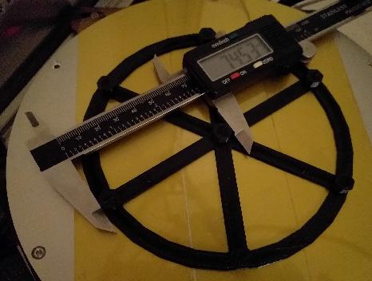
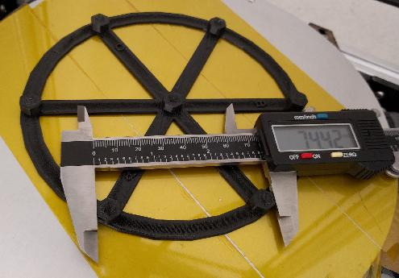
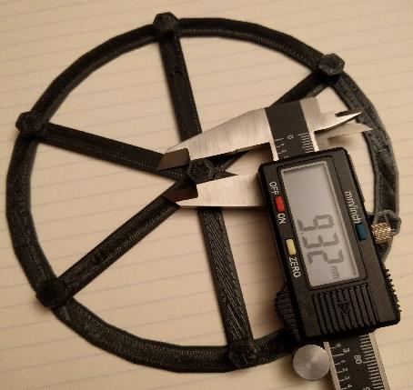
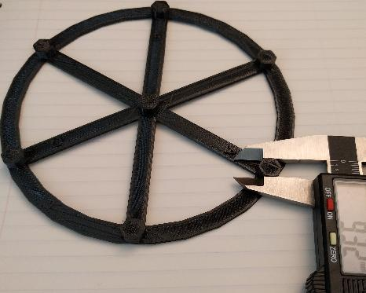

<a id="delta-calibration"></a>
# Calibração Delta

[English](../Delta_Calibrate.md) | **Português brasileiro**

Este documento descreve o sistema de calibração automática da Klipper para impressoras estilo "delta".

A calibração delta envolve encontrar as posições de fim de curso das torres, ângulos das torres, raio delta e comprimentos dos braços delta. Essas configurações controlam o movimento da impressora em uma impressora delta. Cada um desses parâmetros tem um impacto não óbvio e não linear e é difícil calibrá-los manualmente. Em contraste, o código de calibração por software pode fornecer excelentes resultados com apenas alguns minutos. Nenhum hardware especial de sondagem é necessário.

Em última análise, a calibração delta depende da precisão das chaves de fim de curso das torres. Se estiver usando drivers de motor de passo Trinamic, considere habilitar a detecção de [fase do fim de curso](Endstop_Phase.md) para melhorar a precisão dessas chaves.

<a id="automatic-vs-manual-probing"></a>
## Sondagem automática vs manual

O Klipper suporta calibrar os parâmetros delta via método de sondagem manual ou via sonda Z automática.

Vários kits de impressora delta vêm com sondas Z automáticas que não são suficientemente precisas (especificamente, pequenas diferenças no comprimento do braço podem causar inclinação do efetor, o que pode distorcer uma sonda automática). Se estiver usando uma sonda automática, primeiro [calibre a sonda](Probe_Calibrate.md) e depois verifique um [viés de localização da sonda](Probe_Calibrate.md#location-bias-check). Se a sonda automática tiver um viés maior que 25 mícrons (.025mm), use sondagem manual. A sondagem manual leva apenas alguns minutos e elimina o erro introduzido pela sonda.

Se estiver usando uma sonda montada na lateral do hotend (ou seja, com deslocamento em X ou Y), observe que realizar a calibração delta invalidará os resultados da calibração da sonda. Esses tipos de sonda raramente são adequados para uso em delta (porque pequena inclinação do efetor resultará em viés de localização da sonda). Se mesmo assim usar a sonda, certifique-se de executar novamente a calibração da sonda após qualquer calibração delta.

<a id="basic-delta-calibration"></a>
## Calibração delta básica

O Klipper tem um comando DELTA_CALIBRATE que pode realizar a calibração delta básica. Este comando sonda sete pontos diferentes na mesa e calcula novos valores para os ângulos das torres, fins de curso das torres e raio delta.

Para realizar esta calibração, os parâmetros delta iniciais (comprimentos dos braços, raio e posições de fim de curso) devem ser fornecidos e devem ter precisão de poucos milímetros. A maioria dos kits de impressora delta fornecerá esses parâmetros - configure a impressora com esses padrões iniciais e então execute o comando DELTA_CALIBRATE conforme descrito abaixo. Se não houver padrões disponíveis, pesquise online por um guia de calibração delta que possa fornecer um ponto de partida básico.

Durante o processo de calibração delta pode ser necessário que a impressora sonde abaixo do que seria considerado o plano da mesa. É típico permitir isso durante a calibração atualizando a config para que `minimum_z_position=-5` da impressora. (Uma vez concluída a calibração, pode-se remover essa configuração da config.)

Há duas maneiras de realizar a sondagem - sondagem manual (`DELTA_CALIBRATE METHOD=manual`) e sondagem automática (`DELTA_CALIBRATE`). O método de sondagem manual moverá o cabeçote para perto da mesa e aguardará o usuário seguir as etapas descritas em ["o teste do papel"](Bed_Level.md#the-paper-test) para determinar a distância real entre o bico e a mesa na localização dada.

Para realizar a sondagem básica, certifique-se de que a config tenha uma seção [delta_calibrate] definida e então execute a ferramenta:

```
G28
DELTA_CALIBRATE METHOD=manual
```
Após sondar os sete pontos, novos parâmetros delta serão calculados. Salve e aplique esses parâmetros executando:

```
SAVE_CONFIG
```

A calibração básica deve fornecer parâmetros delta precisos o suficiente para impressão básica. Se esta for uma impressora nova, este é um bom momento para imprimir alguns objetos básicos e verificar a funcionalidade geral.

<a id="enhanced-delta-calibration"></a>
## Calibração delta aprimorada

A calibração delta básica geralmente faz um bom trabalho calculando parâmetros delta de modo que o bico fique à distância correta da mesa. No entanto, ela não tenta calibrar a precisão dimensional em X e Y. É uma boa ideia realizar uma calibração delta aprimorada para verificar a precisão dimensional.

Este procedimento de calibração requer imprimir um objeto de teste e medir partes desse objeto de teste com paquímetro digital.

Antes de executar uma calibração delta aprimorada, deve-se executar a calibração delta básica (via comando DELTA_CALIBRATE) e salvar os resultados (via comando SAVE_CONFIG). Certifique-se de que não houve nenhuma alteração notável na configuração nem no hardware da impressora desde a última calibração delta básica (em caso de dúvida, execute novamente a [calibração delta básica](#basic-delta-calibration), incluindo SAVE_CONFIG, logo antes de imprimir o objeto de teste descrito abaixo.)

Use um fatiador para gerar G-Code a partir do arquivo [docs/prints/calibrate_size.stl](../prints/calibrate_size.stl). Fatie o objeto usando velocidade lenta (por ex., 40mm/s). Se possível, use um plástico rígido (como PLA) para o objeto. O objeto tem diâmetro de 140mm. Se for grande demais para a impressora, pode-se reduzi-lo (mas certifique-se de escalar uniformemente ambos os eixos X e Y). Se a impressora suportar impressões significativamente maiores, este objeto também pode ser ampliado. Um tamanho maior pode melhorar a precisão da medição, mas uma boa adesão da impressão é mais importante que um tamanho maior.

Imprima o objeto de teste e aguarde esfriar completamente. Os comandos descritos abaixo devem ser executados com as mesmas configurações de impressora usadas para imprimir o objeto de calibração (não execute DELTA_CALIBRATE entre impressão e medição, nem faça algo que altere a configuração da impressora).

Se possível, realize as medições descritas abaixo com o objeto ainda fixado à mesa de impressão, mas não se preocupe se a peça se soltar da mesa - apenas tente evitar entortar o objeto ao realizar as medições.

Comece medindo a distância entre o pilar central e o pilar ao lado do rótulo "A" (que também deve estar apontando para a torre "A").



Então vá no sentido anti-horário e meça as distâncias entre o pilar central e os outros pilares (distância do centro ao pilar oposto ao rótulo C, distância do centro ao pilar com rótulo B etc.).


Insira esses parâmetros no Klipper com uma lista separada por vírgulas de números de ponto flutuante:

```
DELTA_ANALYZE CENTER_DISTS=<a_dist>,<far_c_dist>,<b_dist>,<far_a_dist>,<c_dist>,<far_b_dist>
```
Forneça os valores sem espaços entre eles.

Então meça a distância entre o pilar A e o pilar oposto ao rótulo C.



Então vá no sentido anti-horário e meça a distância entre o pilar oposto a C até o pilar B, a distância entre o pilar B e o pilar oposto a A, e assim por diante.


Insira esses parâmetros no Klipper:

```
DELTA_ANALYZE OUTER_DISTS=<a_to_far_c>,<far_c_to_b>,<b_to_far_a>,<far_a_to_c>,<c_to_far_b>,<far_b_to_a>
```

Neste ponto pode-se remover o objeto da mesa. As medições finais são dos próprios pilares. Meça o tamanho do pilar central ao longo do raio A, depois do raio B e depois do raio C.




Insira-os no Klipper:

```
DELTA_ANALYZE CENTER_PILLAR_WIDTHS=<a>,<b>,<c>
```

As medições finais são dos pilares externos. Comece medindo a distância do pilar A ao longo da linha de A até o pilar oposto a C.



Então vá no sentido anti-horário e meça os pilares externos restantes (pilar oposto a C ao longo da linha até B, pilar B ao longo da linha até o pilar oposto a A etc.).


E insira-os no Klipper:

```
DELTA_ANALYZE OUTER_PILLAR_WIDTHS=<a>,<far_c>,<b>,<far_a>,<c>,<far_b>
```

Se o objeto foi escalado para tamanho menor ou maior, forneça o fator de escala usado ao fatiar o objeto:

```
DELTA_ANALYZE SCALE=1.0
```
(Um valor de escala 2.0 significaria que o objeto tem o dobro do tamanho original, 0.5 seria metade do tamanho original.)

Por fim, realize a calibração delta aprimorada executando:

```
DELTA_ANALYZE CALIBRATE=extended
```
Este comando pode levar vários minutos para concluir. Após a conclusão, ele calculará parâmetros delta atualizados (raio delta, ângulos das torres, posições de fim de curso e comprimentos dos braços). Use o comando SAVE_CONFIG para salvar e aplicar as configurações:

```
SAVE_CONFIG
```

O comando SAVE_CONFIG salvará tanto os parâmetros delta atualizados quanto as informações das medições de distância. Futuros comandos DELTA_CALIBRATE também utilizarão essas informações de distância. Não tente reinserir as medições brutas de distância após executar SAVE_CONFIG, pois este comando altera a configuração da impressora e as medições brutas não mais se aplicam.

<a id="additional-notes"></a>
### Notas adicionais

* Se a impressora delta tiver boa precisão dimensional, então a distância entre quaisquer dois pilares deve ser em torno de 74mm e a largura de cada pilar deve ser em torno de 9mm. (Especificamente, o objetivo é que a distância entre quaisquer dois pilares menos a largura de um dos pilares seja exatamente 65mm.) Caso haja imprecisão dimensional na peça, a rotina DELTA_ANALYZE calculará novos parâmetros delta usando tanto as medições de distância quanto as medições anteriores de altura do último comando DELTA_CALIBRATE.
* DELTA_ANALYZE pode produzir parâmetros delta surpreendentes. Por exemplo, pode sugerir comprimentos de braço que não correspondem aos comprimentos reais dos braços da impressora. Apesar disso, testes mostraram que DELTA_ANALYZE frequentemente produz resultados superiores. Acredita-se que os parâmetros delta calculados sejam capazes de compensar pequenos erros em outras partes do hardware. Por exemplo, pequenas diferenças no comprimento dos braços podem resultar em inclinação do efetuador e parte dessa inclinação pode ser compensada ajustando os parâmetros de comprimento dos braços.

<a id="using-bed-mesh-on-a-delta"></a>
## Uso de malha de mesa (Bed Mesh) em Delta

É possível usar [malha de mesa (bed mesh)](Bed_Mesh.md) em uma delta. No entanto, é importante obter uma boa calibração delta antes de habilitar uma malha de mesa. Executar a malha de mesa com calibração delta ruim resultará em resultados confusos e ruins.

Observe que realizar a calibração delta invalidará qualquer malha de mesa obtida anteriormente. Após realizar uma nova calibração delta, certifique-se de executar novamente BED_MESH_CALIBRATE.
