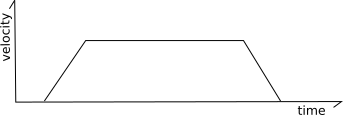
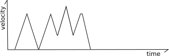
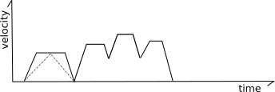
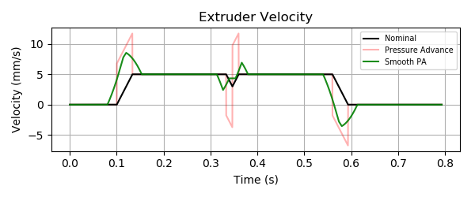

<a id="kinematics"></a>
# Cinemática

[English](../Kinematics.md) | **Português brasileiro**

Este documento fornece uma visão geral de como o Klipper implementa o movimento do robô (sua [cinemática](https://en.wikipedia.org/wiki/Kinematics)). O conteúdo pode ser de interesse tanto para desenvolvedores interessados em trabalhar no software Klipper quanto para usuários interessados em entender melhor a mecânica de suas máquinas.

<a id="acceleration"></a>
## Aceleração

O Klipper implementa um esquema de aceleração constante sempre que o cabeçote de impressão muda de velocidade - a velocidade é alterada gradualmente para a nova velocidade em vez de saltar bruscamente para ela. O Klipper sempre impõe aceleração entre o cabeçote da ferramenta e a impressão. O filamento que sai da extrusora pode ser bastante frágil - solavancos rápidos e/ou mudanças no fluxo da extrusora levam a má qualidade e má adesão à mesa. Mesmo quando não está extrudando, se o cabeçote de impressão estiver no mesmo nível da impressão, então um solavanco rápido do cabeçote pode causar perturbação do filamento recém-depositado. Limitar as mudanças de velocidade do cabeçote de impressão (em relação à impressão) reduz os riscos de perturbar a impressão.

Também é importante limitar a aceleração para que os motores de passo não pulem passos nem exerçam esforço excessivo sobre a máquina. O Klipper limita o torque em cada motor de passo em virtude da limitação da aceleração do cabeçote de impressão. Impor aceleração no cabeçote de impressão naturalmente também limita o torque dos motores de passo que movem o cabeçote de impressão (o inverso nem sempre é verdadeiro).

O Klipper implementa aceleração constante. A fórmula principal para aceleração constante é:

```
velocity(time) = start_velocity + accel*time
```

<a id="trapezoid-generator"></a>
## Gerador de trapézio

O Klipper usa um tradicional "gerador de trapézio" para modelar o movimento de cada movimento - cada movimento tem uma velocidade inicial, acelera até uma velocidade de cruzeiro com aceleração constante, mantém velocidade constante, e então desacelera até a velocidade final usando aceleração constante.



É chamado de "gerador de trapézio" porque um diagrama de velocidade do movimento se parece com um trapézio.

A velocidade de cruzeiro é sempre maior ou igual tanto à velocidade inicial quanto à velocidade final. A fase de aceleração pode ter duração zero (se a velocidade inicial for igual à velocidade de cruzeiro), a fase de cruzeiro pode ter duração zero (se o movimento começar a desacelerar imediatamente após acelerar), e/ou a fase de desaceleração pode ter duração zero (se a velocidade final for igual à velocidade de cruzeiro).


<a id="look-ahead"></a>
## Antecipação (look-ahead)

O sistema de "look-ahead" é usado para determinar velocidades de curva entre movimentos.

Considere os dois movimentos a seguir contidos em um plano XY:


Na situação acima, é possível desacelerar totalmente após o primeiro movimento e então acelerar totalmente no início do próximo movimento, mas isso não é ideal, pois toda essa aceleração e desaceleração aumentaria muito o tempo de impressão e as mudanças frequentes no fluxo da extrusora resultariam em má qualidade de impressão.

Para resolver isso, o mecanismo de "look-ahead" enfileira vários movimentos recebidos e analisa os ângulos entre os movimentos para determinar uma velocidade razoável que pode ser obtida durante a "junção" entre dois movimentos. Se o próximo movimento for quase na mesma direção, então o cabeçote precisa apenas desacelerar um pouco (se for o caso).


No entanto, se o próximo movimento formar um ângulo agudo (o cabeçote vai se deslocar em direção quase reversa no próximo movimento), então apenas uma pequena velocidade de junção é permitida.


As velocidades de junção são determinadas usando "aceleração centrípeta aproximada". Melhor [descrito pelo autor](https://onehossshay.wordpress.com/2011/09/24/improving_grbl_cornering_algorithm/). No entanto, no Klipper, as velocidades de junção são configuradas especificando a velocidade desejada que uma curva de 90° deve ter (a "velocidade de canto quadrado"), e as velocidades de junção para outros ângulos são derivadas disso.

Fórmula principal para look-ahead:

```
end_velocity^2 = start_velocity^2 + 2*accel*move_distance
```

<a id="minimum-cruise-ratio"></a>
### Relação mínima de cruzeiro

O Klipper também implementa um mecanismo para suavizar os movimentos de movimentos curtos em "zigue-zague". Considere os seguintes movimentos:



Acima, as mudanças frequentes de aceleração para desaceleração podem fazer a máquina vibrar, o que causa esforço na máquina e aumenta o ruído. O Klipper implementa um mecanismo para garantir que haja sempre algum movimento em velocidade de cruzeiro entre aceleração e desaceleração. Isso é feito reduzindo a velocidade máxima de alguns movimentos (ou sequência de movimentos) para garantir que haja uma distância mínima percorrida em velocidade de cruzeiro em relação à distância percorrida durante aceleração e desaceleração.

O Klipper implementa esse recurso acompanhando tanto uma aceleração regular de movimento quanto uma taxa virtual de "aceleração até desaceleração":



Especificamente, o código calcula qual seria a velocidade de cada movimento se fosse limitado a esta taxa virtual de "aceleração até desaceleração". Na figura acima, as linhas cinzas tracejadas representam esta taxa de aceleração virtual para o primeiro movimento. Se um movimento não puder atingir sua velocidade máxima de cruzeiro usando esta taxa de aceleração virtual, então sua velocidade máxima é reduzida para a velocidade máxima que poderia obter com esta taxa de aceleração virtual.

Para a maioria dos movimentos, o limite estará igual ou acima dos limites existentes do movimento e nenhuma mudança de comportamento é induzida. Para movimentos curtos em zigue-zague, no entanto, esse limite reduz a velocidade máxima. Observe que ele não altera a aceleração real dentro do movimento - o movimento continua a usar o esquema de aceleração normal até sua velocidade máxima ajustada.

<a id="generating-steps"></a>
## Geração de passos

Uma vez que o processo de look-ahead é concluído, o movimento do cabeçote de impressão para o movimento dado é totalmente conhecido (tempo, posição inicial, posição final, velocidade em cada ponto) e é possível gerar os tempos de passo para o movimento. Este processo é feito dentro de "classes cinemáticas" no código do Klipper. Fora dessas classes cinemáticas, tudo é acompanhado em milímetros, segundos e no espaço de coordenadas cartesianas. É tarefa das classes cinemáticas converter deste sistema genérico de coordenadas para as especificidades de hardware da impressora específica.

O Klipper usa um [solucionador iterativo](https://en.wikipedia.org/wiki/Root-finding_algorithm) para gerar os tempos de passo para cada motor de passo. O código contém as fórmulas para calcular as coordenadas cartesianas ideais do cabeçote em cada momento no tempo, e possui as fórmulas cinemáticas para calcular as posições ideais dos motores de passo com base nessas coordenadas cartesianas. Com essas fórmulas, o Klipper pode determinar o tempo ideal em que o motor de passo deve estar em cada posição de passo. Os passos dados são então agendados nesses tempos calculados.

A fórmula principal para determinar quão longe um movimento deve se deslocar sob aceleração constante é:

```
move_distance = (start_velocity + .5 * accel * move_time) * move_time
```
e a fórmula principal para movimento com velocidade constante é:

```
move_distance = cruise_velocity * move_time
```

As fórmulas principais para determinar a coordenada cartesiana de um movimento dada uma distância de movimento são:

```
cartesian_x_position = start_x + move_distance * total_x_movement / total_movement
cartesian_y_position = start_y + move_distance * total_y_movement / total_movement
cartesian_z_position = start_z + move_distance * total_z_movement / total_movement
```

<a id="cartesian-robots"></a>
### Robôs Cartesianos

A geração de passos para impressoras cartesianas é o caso mais simples. O movimento em cada eixo está diretamente relacionado ao movimento no espaço cartesiano.

Fórmulas principais:

```
stepper_x_position = cartesian_x_position
stepper_y_position = cartesian_y_position
stepper_z_position = cartesian_z_position
```

<a id="corexy-robots"></a>
### Robôs CoreXY

A geração de passos em uma máquina CoreXY é apenas um pouco mais complexa do que em robôs cartesianos básicos. As fórmulas principais são:

```
stepper_a_position = cartesian_x_position + cartesian_y_position
stepper_b_position = cartesian_x_position - cartesian_y_position
stepper_z_position = cartesian_z_position
```

<a id="delta-robots"></a>
### Robôs Delta

A geração de passos em um robô delta é baseada no teorema de Pitágoras:

```
stepper_position = (sqrt(arm_length^2
                         - (cartesian_x_position - tower_x_position)^2
                         - (cartesian_y_position - tower_y_position)^2)
                    + cartesian_z_position)
```

<a id="stepper-motor-acceleration-limits"></a>
### Limites de aceleração do motor de passo

Com cinemática delta, é possível que um movimento que esteja acelerando no espaço cartesiano exija uma aceleração em um motor de passo específico maior que a aceleração do movimento. Isso pode ocorrer quando um braço do motor de passo está mais horizontal do que vertical e a linha de movimento passa perto da torre desse motor de passo. Embora esses movimentos possam exigir uma aceleração do motor de passo maior que a aceleração máxima configurada de movimento da impressora, a massa efetiva movida por esse motor de passo seria menor. Assim, a maior aceleração do motor de passo não resulta em torque significativamente maior no motor de passo e, portanto, é considerada inofensiva.

No entanto, para evitar casos extremos, o Klipper impõe um teto máximo na aceleração do motor de passo de três vezes a aceleração máxima configurada de movimento da impressora. (Da mesma forma, a velocidade máxima do motor de passo é limitada a três vezes a velocidade máxima de movimento.) Para impor esse limite, movimentos na borda extrema do volume de impressão (onde um braço do motor de passo pode estar quase horizontal) terão uma aceleração e velocidade máximas menores.

<a id="extruder-kinematics"></a>
### Cinemática da extrusora

O Klipper implementa o movimento da extrusora em sua própria classe cinemática. Como o tempo e a velocidade de cada movimento do cabeçote de impressão são totalmente conhecidos para cada movimento, é possível calcular os tempos de passo para a extrusora independentemente dos cálculos de tempo de passo do movimento do cabeçote de impressão.

O movimento básico da extrusora é simples de calcular. A geração de tempo de passo usa as mesmas fórmulas que os robôs cartesianos usam:

```
stepper_position = requested_e_position
```

<a id="pressure-advance"></a>
### Avanço de pressão

A experimentação mostrou que é possível melhorar a modelagem da extrusora além da fórmula básica da extrusora. No caso ideal, à medida que um movimento de extrusão progride, o mesmo volume de filamento deveria ser depositado em cada ponto ao longo do movimento e não deveria haver volume extrudado após o movimento. Infelizmente, é comum descobrir que as fórmulas básicas de extrusão fazem com que pouco filamento saia da extrusora no início dos movimentos de extrusão e que excesso de filamento seja extrudado após o fim da extrusão. Isso é frequentemente chamado de "ooze" (babamento).


O sistema de "pressure advance" (avanço de pressão) tenta levar isso em conta usando um modelo diferente para a extrusora. Em vez de ingenuamente acreditar que cada mm^3 de filamento alimentado na extrusora resultará imediatamente na saída dessa quantidade de mm^3 da extrusora, ele usa um modelo baseado em pressão. A pressão aumenta quando o filamento é empurrado para dentro da extrusora (como na [lei de Hooke](https://en.wikipedia.org/wiki/Hooke%27s_law)) e a pressão necessária para extrudar é dominada pela taxa de fluxo através do orifício do bico (como na [lei de Poiseuille](https://en.wikipedia.org/wiki/Poiseuille_law)). A ideia principal é que a relação entre filamento, pressão e taxa de fluxo pode ser modelada usando um coeficiente linear:

```
pa_position = nominal_position + pressure_advance_coefficient * nominal_velocity
```

Consulte o documento [avanço de pressão](Pressure_Advance.md) para informações sobre como encontrar este coeficiente de avanço de pressão.

A fórmula básica de avanço de pressão pode fazer com que o motor da extrusora faça mudanças bruscas de velocidade. O Klipper implementa "suavização" do movimento da extrusora para evitar isso.



O gráfico acima mostra um exemplo de dois movimentos de extrusão com uma velocidade de curva diferente de zero entre eles. Observe que o sistema de avanço de pressão faz com que filamento adicional seja empurrado para dentro da extrusora durante a aceleração. Quanto maior a taxa de fluxo de filamento desejada, mais filamento deve ser empurrado durante a aceleração para compensar a pressão. Durante a desaceleração do cabeçote, o filamento extra sofre retirada (a extrusora terá uma velocidade negativa).

A "suavização" é implementada usando uma média ponderada da posição da extrusora ao longo de um pequeno período de tempo (conforme especificado pelo parâmetro de configuração `pressure_advance_smooth_time`). Essa média pode abranger vários movimentos de código-g. Observe como o motor de passo da extrusora começará a se mover antes do início nominal do primeiro movimento de extrusão e continuará a se mover depois do fim nominal do último movimento de extrusão.

Fórmula principal do "avanço de pressão suavizado":

```
smooth_pa_position(t) =
    ( definitive_integral(pa_position(x) * (smooth_time/2 - abs(t - x)) * dx,
                          from=t-smooth_time/2, to=t+smooth_time/2)
     / (smooth_time/2)^2 )
```
