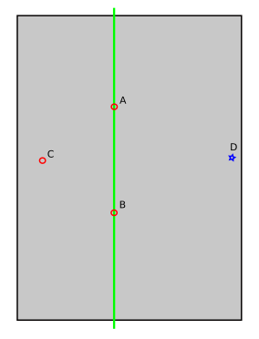

<a id="manual-leveling"></a>
# Nivelamento Manual

[English](../Manual_Level.md) | **Português brasileiro**

Este documento descreve as ferramentas para calibrar o Fim de Curso (Eixo Z) e realizar ajustes nos parafusos da mesa.

<a id="calibrating-a-z-endstop"></a>
## Calibrando Fim de Curso (Eixo Z)

Uma configuração precisa do fim de curso (Eixo Z) é crítica para obter impressões de alta qualidade.

Observe que a precisão da própria chave de fim de curso (Eixo Z) pode ser um fator limitante. Se estiver usando drivers de motor de passo Trinamic, considere ativar a detecção de [fase do fim de curso](Endstop_Phase.md) para melhorar a precisão.

Para executar uma calibração de fim de curso de Z, faça o homing da impressora, comande o cabeçote para mover-se para uma posição Z que esteja pelo menos cinco milímetros acima da mesa (se ainda não estiver), comande o cabeçote para mover-se para uma posição XY próxima ao centro da mesa e, em seguida, navegue até a aba de terminal do OctoPrint e execute:

```
Z_ENDSTOP_CALIBRATE
```
Em seguida, siga as etapas em ["teste do papel"](Bed_Level.md#the-paper-test) para determinar a distância real entre o bico e a mesa no local determinado. Depois que essas etapas forem concluídas, é permitido executar `ACCEPT` para aceitar a posição e salvar os resultados no arquivo de configuração com:

```
SAVE_CONFIG
```

É preferível usar uma chave de fim de curso de Z na extremidade oposta do eixo Z em relação à mesa. (Fazer o homing para longe da mesa é mais robusto, pois geralmente é sempre seguro fazer o homing de Z.) Entretanto, se for preciso fazer o homing em direção à mesa, recomenda-se ajustar o fim de curso para que ele acione a uma pequena distância (por ex., .5mm) acima da mesa. Quase todas as chaves de fim de curso podem ser pressionadas com segurança por uma pequena distância além de seu ponto de acionamento. Quando isso é feito, deve-se observar que o comando `Z_ENDSTOP_CALIBRATE` relata um pequeno valor positivo (por ex., .5mm) para o position_endstop de Z. Acionar o fim de curso enquanto ele ainda está a alguma distância da mesa reduz o risco de colisões inadvertidas com a mesa.

Algumas impressoras têm a capacidade de ajustar manualmente o local do sensor físico do fim de curso. No entanto, é recomendado realizar o posicionamento do fim de curso (Eixo Z) no software com o Klipper - uma vez que o local físico do fim de curso esteja em um local conveniente, pode-se fazer quaisquer ajustes adicionais executando Z_ENDSTOP_CALIBRATE ou atualizando manualmente o position_endstop no arquivo de configuração.

<a id="adjusting-bed-leveling-screws"></a>
## Ajustando os parafusos de nivelamento da mesa

O segredo para obter um bom nivelamento da mesa é utilizar o sistema de movimento de alta precisão da impressora durante o processo de nivelamento da base. Isso é feito comandando o extrusor para uma posição próxima a cada parafuso da base e, em seguida, ajustando esse parafuso até que a base esteja a uma distância da ponta do extrusor. O Klipper tem uma ferramenta para ajudar nisso. Para utilizá-la é necessário especificar o local (Eixo X e Y) de cada parafuso.

Isso é feito criando uma aba de configuração chamada de `[bed_screws]`. Pode parecer algo similar a:

```
[bed_screws]
screw1: 100, 50
screw2: 100, 150
screw3: 150, 100
```

Se um parafuso de mesa estiver sob ela, especifique a posição (Eixo X e Y) diretamente acima do parafuso. Se o parafuso estiver fora da mesa, especifique uma posição (Eixo X e Y) mais próxima do parafuso que ainda esteja dentro do alcance da mesa.

Quando o arquivo de configuração estiver pronto, execute `RESTART`, e então você poderá iniciar executando:

```
BED_SCREWS_ADJUST
```

Esta ferramenta moverá o extrusor para cada local (Eixos X e Y) do parafuso e, em seguida, moverá o extrusor para uma altura Z=0. Neste ponto, pode-se usar o "teste do papel" para ajustar o parafuso da mesa diretamente sob o extrusor. Veja as informações descritas em ["teste do papel"](Bed_Level.md#the-paper-test), mas ajuste o parafuso da mesa em vez de mover o extrusor para alturas diferentes. Ajuste os parafusos da mesa até que haja um pequeno atrito ao esfregar o papel para frente e para trás.

Quando o parafuso estiver ajustado de modo que se sinta uma pequena quantidade de atrito, execute o comando `ACCEPT` ou `ADJUSTED`. Use o comando `ADJUSTED` se o parafuso da mesa precisou de ajuste (normalmente qualquer coisa além de cerca de 1/8 de volta do parafuso). Use o comando `ACCEPT` se nenhum ajuste significativo for necessário. Ambos os comandos farão a ferramenta prosseguir para o próximo parafuso. (Quando um comando `ADJUSTED` é usado, a ferramenta agendará um ciclo adicional de ajustes dos parafusos da mesa; a ferramenta é concluída com êxito quando se verifica que nenhum parafuso da mesa exige ajustes significativos.) Pode-se usar o comando `ABORT` para sair da ferramenta mais cedo.

Este sistema funciona melhor quando a impressora tem uma superfície de impressão plana (como vidro) e guias retas. Após a conclusão bem-sucedida do nivelamento da mesa, a mesma deve estar pronta para impressão.

<a id="fine-grained-bed-screw-adjustments"></a>
### Ajustes de parafusos de mesa de precisão fina

Se a impressora usar três parafusos de mesa e todos os três parafusos estiverem sob a mesa, então pode ser possível executar uma segunda etapa de nivelamento de "alta precisão". Isso é feito movendo o extrusor para locais onde a mesa se move uma distância maior com cada ajuste de parafuso de mesa.

Por exemplo, considere uma mesa com parafusos nos locais A, B e C:



Para cada ajuste feito no parafuso da mesa no local C, a mesa irá balançar ao longo de um pêndulo definido pelos dois parafusos da cama restantes (mostrado aqui como uma linha verde). Nessa situação, cada ajuste no parafuso da mesa em C irá mover a mesa na posição D uma quantidade maior do que diretamente em C. Assim, é possível fazer um ajuste melhorado do parafuso C quando o extrusor está na posição D.

Para usar esse recurso, é necessário determinar as coordenadas adicionais do extrusor e adicioná-las ao arquivo de configuração. Por exemplo:

```
[bed_screws]
screw1: 100, 50
screw1_fine_adjust: 0, 0
screw2: 100, 150
screw2_fine_adjust: 300, 300
screw3: 150, 100
screw3_fine_adjust: 0, 100
```

Quando esse recurso é habilitado, o `BED_SCREWS_ADJUST` solicitará ajustes grosseiros diretamente acima de cada posição dos parafusos, e uma vez que eles forem aceitos, solicitará ajustes finos nos locais adicionais. Continue usando `ACCEPT` e `ADJUSTED` em cada posição.

<a id="adjusting-bed-leveling-screws-using-the-bed-probe"></a>
## Ajustando parafusos de nivelamento da mesa usando o probe de mesa

Esta é outra forma de calibrar o nivelamento da mesa usando o probe. Para usá-la, você deve ter um probe de eixo Z (BL Touch, sensor indutivo, etc).

Para habilitar essa função, é necessário determinar as coordenadas do extrusor de modo que o probe (Eixo Z) fique acima dos parafusos, e então, adicioná-los ao arquivo de configuração. Por exemplo:

```
[screws_tilt_adjust]
screw1: -5, 30
screw1_name: front left screw
screw2: 155, 30
screw2_name: front right screw
screw3: 155, 190
screw3_name: rear right screw
screw4: -5, 190
screw4_name: rear left screw
horizontal_move_z: 10.
speed: 50.
screw_thread: CW-M3
```

O screw1 é sempre o ponto de referência para os demais, portanto o sistema pressupõe que o screw1 está na altura correta. Sempre execute `G28` primeiro e depois execute `SCREWS_TILT_CALCULATE` - ele deve produzir uma saída semelhante a:

```
Send: G28
Recv: ok
Send: SCREWS_TILT_CALCULATE
Recv: // 01:20 means 1 full turn and 20 minutes, CW=clockwise, CCW=counter-clockwise
Recv: // front left screw (base) : x=-5.0, y=30.0, z=2.48750
Recv: // front right screw : x=155.0, y=30.0, z=2.36000 : adjust CW 01:15
Recv: // rear right screw : y=155.0, y=190.0, z=2.71500 : adjust CCW 00:50
Recv: // read left screw : x=-5.0, y=190.0, z=2.47250 : adjust CW 00:02
Recv: ok
```

Isso significa que:

- O parafuso dianteiro esquerdo é o ponto de referência, e isso não deve ser alterado.
- o parafuso dianteiro direito deve ser girado no sentido horário 1 volta completa e um quarto de volta
- O parafuso traseiro direito deve ser girado no sentido anti-horário por 50 minutos
- O parafuso traseiro esquerdo deve ser girado no sentido horário por 2 minutos (não obrigatório)

Observe que "minutos" refere-se a "minutos do mostrador de um relógio". Assim, por exemplo, 15 minutos correspondem a um quarto de volta completa.

Repita o processo várias vezes até obter um bom nivelamento da mesa - normalmente quando todos os ajustes forem inferiores a 6 minutos de rotação.

Se estiver usando um probe montado na lateral do hotend (ou seja, que tenha um deslocamento de Eixo X e Y), observe que ajustar a inclinação da mesa invalidará qualquer calibração de probe anterior que tenha sido realizada com a mesa inclinada. Certifique-se de executar [calibração da sonda](Probe_Calibrate.md) após os parafusos da mesa terem sido ajustados.

O parâmetro `MAX_DEVIATION` é útil quando uma malha da cama salva é usada, para garantir que o nível da mesa não tenha se desviado muito de onde estava quando a malha foi criada. Por exemplo, `SCREWS_TILT_CALCULATE MAX_DEVIATION=0.01` pode ser adicionado ao Gcode inicial personalizado do fatiador antes que a malha seja carregada. Ele irá cancelar a impressão se o limite configurado for excedido (0,01mm, neste exemplo), dando ao usuário a chance de ajustar os parafusos e reiniciar a impressão.

O parâmetro `DIRECTION` é útil se você puder girar os parafusos de ajuste da mesa em apenas uma direção. Por exemplo, você pode ter parafusos que começam apertados na posição mais baixa (ou mais alta) possível, que só podem ser girados em uma única direção, para levantar (ou abaixar) a mesa. Se você só puder girar os parafusos no sentido horário, execute `SCREWS_TILT_CALCULATE DIRECTION=CW`. Se você só puder girá-los no sentido anti-horário, execute `SCREWS_TILT_CALCULATE DIRECTION=CCW`. Um ponto de referência adequado será escolhido de forma que a mesa possa ser nivelada girando todos os parafusos na direção fornecida.
