<a id="measuring-resonances"></a>
# Medindo Ressonâncias

[English](../Measuring_Resonances.md) | **Português brasileiro**

O Klipper tem suporte integrado para acelerômetros compatíveis com ADXL345, MPU-9250, LIS2DW e LIS3DH, que podem ser usados para medir frequências de ressonância da impressora para diferentes eixos e ajustar automaticamente [modeladores de entrada](Resonance_Compensation.md) para compensar ressonâncias. Observe que usar acelerômetros exige alguma soldagem e crimpagem. O ADXL345 pode ser conectado à interface SPI de um Raspberry Pi ou placa MCU (ela precisa ser razoavelmente rápida). A família MPU pode ser conectada à interface I2C de um Raspberry Pi diretamente, ou a uma interface I2C de uma placa MCU que suporte *fast mode* de 400kbit/s no Klipper. O LIS2DW e o LIS3DH podem ser conectados a SPI ou I2C com as mesmas considerações acima.

Ao adquirir acelerômetros, esteja ciente de que há uma variedade de projetos diferentes de placas de circuito impresso e diferentes clones deles. Se for conectá-lo a um MCU de impressora de 5V, certifique-se de que ele tenha regulador de tensão e conversores de nível.

Para ADXL345s, certifique-se de que a placa suporte o modo SPI (um pequeno número de placas parece estar configurado de forma fixa para I2C ao ligar SDO ao GND).

Para MPU-9250/MPU-9255/MPU-6515/MPU-6050/MPU-6500/ICM20948s e LIS2DW/LIS3DH, também há uma variedade de projetos de placas e clones com diferentes resistores de pull-up de I2C que precisarão de complementação.

<a id="mcus-with-klipper-i2c-fast-mode-support"></a>
## MCUs com suporte a I2C *fast-mode* do Klipper

| Família de MCU | MCU(s) testados | MCU(s) com suporte |
| :-: | :-- | :-- |
| Raspberry Pi | 3B+, Pico | 3A, 3A+, 3B, 4 |
| AVR ATmega | ATmega328p | ATmega32u4, ATmega128, ATmega168, ATmega328, ATmega644p, ATmega1280, ATmega1284, ATmega2560 |
| AVR AT90 | - | AT90usb646, AT90usb1286 |
| SAMD | SAMC21G18 | SAMC21G18, SAMD21G18, SAMD21E18, SAMD21J18, SAMD21E15, SAMD51G19, SAMD51J19, SAMD51N19, SAMD51P20, SAME51J19, SAME51N19, SAME54P20 |

<a id="installation-instructions"></a>
## Instruções de instalação

<a id="wiring"></a>
### Fiação

Um cabo Ethernet com pares trançados blindados (cat5e ou melhor) é recomendado para integridade de sinal em longas distâncias. Se você ainda tiver problemas de integridade de sinal (erros de SPI/I2C):

- Verifique novamente a fiação com um multímetro digital para:
   - Conexões corretas com desligado (continuidade)
   - Tensões corretas de alimentação e terra
- Somente I2C:
   - Verifique se as resistências das linhas SCL e SDA para 3.3V estão na faixa de 900 ohms a 1.8K
   - Para detalhes técnicos completos, consulte [capítulo 7 da especificação do barramento I2C e manual do usuário UM10204](https://www.pololu.com/file/0J435/UM10204.pdf) para *fast-mode*
- Encurte o cabo

Conecte a blindagem do cabo Ethernet somente ao terra da placa MCU/Pi.

***Verifique novamente sua fiação antes de ligar para evitar danificar seu MCU/Raspberry Pi ou o acelerômetro.***

<a id="spi-accelerometers"></a>
### Acelerômetros SPI

Ordem sugerida de pares trançados para três pares trançados:

```
GND+MISO
3.3V+MOSI
SCLK+CS
```

Observe que, diferentemente da blindagem do cabo, o GND deve ser conectado em ambas as extremidades.

<a id="adxl345"></a>
#### ADXL345

<a id="direct-to-raspberry-pi"></a>
##### Direto ao Raspberry Pi

**Observação: muitos MCUs funcionarão com um ADXL345 em modo SPI (p. ex. Pi Pico); fiação e configuração variarão de acordo com sua placa específica e pinos disponíveis.**

Você precisa conectar o ADXL345 ao seu Raspberry Pi via SPI. Observe que a conexão I2C, sugerida pela documentação do ADXL345, tem vazão muito baixa e **não funcionará**. O esquema de conexão recomendado:

| Pino do ADXL345 | Pino da RPi | Nome do pino da RPi |
| :-: | :-: | :-: |
| 3V3 (or VCC) | 01 | Alimentação CC de 3.3V |
| GND | 06 | Terra |
| CS | 24 | GPIO08 (SPI0_CE0_N) |
| SDO | 21 | GPIO09 (SPI0_MISO) |
| SDA | 19 | GPIO10 (SPI0_MOSI) |
| SCL | 23 | GPIO11 (SPI0_SCLK) |

Diagramas de fiação Fritzing para algumas das placas ADXL345:

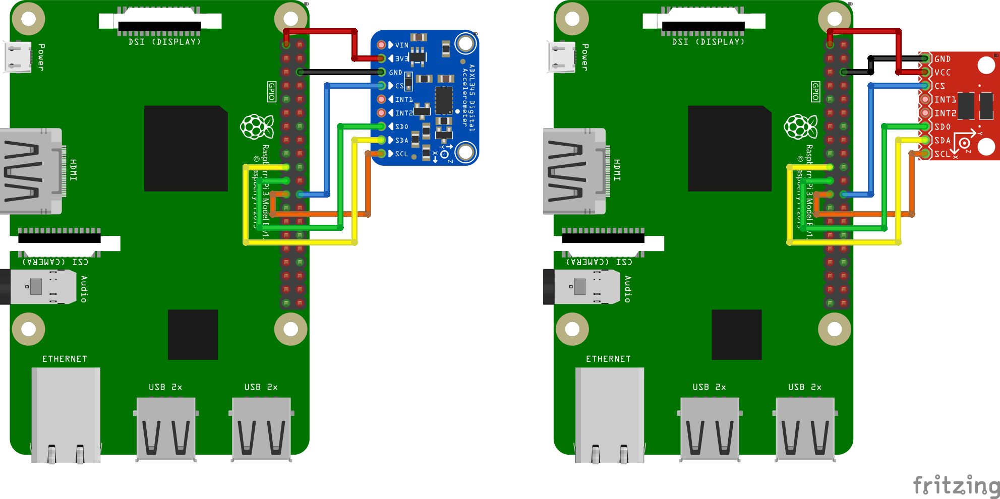

<a id="using-raspberry-pi-pico"></a>
##### Usando Raspberry Pi Pico

Você pode conectar o ADXL345 ao seu Raspberry Pi Pico e depois conectar o Pico ao seu Raspberry Pi via USB. Isso facilita reutilizar o acelerômetro em outros dispositivos Klipper, pois você pode conectar via USB em vez de GPIO. O Pico não tem muito poder de processamento, portanto certifique-se de que ele esteja executando apenas o acelerômetro e nenhuma outra tarefa.

Para evitar danos à sua RPi, conecte o ADXL345 somente em 3.3V. Dependendo do leiaute da placa, pode haver um conversor de nível presente, o que torna 5V perigoso para sua RPi.

| Pino do ADXL345 | Pino do Pico | Nome do pino do Pico |
| :-: | :-: | :-: |
| 3V3 (or VCC) | 36 | Alimentação CC de 3.3V |
| GND | 38 | Terra |
| CS | 2 | GP1 (SPI0_CSn) |
| SDO | 1 | GP0 (SPI0_RX) |
| SDA | 5 | GP3 (SPI0_TX) |
| SCL | 4 | GP2 (SPI0_SCK) |

Diagramas de fiação para algumas das placas ADXL345:

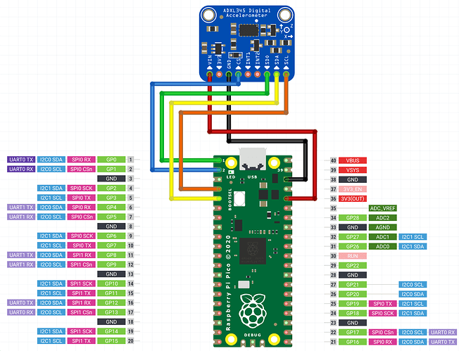

<a id="i2c-accelerometers"></a>
### Acelerômetros I2C

Ordem sugerida de pares trançados para três pares (preferencial):

```
3.3V+GND
SDA+GND
SCL+GND
```

ou para dois pares:

```
3.3V+SDA
GND+SCL
```

Observe que, diferentemente da blindagem de um cabo, qualquer GND(s) deve ser conectado em ambas as extremidades.

<a id="mpu-9250mpu-9255mpu-6515mpu-6050mpu-6500icm20948"></a>
#### MPU-9250/MPU-9255/MPU-6515/MPU-6050/MPU-6500/ICM20948

Estes acelerômetros foram testados para funcionar via I2C na RPi, no RP2040 (Pico) e no AVR a 400kbit/s (*modo rápido*). Alguns módulos de acelerômetro MPU incluem resistores de pull-up, mas alguns são grandes demais, de 10K, e devem ser trocados ou complementados por resistores menores em paralelo.

Esquema de conexão recomendado para I2C no Raspberry Pi:

| Pino do MPU-9250 | Pino da RPi | Nome do pino da RPi |
| :-: | :-: | :-: |
| VCC | 01 | Alimentação CC de 3.3v |
| GND | 09 | Terra |
| SDA | 03 | GPIO02 (SDA1) |
| SCL | 05 | GPIO03 (SCL1) |

O RPi possui resistores de pull-up internos de 1,8K tanto em SCL quanto em SDA.

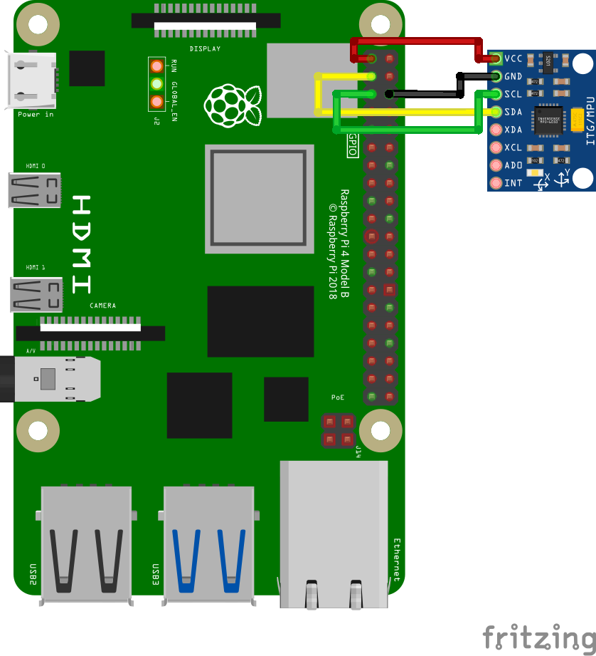

Esquema de conexão recomendado para I2C (i2c0a) no RP2040:

| Pino do MPU-9250 | Pino do RP2040 | Nome do pino do RP2040 |
| :-: | :-: | :-: |
| VCC | 36 | 3v3 |
| GND | 38 | Terra |
| SDA | 01 | GP0 (I2C0 SDA) |
| SCL | 02 | GP1 (I2C0 SCL) |

O Pico não inclui nenhum resistor de pull-up I2C interno.

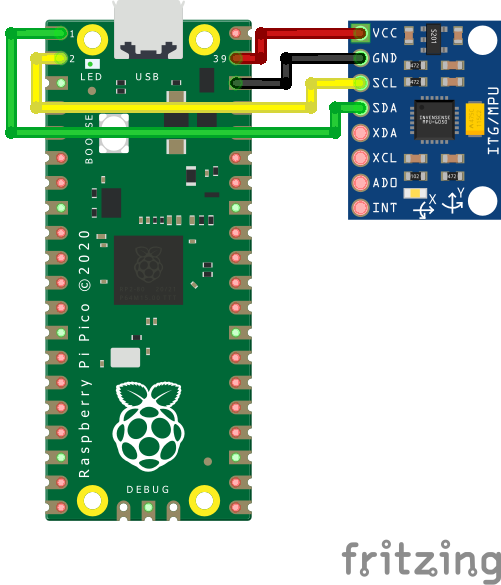

<a id="recommended-connection-scheme-for-i2ctwi-on-the-avr-atmega328p-arduino-nano"></a>
##### Esquema de conexão recomendado para I2C(TWI) no AVR ATmega328P Arduino Nano:

| Pino do MPU-9250 | Pino TQFP32 do Atmega328P | Nome do pino do Atmega328P | Pino do Arduino Nano |
| :-: | :-: | :-: | :-: |
| VCC | 39 | - | - |
| GND | 38 | Terra | GND |
| SDA | 27 | SDA | A4 |
| SCL | 28 | SCL | A5 |

O Arduino Nano não inclui resistores de pull-up integrados nem pino de alimentação de 3.3V.

<a id="mounting-the-accelerometer"></a>
### Montagem do acelerômetro

O acelerômetro deve ser fixado ao cabeçote de impressão (toolhead). É preciso projetar um suporte adequado que se ajuste à sua própria impressora 3D. É melhor alinhar os eixos do acelerômetro com os eixos da impressora (mas se for mais conveniente, os eixos podem ser trocados - ou seja, não é preciso alinhar o eixo X com X e assim por diante - não há problema mesmo que o eixo Z do acelerômetro seja o eixo X da impressora, etc.).

Um exemplo de montagem do ADXL345 no SmartEffector:

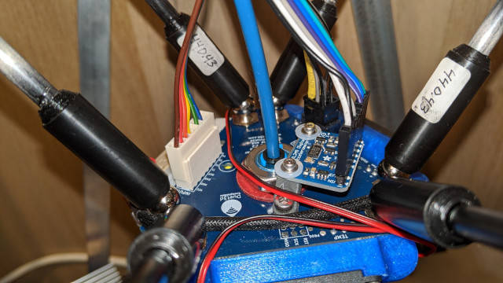

Observe que em uma impressora do tipo bed slinger é preciso projetar 2 suportes: um para o cabeçote de impressão e outro para a mesa, e executar as medições duas vezes. Consulte a [seção](#bed-slinger-printers) correspondente para mais detalhes.

**Atenção:** certifique-se de que o acelerômetro e quaisquer parafusos que o prendem não toquem nenhuma parte metálica da impressora. Basicamente, o suporte deve ser projetado de modo a garantir o isolamento elétrico do acelerômetro em relação à estrutura da impressora. Não garantir isso pode criar um laço de terra (ground loop) no sistema que pode danificar a eletrônica.

<a id="software-installation"></a>
### Instalação de software

Observe que medições de ressonância e autocalibração do shaper exigem dependências adicionais de software não instaladas por padrão. Primeiro, execute no seu Raspberry Pi os seguintes comandos:

```
sudo apt update
sudo apt install python3-numpy python3-matplotlib libatlas-base-dev libopenblas-dev
```

Em seguida, para instalar o NumPy no ambiente Klipper, execute o comando:

```
~/klippy-env/bin/pip install -v "numpy<1.26"
```
Observe que, dependendo do desempenho da CPU, pode levar *muito* tempo, até 10-20 minutos. Seja paciente e aguarde a conclusão da instalação. Em algumas ocasiões, se a placa tiver pouca RAM, a instalação pode falhar e você precisará habilitar swap. Observe também a versão forçada, pois versões mais novas do NumPy têm requisitos que podem não ser atendidos em alguns ambientes Python do Klipper.

Após instalado, verifique se nenhum erro aparece no comando:

```
~/klippy-env/bin/python -c 'import numpy;'
```
A saída correta deve ser simplesmente uma nova linha.

<a id="configure-adxl345-with-rpi"></a>
#### Configurar ADXL345 com RPi

Primeiro, verifique e siga as instruções no [documento de microcontrolador RPi](RPi_microcontroller.md) para configurar o "linux mcu" no Raspberry Pi. Isso configurará uma segunda instância do Klipper executada no seu Pi.

Certifique-se de que o driver SPI do Linux esteja habilitado executando `sudo raspi-config` e habilitando SPI no menu "Interfacing options".

Adicione o seguinte ao arquivo printer.cfg:

```
[mcu rpi]
serial: /tmp/klipper_host_mcu

[adxl345]
cs_pin: rpi:None

[resonance_tester]
accel_chip: adxl345
probe_points:
    100, 100, 20  # um exemplo
```
É aconselhável começar com 1 ponto de sondagem, no meio da mesa de impressão, ligeiramente acima dela.

<a id="configure-adxl345-with-pi-pico"></a>
#### Configurar ADXL345 com Pi Pico

<a id="flash-the-pico-firmware"></a>
##### Gravar o firmware do Pico

No seu Raspberry Pi, compile o firmware para o Pico.

```
cd ~/klipper
make clean
make menuconfig
```
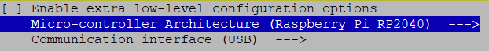

Agora, mantendo pressionado o botão `BOOTSEL` no Pico, conecte o Pico ao Raspberry Pi via USB. Compile e grave (flash) o firmware.

```
make flash FLASH_DEVICE=first
```

Se isso falhar, será informado qual `FLASH_DEVICE` usar. Neste exemplo, é `make flash FLASH_DEVICE=2e8a:0003`. 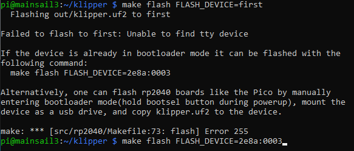

<a id="configure-the-connection"></a>
##### Configurar a conexão

O Pico agora será reiniciado com o novo firmware e deve aparecer como um dispositivo serial. Encontre o dispositivo serial do Pico com `ls /dev/serial/by-id/*`. Agora você pode adicionar um arquivo `adxl.cfg` com as seguintes configurações:

```
[mcu adxl]
# Altere <mySerial> para o que você encontrou acima. Por exemplo,
# usb-Klipper_rp2040_E661640843545B2E-if00
serial: /dev/serial/by-id/usb-Klipper_rp2040_<mySerial>

[adxl345]
cs_pin: adxl:gpio1
spi_bus: spi0a
axes_map: x,z,y

[resonance_tester]
accel_chip: adxl345
probe_points:
    # Em algum lugar ligeiramente acima do meio da sua mesa de impressão
    147,154, 20

[output_pin power_mode] # Melhore a estabilidade da alimentação
pin: adxl:gpio23
```

Se estiver configurando o ADXL345 em um arquivo separado, como mostrado acima, você também deverá modificar seu arquivo `printer.cfg` para incluir isto:

```
[include adxl.cfg] # Comente esta linha ao desconectar o acelerômetro
```

Reinicie o Klipper com o comando `RESTART`.

<a id="configure-lis2dw-series-over-spi"></a>
#### Configurar a série LIS2DW via SPI

```
[mcu lis]
# Altere <mySerial> para o que você encontrou acima. Por exemplo,
# usb-Klipper_rp2040_E661640843545B2E-if00
serial: /dev/serial/by-id/usb-Klipper_rp2040_<mySerial>

[lis2dw]
cs_pin: lis:gpio1
spi_bus: spi0a
axes_map: x,z,y

[resonance_tester]
accel_chip: lis2dw
probe_points:
    # Em algum lugar ligeiramente acima do meio da sua mesa de impressão
    147,154, 20
```

<a id="configure-mpu-60009000-series-with-rpi"></a>
#### Configurar a série MPU-6000/9000 com RPi

Certifique-se de que o driver I2C do Linux esteja habilitado e que a taxa (baud rate) esteja definida em 400000 (consulte a seção [Habilitando I2C](RPi_microcontroller.md#optional-enabling-i2c) para mais detalhes). Em seguida, adicione o seguinte ao printer.cfg:

```
[mcu rpi]
serial: /tmp/klipper_host_mcu

[mpu9250]
i2c_mcu: rpi
i2c_bus: i2c.1

[resonance_tester]
accel_chip: mpu9250
probe_points:
    100, 100, 20  # um exemplo
```
Se você estiver usando o ICM20948, substitua as ocorrências de "mpu9250" por "icm20948".

<a id="configure-mpu-9520-compatibles-with-pico"></a>
#### Configurar compatíveis com MPU-9520 com Pico

O I2C do Pico é definido em 400000 por padrão. Basta adicionar o seguinte ao printer.cfg:

```
[mcu pico]
serial: /dev/serial/by-id/<your Pico's serial ID>

[mpu9250]
i2c_mcu: pico
i2c_bus: i2c0a

[resonance_tester]
accel_chip: mpu9250
probe_points:
    100, 100, 20  # um exemplo

[static_digital_output pico_3V3pwm] # Melhore a estabilidade da alimentação
pins: pico:gpio23
```
Se você estiver usando o ICM20948, substitua as ocorrências de "mpu9250" por "icm20948".

<a id="configure-mpu-9520-compatibles-with-avr"></a>
#### Configurar compatíveis com MPU-9520 com AVR

O I2C do AVR será definido em 400000 pela opção mpu9250. Basta adicionar o seguinte ao printer.cfg:

```
[mcu nano]
serial: /dev/serial/by-id/<your nano's serial ID>

[mpu9250]
i2c_mcu: nano

[resonance_tester]
accel_chip: mpu9250
probe_points:
    100, 100, 20  # um exemplo
```
Se você estiver usando o ICM20948, substitua as ocorrências de "mpu9250" por "icm20948".

Reinicie o Klipper com o comando `RESTART`.

<a id="measuring-the-resonances"></a>
## Medição das ressonâncias

<a id="checking-the-setup"></a>
### Verificação da configuração

Agora você pode testar uma conexão.

- Para impressoras "non bed-slingers" (p. ex. um acelerômetro), no Octoprint, digite `ACCELEROMETER_QUERY`
- Para "bed-slingers" (p. ex. mais de um acelerômetro), digite `ACCELEROMETER_QUERY CHIP=<chip>` onde `<chip>` é o nome do chip conforme digitado, p. ex. `CHIP=bed` (consulte: [bed-slinger](#bed-slinger-printers)) para todos os chips de acelerômetro instalados.

Você deve ver as medições atuais do acelerômetro, incluindo a aceleração de queda livre, p. ex.

```
Recv: // adxl345 values (x, y, z): 470.719200, 941.438400, 9728.196800
```

Se você receber um erro como `Invalid adxl345 id (got xx vs e5)`, onde `xx` é algum outro ID, tente novamente imediatamente. Há um problema com a inicialização SPI. Se ainda receber erro, isso indica problema de conexão com o ADXL345 ou sensor defeituoso. Verifique novamente a alimentação, a fiação (se corresponde aos esquemas, se nenhum fio está rompido ou solto, etc.) e a qualidade da solda.

**Se você estiver usando um acelerômetro compatível com MPU-9250 e ele aparecer como `mpu-unknown`, use com cautela! Provavelmente são chips recondicionados!**

Em seguida, tente executar `MEASURE_AXES_NOISE` no Octoprint, você deve obter alguns números de linha de base para o ruído do acelerômetro nos eixos (devem estar em algum lugar na faixa de ~1-100). Ruído de eixos muito alto (p. ex. 1000 ou mais) pode indicar problemas no sensor, problemas com sua alimentação ou ventoinhas desbalanceadas muito ruidosas em uma impressora 3D.

<a id="measuring-the-resonances-1"></a>
### Medição das ressonâncias

Agora você pode executar alguns testes reais. Execute o seguinte comando:

```
TEST_RESONANCES AXIS=X
```
Observe que isso criará vibrações no eixo X. Também desativará o input shaping se ele estava habilitado anteriormente, pois não é válido executar o teste de ressonância com o input shaper habilitado.

**Atenção!** Certifique-se de observar a impressora na primeira vez, para garantir que as vibrações não se tornem violentas demais (o comando `M112` pode ser usado para abortar o teste em caso de emergência; esperamos que não chegue a isso). Se as vibrações ficarem fortes demais, você pode tentar especificar um valor menor que o padrão para o parâmetro `accel_per_hz` na seção `[resonance_tester]`, p. ex.

```
[resonance_tester]
accel_chip: adxl345
accel_per_hz: 50  # o padrão é 75
probe_points: ...
```

Se funcionar para o eixo X, execute também para o eixo Y:

```
TEST_RESONANCES AXIS=Y
```
Isso gerará 2 arquivos CSV (`/tmp/resonances_x_*.csv` e `/tmp/resonances_y_*.csv`). Esses arquivos podem ser processados com o script autônomo em um Raspberry Pi. Este script deve ser executado com um único arquivo CSV para cada eixo medido, embora possa ser usado com vários arquivos CSV se você desejar calcular a média dos resultados. Calcular a média dos resultados pode ser útil, por exemplo, se testes de ressonância foram feitos em vários pontos de teste. Exclua os arquivos CSV extras se não desejar calcular a média deles.

```
~/klipper/scripts/calibrate_shaper.py /tmp/resonances_x_*.csv -o /tmp/shaper_calibrate_x.png
~/klipper/scripts/calibrate_shaper.py /tmp/resonances_y_*.csv -o /tmp/shaper_calibrate_y.png
```
Este script gerará os gráficos `/tmp/shaper_calibrate_x.png` e `/tmp/shaper_calibrate_y.png` com respostas em frequência. Você também obterá as frequências sugeridas para cada input shaper, bem como qual input shaper é recomendado para sua configuração. Por exemplo:

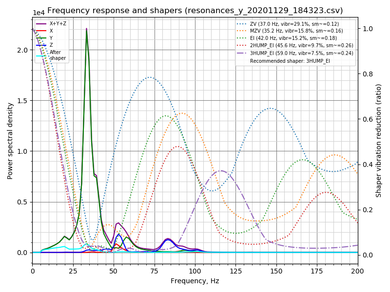

```
Fitted shaper 'zv' frequency = 34.4 Hz (vibrations = 4.0%, smoothing ~= 0.132)
To avoid too much smoothing with 'zv', suggested max_accel <= 4500 mm/sec^2
Fitted shaper 'mzv' frequency = 34.6 Hz (vibrations = 0.0%, smoothing ~= 0.170)
To avoid too much smoothing with 'mzv', suggested max_accel <= 3500 mm/sec^2
Fitted shaper 'ei' frequency = 41.4 Hz (vibrations = 0.0%, smoothing ~= 0.188)
To avoid too much smoothing with 'ei', suggested max_accel <= 3200 mm/sec^2
Fitted shaper '2hump_ei' frequency = 51.8 Hz (vibrations = 0.0%, smoothing ~= 0.201)
To avoid too much smoothing with '2hump_ei', suggested max_accel <= 3000 mm/sec^2
Fitted shaper '3hump_ei' frequency = 61.8 Hz (vibrations = 0.0%, smoothing ~= 0.215)
To avoid too much smoothing with '3hump_ei', suggested max_accel <= 2800 mm/sec^2
Recommended shaper is mzv @ 34.6 Hz
```

A configuração sugerida pode ser adicionada à seção `[input_shaper]` do `printer.cfg`, p. ex.:

```
[input_shaper]
shaper_freq_x: ...
shaper_type_x: ...
shaper_freq_y: 34.6
shaper_type_y: mzv

[printer]
max_accel: 3000  # não deve exceder o max_accel estimado para os eixos X e Y
```
ou você pode escolher você mesmo alguma outra configuração com base nos gráficos gerados: picos na densidade espectral de potência nos gráficos correspondem às frequências de ressonância da impressora.

Observe que, alternativamente, você pode executar a autocalibração do input shaper a partir do Klipper [diretamente](#input-shaper-auto-calibration), o que pode ser conveniente, por exemplo, para a [recalibração](#input-shaper-re-calibration) do input shaper.

<a id="bed-slinger-printers"></a>
### Impressoras bed-slinger

Se sua impressora for uma impressora bed slinger, você precisará alterar a localização do acelerômetro entre as medições dos eixos X e Y: meça as ressonâncias do eixo X com o acelerômetro fixado ao cabeçote de impressão e as ressonâncias do eixo Y - à mesa (a configuração usual de bed slinger).

No entanto, você também pode conectar dois acelerômetros simultaneamente, embora o ADXL345 deva ser conectado a placas diferentes (digamos, a um RPi e à placa MCU da impressora), ou a duas interfaces SPI físicas diferentes na mesma placa (raramente disponíveis). Então eles podem ser configurados da seguinte maneira:

```
[adxl345 hotend]
# Assumindo que o chip `hotend` está conectado a um RPi
cs_pin: rpi:None

[adxl345 bed]
# Assumindo que o chip `bed` está conectado a uma placa MCU da impressora
cs_pin: ...  # Pino SPI de seleção de chip (CS) da placa da impressora

[resonance_tester]
# Assumindo a configuração típica da impressora bed slinger
accel_chip_x: adxl345 hotend
accel_chip_y: adxl345 bed
probe_points: ...
```

Dois MPUs podem compartilhar um barramento I2C, mas **não** podem medir simultaneamente, pois o barramento I2C de 400kbit/s não é rápido o suficiente. Um deve ter seu pino AD0 puxado para baixo, para 0V (endereço 104), e o outro seu pino AD0 puxado para cima, para 3.3V (endereço 105):

```
[mpu9250 hotend]
i2c_mcu: rpi
i2c_bus: i2c.1
i2c_address: 104 # Esta MPU tem o pino AD0 mantido em nível baixo

[mpu9250 bed]
i2c_mcu: rpi
i2c_bus: i2c.1
i2c_address: 105 # Esta MPU tem o pino AD0 mantido em nível alto

[resonance_tester]
# Assumindo a configuração típica da impressora bed slinger
accel_chip_x: mpu9250 hotend
accel_chip_y: mpu9250 bed
probe_points: ...
```
[Teste cada MPU individualmente antes de conectar ambos ao barramento para facilitar a depuração.]

Então os comandos `TEST_RESONANCES AXIS=X` e `TEST_RESONANCES AXIS=Y` usarão o acelerômetro correto para cada eixo.

<a id="max-smoothing"></a>
### Suavização (smoothing) máxima

Tenha em mente que o input shaper pode criar alguma suavização nas peças. O ajuste automático do input shaper realizado pelo script `calibrate_shaper.py` ou pelo comando `SHAPER_CALIBRATE` tenta não agravar a suavização, mas ao mesmo tempo tenta minimizar as vibrações resultantes. Às vezes eles podem fazer uma escolha subótima da frequência do shaper, ou talvez você simplesmente prefira ter menos suavização nas peças à custa de maiores vibrações restantes. Nesses casos, você pode solicitar limitar a suavização máxima do input shaper.

Vamos considerar os seguintes resultados do ajuste automático:

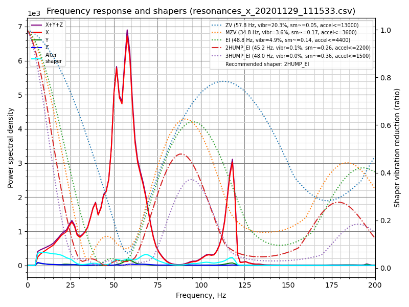

```
Fitted shaper 'zv' frequency = 57.8 Hz (vibrations = 20.3%, smoothing ~= 0.053)
To avoid too much smoothing with 'zv', suggested max_accel <= 13000 mm/sec^2
Fitted shaper 'mzv' frequency = 34.8 Hz (vibrations = 3.6%, smoothing ~= 0.168)
To avoid too much smoothing with 'mzv', suggested max_accel <= 3600 mm/sec^2
Fitted shaper 'ei' frequency = 48.8 Hz (vibrations = 4.9%, smoothing ~= 0.135)
To avoid too much smoothing with 'ei', suggested max_accel <= 4400 mm/sec^2
Fitted shaper '2hump_ei' frequency = 45.2 Hz (vibrations = 0.1%, smoothing ~= 0.264)
To avoid too much smoothing with '2hump_ei', suggested max_accel <= 2200 mm/sec^2
Fitted shaper '3hump_ei' frequency = 48.0 Hz (vibrations = 0.0%, smoothing ~= 0.356)
To avoid too much smoothing with '3hump_ei', suggested max_accel <= 1500 mm/sec^2
Recommended shaper is 2hump_ei @ 45.2 Hz
```
Observe que os valores de `smoothing` relatados são alguns valores projetados abstratos. Esses valores podem ser usados para comparar diferentes configurações: quanto maior o valor, mais suavização um shaper criará. No entanto, essas pontuações de suavização não representam nenhuma medida real de suavização, porque a suavização real depende dos parâmetros [`max_accel`](#selecting-max_accel) e `square_corner_velocity`. Portanto, você deve imprimir algumas impressões de teste para ver quanta suavização exatamente uma configuração escolhida cria.

No exemplo acima, os parâmetros de shaper sugeridos não são ruins, mas e se você quiser menos suavização no eixo X? Você pode tentar limitar a suavização máxima do shaper usando o seguinte comando:

```
~/klipper/scripts/calibrate_shaper.py /tmp/resonances_x_*.csv -o /tmp/shaper_calibrate_x.png --max_smoothing=0.2
```
que limita a suavização à pontuação 0,2. Agora você pode obter o seguinte resultado:

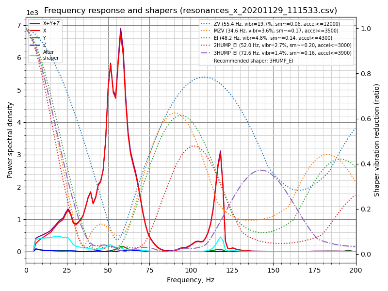

```
Fitted shaper 'zv' frequency = 55.4 Hz (vibrations = 19.7%, smoothing ~= 0.057)
To avoid too much smoothing with 'zv', suggested max_accel <= 12000 mm/sec^2
Fitted shaper 'mzv' frequency = 34.6 Hz (vibrations = 3.6%, smoothing ~= 0.170)
To avoid too much smoothing with 'mzv', suggested max_accel <= 3500 mm/sec^2
Fitted shaper 'ei' frequency = 48.2 Hz (vibrations = 4.8%, smoothing ~= 0.139)
To avoid too much smoothing with 'ei', suggested max_accel <= 4300 mm/sec^2
Fitted shaper '2hump_ei' frequency = 52.0 Hz (vibrations = 2.7%, smoothing ~= 0.200)
To avoid too much smoothing with '2hump_ei', suggested max_accel <= 3000 mm/sec^2
Fitted shaper '3hump_ei' frequency = 72.6 Hz (vibrations = 1.4%, smoothing ~= 0.155)
To avoid too much smoothing with '3hump_ei', suggested max_accel <= 3900 mm/sec^2
Recommended shaper is 3hump_ei @ 72.6 Hz
```

Se você comparar com os parâmetros sugeridos anteriormente, as vibrações são um pouco maiores, mas a suavização é significativamente menor que antes, permitindo aceleração máxima maior.

Ao decidir qual parâmetro `max_smoothing` escolher, você pode usar uma abordagem de tentativa e erro. Tente alguns valores diferentes e veja quais resultados obtém. Observe que a suavização real produzida pelo input shaper depende, principalmente, da frequência de ressonância mais baixa da impressora: quanto maior a frequência da ressonância mais baixa - menor a suavização. Portanto, se você solicitar ao script que encontre uma configuração do input shaper com suavização irrealisticamente pequena, isso será à custa de aumento de ringing nas frequências de ressonância mais baixas (que, tipicamente, também são mais visivelmente proeminentes nas impressões). Portanto, sempre verifique novamente as vibrações restantes projetadas relatadas pelo script e certifique-se de que não estejam muito altas.

Observe que se você escolheu um bom valor de `max_smoothing` para ambos os seus eixos, você pode armazená-lo no `printer.cfg` como

```
[resonance_tester]
accel_chip: ...
probe_points: ...
max_smoothing: 0.25  # um exemplo
```
Então, se você [executar novamente](#input-shaper-re-calibration) o autoajuste do input shaper usando o comando `SHAPER_CALIBRATE` do Klipper no futuro, ele usará o valor armazenado de `max_smoothing` como referência.

<a id="selecting-max_accel"></a>
### Seleção de max_accel

Como o input shaper pode criar alguma suavização nas peças, especialmente em acelerações altas, você ainda precisará escolher o valor de `max_accel` que não crie suavização demais nas peças impressas. Um script de calibração fornece uma estimativa para o parâmetro `max_accel` que não deve criar suavização demais. Observe que o `max_accel` exibido pelo script de calibração é apenas um máximo teórico no qual o respectivo shaper ainda é capaz de funcionar sem produzir suavização demais. De forma alguma é uma recomendação para definir essa aceleração para impressão. A aceleração máxima que sua impressora é capaz de sustentar depende de suas propriedades mecânicas e do torque máximo dos motores de passo utilizados. Portanto, sugere-se definir `max_accel` na seção `[printer]` que não exceda os valores estimados para os eixos X e Y, provavelmente com alguma margem de segurança conservadora.

Alternativamente, siga [esta](Resonance_Compensation.md#selecting-max_accel) parte do guia de ajuste do input shaper e imprima o modelo de teste para escolher o parâmetro `max_accel` experimentalmente.

O mesmo aviso se aplica à [autocalibração](#input-shaper-auto-calibration) do input shaper com o comando `SHAPER_CALIBRATE`: ainda é necessário escolher o valor correto de `max_accel` após a autocalibração, e os limites de aceleração sugeridos não serão aplicados automaticamente.

Tenha em mente que a aceleração máxima sem muita suavização depende do `square_corner_velocity`. A recomendação geral é não alterá-lo de seu valor padrão 5.0, e este é o valor usado por padrão pelo script `calibrate_shaper.py`. Se você o alterou, deve informar o script sobre isso passando o parâmetro `--square_corner_velocity=...`, p. ex.

```
~/klipper/scripts/calibrate_shaper.py /tmp/resonances_x_*.csv -o /tmp/shaper_calibrate_x.png --square_corner_velocity=10.0
```
para que ele possa calcular corretamente as recomendações de aceleração máxima. Observe que o comando `SHAPER_CALIBRATE` já leva em conta o parâmetro configurado `square_corner_velocity`, e não há necessidade de especificá-lo explicitamente.

Se você estiver fazendo uma recalibração do shaper e a suavização relatada para a configuração de shaper sugerida for quase a mesma que você obteve durante a calibração anterior, esta etapa pode ser ignorada.

<a id="measuring-the-resonances-of-z-axis"></a>
### Medição das ressonâncias do eixo Z

Medir as ressonâncias do eixo Z é semelhante em muitos aspectos à medição das ressonâncias dos eixos X e Y, com algumas diferenças sutis. De forma semelhante às medições de outros eixos, você precisará ter um acelerômetro montado nas partes móveis do eixo Z - seja a própria mesa (se a mesa se move no eixo Z), ou o cabeçote de impressão (se o cabeçote/pórtico se move em Z). Você precisará adicionar a configuração apropriada do chip ao `printer.cfg` e também adicioná-la à seção `[resonance_tester]`, p. ex.

```
[resonance_tester]
accel_chip_z: <accelerometer full name>
```
Certifique-se também de que os `probe_points` configurados em `[resonance_tester]` permitam folga suficiente para movimentos do eixo Z (20 mm acima da superfície da mesa deve fornecer folga suficiente com os parâmetros de teste padrão).

A próxima consideração é que o eixo Z normalmente pode atingir velocidades e acelerações máximas menores que os eixos X e Y. Os parâmetros padrão do teste levam isso em consideração e são muito menos agressivos, mas ainda pode ser necessário aumentar `max_z_accel` e `max_z_velocity`. Se você os configurou na seção `[printer]`, certifique-se de defini-los em pelo menos

```
[printer]
max_z_velocity: 20
max_z_accel: 1550
```
mas apenas durante o teste, depois você pode revertê-los aos valores originais se necessário. E se você usar parâmetros de teste personalizados para o eixo Z, `TEST_RESONANCES` e `SHAPER_CALIBRATE` fornecerão os limites mínimos necessários, se preciso para seu caso específico.

Após todas as alterações no `printer.cfg` terem sido feitas, reinicie o Klipper e execute

```
TEST_RESONANCES AXIS=Z
```
ou

```
SHAPER_CALIBRATE AXIS=Z
```
e prossiga a partir daí conforme faria para outros eixos. Por exemplo, após o comando `TEST_RESONANCES` você pode executar o script `calibrate_shaper.py` e obter recomendações de shaper e o gráfico de resposta de ressonância:

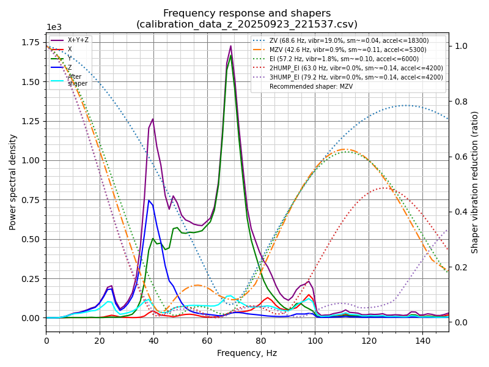

Após a calibração, os parâmetros do shaper podem ser armazenados no `printer.cfg`, p. ex. a partir do exemplo acima:

```
[input_shaper]
...
shaper_type_z: mzv
shaper_freq_z: 42.6
```

Além disso, dados os movimentos lentos do eixo Z, você pode facilmente considerar input shapers mais agressivos, p. ex.

```
[input_shaper]
...
shaper_type_z: 2hump_ei
shaper_freq_z: 63.0
```

Se o teste produzir resultados falsos, você pode tentar aumentar o parâmetro `accel_per_hz_z` em `[resonance_tester]` de seu valor padrão 15 para um valor maior na faixa de 20-30, p. ex.

```
[resonance_tester]
accel_per_hz_z: 25
```
e repita o teste. Aumentar esse valor provavelmente exigirá aumentar também os parâmetros `max_z_accel` e `max_z_velocity`. Você pode executar o comando `TEST_RESONANCES AXIS=Z` para obter os valores mínimos necessários.

No entanto, se você não conseguir medir as ressonâncias do eixo Z, pode considerar apenas usar

```
[input_shaper]
...
shaper_type_z: 3hump_ei
shaper_freq_z: 65
```
como uma escolha geral aceitável, dado que a suavização dos movimentos do eixo Z não é uma preocupação particular.

<a id="unreliable-measurements-of-resonance-frequencies"></a>
### Medições não confiáveis das frequências de ressonância

Às vezes as medições de ressonância podem produzir resultados falsos, levando a sugestões incorretas para os input shapers. Isso pode ser causado por vários motivos, incluindo ventoinhas em funcionamento no cabeçote de impressão, posição incorreta ou montagem não rígida do acelerômetro, ou problemas mecânicos como correias soltas ou eixo emperrado ou irregular. Tenha em mente que todas as ventoinhas devem ser desativadas para testes de ressonância, especialmente as ruidosas, e que o acelerômetro deve ser rigidamente montado na parte móvel correspondente (p. ex. na própria mesa para bed slinger, ou na extrusora da própria impressora e não no carro, e algumas pessoas obtêm melhores resultados montando o acelerômetro no próprio bico). Quanto a problemas mecânicos, o usuário deve inspecionar se há alguma falha que possa ser corrigida com um eixo móvel (p. ex. trilhos de guia linear limpos e lubrificados e tensão das rodas V-slot ajustada corretamente). Se nada disso ajudar, o usuário pode tentar os outros shapers da lista produzida além do recomendado por padrão.

<a id="testing-custom-axes"></a>
### Teste de eixos personalizados

O comando `TEST_RESONANCES` suporta eixos personalizados. Embora isso não seja realmente útil para calibração de input shaper, pode ser usado para estudar ressonâncias da impressora em profundidade e para verificar, por exemplo, a tensão da correia.

Para verificar a tensão da correia em impressoras CoreXY, execute

```
TEST_RESONANCES AXIS=1,1 OUTPUT=raw_data
TEST_RESONANCES AXIS=1,-1 OUTPUT=raw_data
```
e use `graph_accelerometer.py` para processar os arquivos gerados, p. ex.

```
~/klipper/scripts/graph_accelerometer.py -c /tmp/raw_data_axis*.csv -o /tmp/resonances.png
```
que gerará `/tmp/resonances.png` comparando as ressonâncias.

Para impressoras Delta com o posicionamento padrão das torres (torre A ~= 210 graus, B ~= 330 graus e C ~= 90 graus), execute

```
TEST_RESONANCES AXIS=0,1 OUTPUT=raw_data
TEST_RESONANCES AXIS=-0.866025404,-0.5 OUTPUT=raw_data
TEST_RESONANCES AXIS=0.866025404,-0.5 OUTPUT=raw_data
```
e então use o mesmo comando

```
~/klipper/scripts/graph_accelerometer.py -c /tmp/raw_data_axis*.csv -o /tmp/resonances.png
```
para gerar `/tmp/resonances.png` comparando as ressonâncias.

<a id="input-shaper-auto-calibration"></a>
## Autocalibração do Input Shaper

Além de escolher manualmente os parâmetros apropriados para o recurso de input shaper, também é possível executar o autoajuste para o input shaper diretamente a partir do Klipper. Execute o seguinte comando via terminal Octoprint:

```
SHAPER_CALIBRATE
```

Isso executará o teste completo para ambos os eixos e gerará a saída csv (`/tmp/calibration_data_*.csv` por padrão) para a resposta em frequência e os input shapers sugeridos. Você também obterá as frequências sugeridas para cada input shaper, bem como qual input shaper é recomendado para sua configuração, no console Octoprint. Por exemplo:

```
Calculating the best input shaper parameters for y axis
Fitted shaper 'zv' frequency = 39.0 Hz (vibrations = 13.2%, smoothing ~= 0.105)
To avoid too much smoothing with 'zv', suggested max_accel <= 5900 mm/sec^2
Fitted shaper 'mzv' frequency = 36.8 Hz (vibrations = 1.7%, smoothing ~= 0.150)
To avoid too much smoothing with 'mzv', suggested max_accel <= 4000 mm/sec^2
Fitted shaper 'ei' frequency = 36.6 Hz (vibrations = 2.2%, smoothing ~= 0.240)
To avoid too much smoothing with 'ei', suggested max_accel <= 2500 mm/sec^2
Fitted shaper '2hump_ei' frequency = 48.0 Hz (vibrations = 0.0%, smoothing ~= 0.234)
To avoid too much smoothing with '2hump_ei', suggested max_accel <= 2500 mm/sec^2
Fitted shaper '3hump_ei' frequency = 59.0 Hz (vibrations = 0.0%, smoothing ~= 0.235)
To avoid too much smoothing with '3hump_ei', suggested max_accel <= 2500 mm/sec^2
Recommended shaper_type_y = mzv, shaper_freq_y = 36.8 Hz
```
Se você concordar com os parâmetros sugeridos, pode executar `SAVE_CONFIG` agora para salvá-los e reiniciar o Klipper. Observe que isso não atualizará o valor de `max_accel` na seção `[printer]`. Você deve atualizá-lo manualmente seguindo as considerações na seção [Seleção de max_accel](#selecting-max_accel).

Se sua impressora for uma impressora bed slinger, você pode especificar qual eixo testar, para que possa alterar o ponto de montagem do acelerômetro entre os testes (por padrão o teste é realizado para ambos os eixos):

```
SHAPER_CALIBRATE AXIS=Y
```

Você pode executar `SAVE_CONFIG` duas vezes - após calibrar cada eixo.

No entanto, se você conectou dois acelerômetros simultaneamente, basta executar `SHAPER_CALIBRATE` sem especificar um eixo para calibrar o input shaper para ambos os eixos de uma vez.

<a id="input-shaper-re-calibration"></a>
### Recalibração do Input Shaper

O comando `SHAPER_CALIBRATE` também pode ser usado para recalibrar o input shaper no futuro, especialmente se forem feitas algumas alterações na impressora que possam afetar sua cinemática. Pode-se executar novamente a calibração completa usando o comando `SHAPER_CALIBRATE`, ou restringir a autocalibração a um único eixo fornecendo o parâmetro `AXIS=`, como

```
SHAPER_CALIBRATE AXIS=X
```

**Aviso!** Não é aconselhável executar a autocalibração do shaper com muita frequência (p. ex. antes de cada impressão, ou todos os dias). Para determinar frequências de ressonância, a autocalibração cria vibrações intensas em cada um dos eixos. Geralmente, impressoras 3D não são projetadas para suportar exposição prolongada a vibrações próximas às frequências de ressonância. Fazer isso pode aumentar o desgaste dos componentes da impressora e reduzir sua vida útil. Há também um risco aumentado de algumas peças se desaparafusarem ou se soltarem. Sempre verifique se todas as peças da impressora (incluindo as que normalmente não se movem) estão firmemente fixadas no lugar após cada autoajuste.

Além disso, devido a algum ruído nas medições, é possível que os resultados do ajuste sejam ligeiramente diferentes de uma execução de calibração para outra. Ainda assim, não se espera que o ruído afete muito a qualidade de impressão. No entanto, ainda é aconselhável verificar novamente os parâmetros sugeridos e imprimir algumas impressões de teste antes de usá-los para confirmar que são bons.

<a id="offline-processing-of-the-accelerometer-data"></a>
## Processamento offline dos dados do acelerômetro

É possível gerar os dados brutos do acelerômetro e processá-los offline (p. ex. em uma máquina hospedeira), por exemplo para encontrar ressonâncias. Para fazer isso, execute os seguintes comandos via terminal Octoprint:

```
SET_INPUT_SHAPER SHAPER_FREQ_X=0 SHAPER_FREQ_Y=0
TEST_RESONANCES AXIS=X OUTPUT=raw_data
```
ignorando quaisquer erros do comando `SET_INPUT_SHAPER`. Para o comando `TEST_RESONANCES`, especifique o eixo de teste desejado. Os dados brutos serão gravados no diretório `/tmp` no RPi.

Os dados brutos também podem ser obtidos executando o comando `ACCELEROMETER_MEASURE` duas vezes durante alguma atividade normal da impressora - primeiro para iniciar as medições e depois para interrompê-las e gravar o arquivo de saída. Consulte [G-Codes](G-Codes.md#adxl345) para mais detalhes.

Os dados podem ser processados posteriormente pelos seguintes scripts: `scripts/graph_accelerometer.py` e `scripts/calibrate_shaper.py`. Ambos aceitam um ou vários arquivos csv brutos como entrada, dependendo do modo. O script graph_accelerometer.py oferece suporte a vários modos de operação:

* plotagem dos dados brutos do acelerômetro (use o parâmetro `-r`), apenas 1 entrada é aceita;
* plotagem da resposta em frequência (nenhum parâmetro extra necessário), se várias entradas forem especificadas, a resposta em frequência média é calculada;
* comparação da resposta em frequência entre várias entradas (use o parâmetro `-c`); você pode especificar adicionalmente qual eixo do acelerômetro considerar via parâmetro `-a x`, `-a y` ou `-a z` (se nenhum for especificado, a soma das vibrações de todos os eixos é usada);
* plotagem do espectrograma (use o parâmetro `-s`), apenas 1 entrada é aceita; você pode especificar adicionalmente qual eixo do acelerômetro considerar via parâmetro `-a x`, `-a y` ou `-a z` (se nenhum for especificado, a soma das vibrações de todos os eixos é usada).

Observe que o script graph_accelerometer.py oferece suporte apenas aos arquivos raw_data\*.csv e não aos arquivos resonances\*.csv ou calibration_data\*.csv.

Por exemplo,

```
~/klipper/scripts/graph_accelerometer.py /tmp/raw_data_x_*.csv -o /tmp/resonances_x.png -c -a z
```
plotará a comparação de vários arquivos `/tmp/raw_data_x_*.csv` para o eixo Z no arquivo `/tmp/resonances_x.png`.

O script shaper_calibrate.py aceita 1 ou várias entradas e pode executar o ajuste automático do input shaper e sugerir os melhores parâmetros que funcionam bem para todas as entradas fornecidas. Ele imprime os parâmetros sugeridos no console e pode adicionalmente gerar o gráfico se o parâmetro `-o output.png` for fornecido, ou o arquivo CSV se o parâmetro `-c output.csv` for especificado.

Fornecer várias entradas para o script shaper_calibrate.py pode ser útil ao executar algum ajuste avançado dos input shapers, por exemplo:

* Executar `TEST_RESONANCES AXIS=X OUTPUT=raw_data` (e o eixo `Y`) para um único eixo duas vezes em uma impressora bed slinger com o acelerômetro fixado ao toolhead na primeira vez, e o acelerômetro fixado à mesa na segunda vez, a fim de detectar ressonâncias cruzadas entre eixos e tentar cancelá-las com input shapers.
* Executar `TEST_RESONANCES AXIS=Y OUTPUT=raw_data` duas vezes em uma bed slinger com mesa de vidro e superfícies magnéticas (que é mais leve) para encontrar os parâmetros de input shaper que funcionam bem para qualquer configuração de superfície de impressão.
* Combinar os dados de ressonância de vários pontos de teste.
* Combinar os dados de ressonância de 2 eixos (por ex., em uma impressora bed slinger para configurar o input_shaper do eixo X a partir das ressonâncias dos eixos X e Y para cancelar vibrações da *mesa* caso o bico 'prenda' na impressão ao se mover na direção do eixo X).
