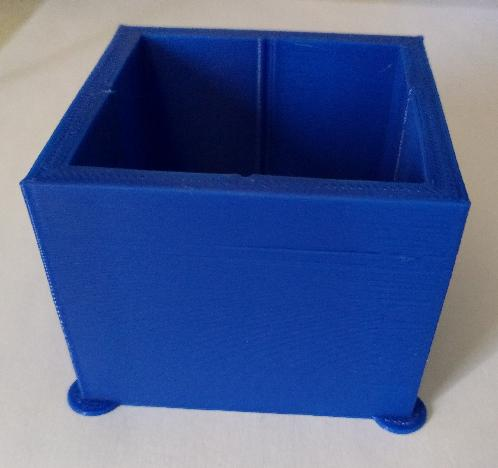
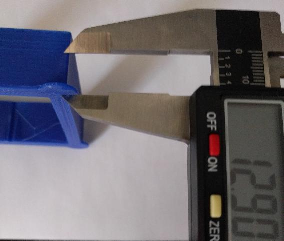

<a id="pressure-advance"></a>
# Avanço de pressão

[English](../Pressure_Advance.md) | **Português brasileiro**

Este documento fornece informações sobre como ajustar a variável de configuração "avanço de pressão" para um bico e filamento específicos. O recurso de avanço de pressão pode ser útil para reduzir o vazamento de filamento (ooze). Para obter mais informações sobre como o avanço de pressão é implementado, consulte o documento [cinemática](Kinematics.md).

<a id="tuning-pressure-advance"></a>
## Ajuste do pressure advance

O pressure advance faz duas coisas úteis - reduz o vazamento (ooze) durante movimentos sem extrusão e reduz o acúmulo de material (blobbing) nas curvas. Este guia usa o segundo recurso (redução de blobbing nas curvas) como mecanismo para o ajuste.

Para calibrar o pressure advance, a impressora deve estar configurada e operacional, pois o teste de ajuste envolve imprimir e inspecionar um objeto de teste. É recomendável ler este documento por completo antes de executar o teste.

Use um fatiador (slicer) para gerar o g-code para o quadrado grande e oco encontrado em [docs/prints/square_tower.stl](../prints/square_tower.stl). Use alta velocidade (por ex., 100mm/s), zero preenchimento (infill) e altura de camada grossa (a altura de camada deve ser em torno de 75% do diâmetro do bico). Certifique-se de que quaisquer costuras de "dynamic acceleration control" e "scarf joint" estejam desativadas no fatiador.

Prepare-se para o teste emitindo o seguinte comando G-Code:

```
SET_VELOCITY_LIMIT SQUARE_CORNER_VELOCITY=1 ACCEL=500
```
Este comando faz o bico se mover mais lentamente nas curvas para enfatizar os efeitos da pressão da extrusora. Então, para impressoras com extrusora direct drive, execute o comando:

```
TUNING_TOWER COMMAND=SET_PRESSURE_ADVANCE PARAMETER=ADVANCE START=0 FACTOR=.005
```
Para extrusoras bowden longas, use:

```
TUNING_TOWER COMMAND=SET_PRESSURE_ADVANCE PARAMETER=ADVANCE START=0 FACTOR=.020
```
Então imprima o objeto. Quando totalmente impressa, a impressão de teste se parece com:



O comando TUNING_TOWER acima instrui o Klipper a alterar a configuração pressure_advance em cada camada da impressão. Camadas mais altas na impressão terão um valor maior de pressure advance definido. Camadas abaixo da configuração ideal de pressure_advance terão blobbing nos cantos, e camadas acima da configuração ideal podem levar a cantos arredondados e má extrusão antes do canto.

Pode-se cancelar a impressão mais cedo se observar que os cantos não estão mais imprimindo bem (e assim pode-se evitar imprimir camadas que sabidamente estão acima do valor ideal de pressure_advance).

Inspecione a impressão e use um paquímetro digital para encontrar a altura que tem os cantos com melhor qualidade. Em caso de dúvida, prefira uma altura menor.



O valor de pressure_advance pode então ser calculado como `pressure_advance = <start> + <measured_height> * <factor>`. (Por exemplo, `0 + 12.90 * .020` seria `.258`.)

É possível escolher configurações personalizadas para START e FACTOR se isso ajudar a identificar a melhor configuração de pressure advance. Ao fazer isso, certifique-se de emitir o comando TUNING_TOWER no início de cada impressão de teste.

Valores típicos de pressure advance estão entre 0.050 e 1.000 (o limite superior geralmente apenas com extrusoras bowden). Se não houver melhoria significativa com um pressure advance de até 1.000, então é improvável que o pressure advance melhore a qualidade das impressões. Retorne a uma configuração padrão com o pressure advance desativado.

Embora este exercício de ajuste melhore diretamente a qualidade dos cantos, vale lembrar que uma boa configuração de pressure advance também reduz o ooze em toda a impressão.

Ao concluir este teste, defina `pressure_advance = <calculated_value>` na seção `[extruder]` do arquivo de configuração e emita um comando RESTART. O comando RESTART limpará o estado de teste e retornará a aceleração e as velocidades nas curvas aos seus valores normais.

<a id="important-notes"></a>
## Notas importantes

* O valor de avanço de pressão depende da extrusora, do bico e do filamento. É comum que filamentos de fabricantes diferentes ou com pigmentos diferentes exijam valores de avanço de pressão significativamente diferentes. Portanto, deve-se calibrar o avanço de pressão em cada impressora e com cada rolo de filamento.
* A temperatura de impressão e as taxas de extrusão podem afetar o avanço de pressão. Certifique-se de ajustar o [rotation_distance da extrusora](Rotation_Distance.md#calibrating-rotation_distance-on-extruders) e a [temperatura do bico](http://reprap.org/wiki/Triffid_Hunter%27s_Calibration_Guide#Nozzle_Temperature) antes de ajustar o avanço de pressão.
* A impressão de teste foi projetada para rodar com alta vazão da extrusora, mas com definições de fatiamento por outro lado "normais". Obtém-se uma alta vazão usando alta velocidade de impressão (por ex., 100mm/s) e altura de camada grossa (normalmente cerca de 75% do diâmetro do bico). Outras definições do fatiador devem ser semelhantes aos seus padrões (por ex., perímetros de 2 ou 3 linhas, quantidade normal de retirada). Pode ser útil definir a velocidade do perímetro externo com a mesma velocidade do restante da impressão, mas isso não é um requisito.
* É comum que a impressão de teste apresente comportamento diferente em cada canto. Frequentemente o fatiador providenciará a troca de camada em um canto, o que pode fazer esse canto ficar significativamente diferente dos outros três cantos. Se isso ocorrer, ignore esse canto e ajuste o avanço de pressão usando os outros três cantos. Também é comum que os cantos restantes variem ligeiramente. (Isso pode ocorrer devido a pequenas diferenças em como a estrutura da impressora reage a curvas em certas direções.) Tente escolher um valor que funcione bem para todos os cantos restantes. Em caso de dúvida, prefira um valor de avanço de pressão mais baixo.
* Se um valor alto de avanço de pressão (por ex., acima de 0.200) for usado, pode-se descobrir que a extrusora pula ao retornar à aceleração normal da impressora. O sistema de avanço de pressão compensa a pressão empurrando filamento extra durante a aceleração e retirando esse filamento durante a desaceleração. Com aceleração alta e avanço de pressão alto, a extrusora pode não ter torque suficiente para empurrar o filamento necessário. Se isso ocorrer, use um valor de aceleração mais baixo ou desabilite o avanço de pressão.
* Quando o avanço de pressão estiver ajustado no Klipper, ainda pode ser útil configurar um pequeno valor de retirada no fatiador (por ex., 0.75mm) e utilizar a opção "limpar ao retrair" do fatiador, se disponível. Essas definições do fatiador podem ajudar a neutralizar o fiapo causado pela coesão do filamento (filamento puxado para fora do bico devido à viscosidade do plástico). Recomenda-se desabilitar a opção "elevar Z ao retrair" do fatiador.
* O sistema de avanço de pressão não altera a temporização nem o percurso do cabeçote. Uma impressão com avanço de pressão habilitado levará o mesmo tempo que uma impressão sem avanço de pressão. O avanço de pressão também não altera a quantidade total de filamento extrudado durante uma impressão. O avanço de pressão resulta em movimento extra da extrusora durante a aceleração e a desaceleração do movimento. Uma definição muito alta de avanço de pressão resultará em uma quantidade muito grande de movimento da extrusora durante a aceleração e a desaceleração, e nenhuma definição de configuração impõe um limite à quantidade desse movimento.
