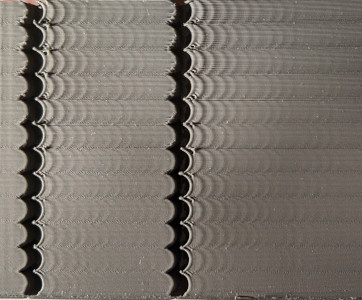
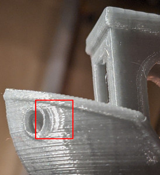
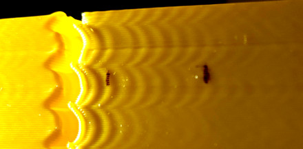
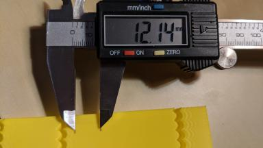
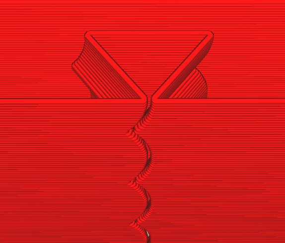
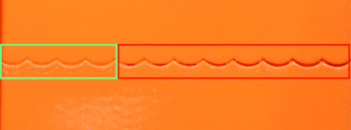

<a id="resonance-compensation"></a>
# Compensação de Ressonância

[English](../Resonance_Compensation.md) | **Português brasileiro**

O Klipper suporta Input Shaping - uma técnica que pode ser usada para reduzir ringing (também conhecido como echoing, ghosting ou rippling) nas impressões. Ringing é um defeito de superfície de impressão quando, tipicamente, elementos como bordas se repetem em uma superfície impressa como um sutil 'eco':

|||

Ringing é causado por vibrações mecânicas na impressora devido a mudanças rápidas da direção de impressão. Observe que ringing geralmente tem origens mecânicas: estrutura da impressora insuficientemente rígida, correias frouxas ou elásticas demais, problemas de alinhamento de peças mecânicas, massa móvel pesada, etc. Esses pontos devem ser verificados e corrigidos primeiro, se possível.

[Compensação de vibrações (input shaping)](https://en.wikipedia.org/wiki/Input_shaping) é uma técnica de controle em malha aberta que cria um sinal de comando que cancela suas próprias vibrações. Input shaping requer algum ajuste e medições antes de poder ser habilitado. Além do ringing, Input Shaping tipicamente reduz as vibrações e tremores da impressora em geral, e também pode melhorar a confiabilidade do modo stealthChop dos drivers de motor de passo Trinamic.

<a id="tuning"></a>
## Ajuste

O ajuste básico requer medir as frequências de ringing da impressora imprimindo um modelo de teste.

Fatie o modelo de teste de ringing, que pode ser encontrado em [docs/prints/ringing_tower.stl](../prints/ringing_tower.stl), no fatiador:

* Altura de camada sugerida é 0.2 ou 0.25 mm.
* Preenchimento (infill) e camadas superiores podem ser definidos como 0.
* Use 1-2 perímetros, ou ainda melhor o modo vaso suave (smooth vase) com base de 1-2 mm.
* Use velocidade suficientemente alta, em torno de 80-100 mm/sec, para perímetros **externos**.
* Certifique-se de que o tempo mínimo de camada seja **no máximo** 3 segundos.
* Certifique-se de que qualquer "controle dinâmico de aceleração" esteja desativado no fatiador.
* Não gire o modelo. O modelo tem marcas X e Y na parte traseira do modelo. Observe a localização incomum das marcas em relação aos eixos da impressora - não é um erro. As marcas podem ser usadas posteriormente no processo de ajuste como referência, pois mostram a qual eixo as medições correspondem.

<a id="ringing-frequency"></a>
### Frequência de ringing

Primeiro, meça a **frequência de ringing**.

1. Se o parâmetro `square_corner_velocity` foi alterado, reverta-o para 5.0. Não é aconselhável aumentá-lo ao usar input shaper, pois pode causar mais suavização nas peças - é melhor usar um valor de aceleração maior.
1. Desative o recurso `minimum_cruise_ratio` emitindo o seguinte comando: `SET_VELOCITY_LIMIT MINIMUM_CRUISE_RATIO=0`
1. Desative o Pressure Advance: `SET_PRESSURE_ADVANCE ADVANCE=0`
1. Se você já adicionou a seção `[input_shaper]` ao printer.cfg, execute o comando `SET_INPUT_SHAPER SHAPER_FREQ_X=0 SHAPER_FREQ_Y=0`. Se receber o erro “Unknown command”, pode ignorá-lo com segurança neste ponto e continuar com as medições.
1. Execute o comando: `TUNING_TOWER COMMAND=SET_VELOCITY_LIMIT PARAMETER=ACCEL START=1500 STEP_DELTA=500 STEP_HEIGHT=5` Basicamente, tentamos tornar o ringing mais pronunciado definindo valores grandes diferentes para aceleração. Este comando aumentará a aceleração a cada 5 mm a partir de 1500 mm/sec^2: 1500 mm/sec^2, 2000 mm/sec^2, 2500 mm/sec^2 e assim por diante até 7000 mm/sec^2 na última faixa.
1. Imprima o modelo de teste fatiado com os parâmetros sugeridos.
1. Você pode interromper a impressão mais cedo se o ringing estiver claramente visível e se perceber que a aceleração está alta demais para sua impressora (p. ex., a impressora vibra demais ou começa a perder passos).
1. Use as marcas X e Y na parte traseira do modelo como referência. As medições do lado com a marca X devem ser usadas para a *configuração* do eixo X, e a marca Y - para a configuração do eixo Y. Meça a distância *D* (em mm) entre várias oscilações na peça com a marca X, próximo aos entalhes, de preferência ignorando a primeira oscilação ou as duas primeiras. Para medir a distância entre oscilações mais facilmente, marque primeiro as oscilações e depois meça a distância entre as marcas com régua ou paquímetro:

   |||
1. Conte a quantas oscilações *N* corresponde a distância medida *D*. Se não souber como contar as oscilações, consulte a figura acima, que mostra *N* = 6 oscilações.
1. Calcule a frequência de ringing do eixo X como *V* &middot; *N* / *D* (Hz), em que *V* é a velocidade dos perímetros externos (mm/sec). Para o exemplo acima, marcamos 6 oscilações e o teste foi impresso a 100 mm/sec de velocidade, portanto a frequência é 100 * 6 / 12.14 ≈ 49.4 Hz.
1. Faça (8) - (10) para a marca Y também.

Observe que o ringing na impressão de teste deve seguir o padrão dos entalhes curvos, como na imagem acima. Se não seguir, então esse defeito não é realmente ringing e tem origem diferente - seja mecânica, ou um problema na extrusora. Ele deve ser corrigido primeiro antes de habilitar e ajustar input shapers.

Se as medições não forem confiáveis porque, digamos, a distância entre as oscilações não é estável, pode significar que a impressora tem várias frequências de ressonância no mesmo eixo. Pode-se tentar seguir o processo de ajuste descrito na seção [Medidas não confiáveis das frequências de ringing](#unreliable-measurements-of-ringing-frequencies) em vez disso e ainda assim obter algum benefício da técnica de input shaping.

A frequência de ringing pode depender da posição do modelo dentro da mesa de impressão (buildplate) e da altura Z, *especialmente em impressoras delta*; você pode verificar se vê diferenças nas frequências em diferentes posições ao longo dos lados do modelo de teste e em diferentes alturas. Você pode calcular as frequências médias de ringing sobre os eixos X e Y se for esse o caso.

Se a frequência de ringing medida for muito baixa (abaixo de aprox. 20-25 Hz), pode ser uma boa ideia investir em enrijecer a impressora ou diminuir a massa móvel - dependendo do que for aplicável no seu caso - antes de prosseguir com o ajuste adicional de input shaping, e medir novamente as frequências depois. Para muitos modelos populares de impressora já existem frequentemente algumas soluções disponíveis.

Observe que as frequências de ringing podem mudar se forem feitas alterações na impressora que afetem a massa móvel ou alterem a rigidez do sistema, por exemplo:

* Algumas ferramentas são instaladas, removidas ou substituídas no cabeçote de impressão (toolhead) alterando sua massa, ex. um novo motor de passo (mais pesado ou mais leve) para extrusora direct ou um novo hotend é instalado, ventoinha pesada com duto é adicionada, etc.
* Correias são tensionadas.
* Alguns acessórios para aumentar a rigidez da estrutura são instalados.
* Mesa diferente é instalada em impressora bed-slinger, ou vidro adicionado, etc.

Se tais alterações forem feitas, é uma boa ideia ao menos medir as frequências de ringing para ver se elas mudaram.

<a id="input-shaper-configuration"></a>
### Configuração do input shaper

Após as frequências de ringing dos eixos X e Y serem medidas, você pode adicionar a seguinte seção ao seu `printer.cfg`:

```
[input_shaper]
shaper_freq_x: ...  # frequência para a marca X do modelo de teste
shaper_freq_y: ...  # frequência para a marca Y do modelo de teste
```

Para o exemplo acima, obtemos shaper_freq_x/y = 49.4.

<a id="choosing-input-shaper"></a>
### Escolha do input shaper

O Klipper suporta vários input shapers. Eles diferem em sua sensibilidade a erros na determinação da frequência de ressonância e em quanta suavização (smoothing) causam nas peças impressas. Além disso, alguns dos shapers como 2HUMP_EI e 3HUMP_EI geralmente não devem ser usados com shaper_freq = frequência de ressonância - eles são configurados a partir de considerações diferentes para reduzir várias ressonâncias de uma vez.

Para a maioria das impressoras, podem ser recomendados os shapers MZV ou EI. Esta seção descreve um processo de teste para escolher entre eles e definir alguns outros parâmetros relacionados.

Imprima o modelo de teste de ringing como segue:

1. Reinicie o firmware: `RESTART`
1. Prepare para o teste: `SET_VELOCITY_LIMIT MINIMUM_CRUISE_RATIO=0`
1. Desative o Pressure Advance: `SET_PRESSURE_ADVANCE ADVANCE=0`
1. Execute: `SET_INPUT_SHAPER SHAPER_TYPE=MZV`
1. Execute o comando: `TUNING_TOWER COMMAND=SET_VELOCITY_LIMIT PARAMETER=ACCEL START=1500 STEP_DELTA=500 STEP_HEIGHT=5`
1. Imprima o modelo de teste fatiado com os parâmetros sugeridos.

Se você não vir ringing neste ponto, então o shaper MZV pode ser recomendado para uso.

Se você vir algum ringing, meça novamente as frequências usando as etapas (8)-(10) descritas na seção [Frequência de ringing](#ringing-frequency). Se as frequências diferirem significativamente dos valores obtidos anteriormente, será necessária uma configuração mais complexa de input shaper. Você pode consultar os detalhes técnicos da seção [Compensadores de vibrações (input shapers)](#input-shapers). Caso contrário, prossiga para a próxima etapa.

Agora teste o input shaper EI. Para testá-lo, repita as etapas (1)-(6) acima, mas executando na etapa 4 o seguinte comando em vez disso: `SET_INPUT_SHAPER SHAPER_TYPE=EI`.

Compare as duas impressões com input shaper MZV e EI. Se EI mostrar resultados visivelmente melhores que MZV, use o shaper EI, caso contrário prefira MZV. Observe que o shaper EI causará mais suavização nas peças impressas (veja a próxima seção para mais detalhes). Adicione o parâmetro `shaper_type: mzv` (ou ei) à seção [input_shaper], ex.:

```
[input_shaper]
shaper_freq_x: ...
shaper_freq_y: ...
shaper_type: mzv
```

Algumas observações sobre a seleção do shaper:

* O shaper EI pode ser mais adequado para impressoras bed slinger (se a frequência de ressonância e a suavização resultante permitirem): à medida que mais filamento é depositado na mesa móvel, a massa da mesa aumenta e a frequência de ressonância diminuirá. Como o shaper EI é mais robusto a mudanças na frequência de ressonância, ele pode funcionar melhor ao imprimir peças grandes.
* Devido à natureza da cinemática delta, as frequências de ressonância podem diferir muito em diferentes partes do volume de impressão. Portanto, o shaper EI pode ser mais adequado para impressoras delta do que MZV ou ZV, e deve ser considerado para uso. Se a frequência de ressonância for suficientemente grande (mais de 50-60 Hz), pode-se até tentar testar o shaper 2HUMP_EI (executando o teste sugerido acima com `SET_INPUT_SHAPER SHAPER_TYPE=2HUMP_EI`), mas verifique as considerações na [seção abaixo](#selecting-max_accel) antes de habilitá-lo.

<a id="selecting-max_accel"></a>
### Seleção de max_accel

Você já deve ter um teste impresso para o shaper escolhido na etapa anterior (se não tiver, imprima o modelo de teste fatiado com os [parâmetros sugeridos](#tuning) com pressure advance desativado `SET_PRESSURE_ADVANCE ADVANCE=0` e com a torre de ajuste habilitada como `TUNING_TOWER COMMAND=SET_VELOCITY_LIMIT PARAMETER=ACCEL START=1500 STEP_DELTA=500 STEP_HEIGHT=5`). Observe que em acelerações muito altas, dependendo da frequência de ressonância e do input shaper escolhido (ex. o shaper EI cria mais suavização que MZV), input shaping pode causar suavização e arredondamento excessivos das peças. Assim, max_accel deve ser escolhido de modo a evitar isso. Outro parâmetro que pode impactar a suavização é `square_corner_velocity`, portanto não é aconselhável aumentá-lo acima do padrão de 5 mm/sec para evitar maior suavização.

Para selecionar um valor adequado de max_accel, inspecione o modelo para o input shaper escolhido. Primeiro, anote em qual aceleração o ringing ainda é pequeno - com o qual você esteja satisfeito.

Em seguida, verifique a suavização. Para ajudar nisso, o modelo de teste tem uma pequena abertura (gap) na parede (0.15 mm):



À medida que a aceleração aumenta, a suavização também aumenta, e a abertura real na impressão se alarga:



Nesta figura, a aceleração aumenta da esquerda para a direita, e a lacuna começa a crescer a partir de 3500 mm/sec^2 (5ª faixa a partir da esquerda). Portanto o bom valor para max_accel = 3000 (mm/sec^2) neste caso para evitar a suavização excessiva.

Anote a aceleração quando a abertura ainda for muito pequena em sua impressão de teste. Se você vir protuberâncias, mas nenhuma abertura na parede, mesmo em acelerações altas, pode ser devido ao Pressure Advance desativado, especialmente em extrusoras Bowden. Se for esse o caso, pode ser necessário repetir a impressão com PA habilitado. Também pode ser resultado de fluxo de filamento mal calibrado (alto demais), portanto é uma boa ideia verificar isso também.

Escolha o mínimo entre os dois valores de aceleração (do ringing e da suavização), e coloque-o como `max_accel` no printer.cfg.

Como observação, pode acontecer - especialmente em baixas frequências de ringing - que o shaper EI cause suavização excessiva mesmo em acelerações mais baixas. Neste caso, MZV pode ser uma escolha melhor, pois pode permitir valores de aceleração mais altos.

Em frequências de ringing muito baixas (~25 Hz e abaixo) até mesmo o shaper MZV pode criar suavização excessiva. Se for esse o caso, você também pode tentar repetir as etapas na seção [Escolha do input shaper](#choosing-input-shaper) com o shaper ZV, usando o comando `SET_INPUT_SHAPER SHAPER_TYPE=ZV`. O shaper ZV deve mostrar ainda menos suavização que MZV, mas é mais sensível a erros na medição das frequências de ringing.

Outra consideração é que se a frequência de ressonância for muito baixa (abaixo de 20-25 Hz), pode ser uma boa ideia aumentar a rigidez da impressora ou reduzir a massa móvel. Caso contrário, aceleração e velocidade de impressão podem ficar limitadas devido à suavização excessiva agora em vez de ringing.

<a id="fine-tuning-resonance-frequencies"></a>
### Ajuste fino das frequências de ressonância

Observe que a precisão das medições das frequências de ressonância usando o modelo de teste de ringing é suficiente para a maioria dos propósitos, portanto ajuste adicional não é aconselhado. Se você ainda quiser tentar conferir seus resultados (ex. se ainda vir algum ringing após imprimir um modelo de teste com o input shaper de sua escolha com as mesmas frequências medidas anteriormente), você pode seguir as etapas desta seção. Observe que se você vir ringing em frequências diferentes após habilitar [input_shaper], esta seção não ajudará com isso.

Supondo que você tenha fatiado o modelo de ringing com os parâmetros sugeridos, conclua as seguintes etapas para cada um dos eixos X e Y:

1. Prepare para o teste: `SET_VELOCITY_LIMIT MINIMUM_CRUISE_RATIO=0`
1. Certifique-se de que o Pressure Advance esteja desativado: `SET_PRESSURE_ADVANCE ADVANCE=0`
1. Execute: `SET_INPUT_SHAPER SHAPER_TYPE=ZV`
1. A partir do modelo de teste de ringing existente com seu input shaper escolhido, selecione a aceleração que mostre bem o ringing e defina-a com: `SET_VELOCITY_LIMIT ACCEL=...`
1. Calcule os parâmetros necessários para o comando `TUNING_TOWER` para ajustar o parâmetro `shaper_freq_x` como segue: start = shaper_freq_x * 83 / 132 e factor = shaper_freq_x / 66, em que `shaper_freq_x` aqui é o valor atual em `printer.cfg`.
1. Execute o comando: `TUNING_TOWER COMMAND=SET_INPUT_SHAPER PARAMETER=SHAPER_FREQ_X START=start FACTOR=factor BAND=5` usando os valores `start` e `factor` calculados no passo (5).
1. Imprima o modelo de teste.
1. Restaure o valor de frequência original: `SET_INPUT_SHAPER SHAPER_FREQ_X=...`.
1. Encontre a faixa que mostra menos ringing e conte seu número a partir da base começando em 1.
1. Calcule o novo valor de shaper_freq_x via shaper_freq_x antigo * (39 + 5 * nº-da-faixa) / 66.

Repita essas etapas para o eixo Y da mesma maneira, substituindo as referências ao eixo X pelo eixo Y (por exemplo, substitua `shaper_freq_x` por `shaper_freq_y` nas fórmulas e no comando `TUNING_TOWER`).

Como exemplo, vamos supor que você tenha medido a frequência de ringing de um dos eixos igual a 45 Hz. Isso resulta em start = 45 * 83 / 132 = 28,30 e factor = 45 / 66 = 0,6818 para o comando `TUNING_TOWER`. Agora vamos supor que, após imprimir o modelo de teste, a quarta faixa a partir da base apresente o menor ringing. Isso resulta no valor atualizado de shaper_freq_? igual a 45 * (39 + 5 * 4) / 66 ≈ 40,23.

Depois que os novos parâmetros `shaper_freq_x` e `shaper_freq_y` tiverem sido calculados, você pode atualizar a seção `[input_shaper]` em `printer.cfg` com os novos valores de `shaper_freq_x` e `shaper_freq_y`.

<a id="pressure-advance"></a>
### Pressure Advance

Se você usa Pressure Advance, ele pode precisar ser reajustado. Siga as [instruções](Pressure_Advance.md#tuning-pressure-advance) para encontrar o novo valor, caso ele seja diferente do anterior. Certifique-se de reiniciar o Klipper antes de ajustar o Pressure Advance.

<a id="unreliable-measurements-of-ringing-frequencies"></a>
### Medições de frequências de ringing não confiáveis

Se você não conseguir medir as frequências de ringing, por exemplo, se a distância entre as oscilações não for estável, ainda assim poderá aproveitar as técnicas de input shaping, mas os resultados podem não ser tão bons quanto com medições adequadas das frequências, e exigirão um pouco mais de ajuste e impressão do modelo de teste. Observe que outra possibilidade é adquirir e instalar um acelerômetro e medir as ressonâncias com ele (consulte a [documentação](Measuring_Resonances.md) que descreve o hardware necessário e o processo de configuração) - mas essa opção exige alguma crimpagem e soldagem.

Para o ajuste, adicione uma seção `[input_shaper]` vazia ao seu `printer.cfg`. Então, supondo que você tenha fatiado o modelo de ringing com os parâmetros sugeridos, imprima o modelo de teste 3 vezes como segue. Na primeira vez, antes de imprimir, execute

1. `RESTART`
1. `SET_VELOCITY_LIMIT MINIMUM_CRUISE_RATIO=0`
1. `SET_PRESSURE_ADVANCE ADVANCE=0`
1. `SET_INPUT_SHAPER SHAPER_TYPE=2HUMP_EI SHAPER_FREQ_X=60 SHAPER_FREQ_Y=60`
1. `TUNING_TOWER COMMAND=SET_VELOCITY_LIMIT PARAMETER=ACCEL START=1500 STEP_DELTA=500 STEP_HEIGHT=5`

e imprima o modelo. Depois imprima o modelo novamente, mas antes de imprimir execute em vez disso

1. `SET_INPUT_SHAPER SHAPER_TYPE=2HUMP_EI SHAPER_FREQ_X=50 SHAPER_FREQ_Y=50`
1. `TUNING_TOWER COMMAND=SET_VELOCITY_LIMIT PARAMETER=ACCEL START=1500 STEP_DELTA=500 STEP_HEIGHT=5`

Depois imprima o modelo pela 3ª vez, mas agora execute

1. `SET_INPUT_SHAPER SHAPER_TYPE=2HUMP_EI SHAPER_FREQ_X=40 SHAPER_FREQ_Y=40`
1. `TUNING_TOWER COMMAND=SET_VELOCITY_LIMIT PARAMETER=ACCEL START=1500 STEP_DELTA=500 STEP_HEIGHT=5`

Essencialmente, estamos imprimindo o modelo de teste de ringing com TUNING_TOWER usando o shaper 2HUMP_EI com shaper_freq = 60 Hz, 50 Hz e 40 Hz.

Se nenhum dos modelos demonstrar melhorias no ringing, então, infelizmente, não parece que as técnicas de input shaping possam ajudar no seu caso.

Caso contrário, pode ser que todos os modelos não apresentem ringing, ou que alguns apresentem ringing e outros - nem tanto. Escolha o modelo de teste com a frequência mais alta que ainda apresente boas melhorias no ringing. Por exemplo, se os modelos de 40 Hz e 50 Hz apresentarem quase nenhum ringing, e o modelo de 60 Hz já apresentar um pouco mais de ringing, fique com 50 Hz.

Agora verifique se o shaper EI seria suficiente no seu caso. Escolha a frequência do shaper EI com base na frequência do shaper 2HUMP_EI que você escolheu:

* Para o shaper 2HUMP_EI de 60 Hz, use o shaper EI com shaper_freq = 50 Hz.
* Para o shaper 2HUMP_EI de 50 Hz, use o shaper EI com shaper_freq = 40 Hz.
* Para o shaper 2HUMP_EI de 40 Hz, use o shaper EI com shaper_freq = 33 Hz.

Agora imprima o modelo de teste mais uma vez, executando

1. `SET_INPUT_SHAPER SHAPER_TYPE=EI SHAPER_FREQ_X=... SHAPER_FREQ_Y=...`
1. `TUNING_TOWER COMMAND=SET_VELOCITY_LIMIT PARAMETER=ACCEL START=1500 STEP_DELTA=500 STEP_HEIGHT=5`

fornecendo shaper_freq_x=... e shaper_freq_y=... conforme determinado anteriormente.

Se o shaper EI apresentar resultados bons e muito comparáveis aos do shaper 2HUMP_EI, fique com o shaper EI e a frequência determinada anteriormente, caso contrário use o shaper 2HUMP_EI com a frequência correspondente. Adicione os resultados ao `printer.cfg` como, por exemplo,

```
[input_shaper]
shaper_freq_x: 50
shaper_freq_y: 50
shaper_type: 2hump_ei
```

Continue o ajuste com a seção [Seleção de max_accel](#selecting-max_accel).

<a id="troubleshooting-and-faq"></a>
## Solução de problemas e perguntas frequentes

<a id="i-cannot-get-reliable-measurements-of-resonance-frequencies"></a>
### Não consigo obter medições confiáveis das frequências de ressonância

Primeiro, certifique-se de que não se trata de algum outro problema com a impressora em vez de ringing. Se as medições não forem confiáveis porque, digamos, a distância entre as oscilações não é estável, isso pode significar que a impressora tem várias frequências de ressonância no mesmo eixo. Pode-se tentar seguir o processo de ajuste descrito na seção [Medições não confiáveis das frequências de ringing](#unreliable-measurements-of-ringing-frequencies) e ainda obter algum benefício da técnica de input shaping. Outra possibilidade é instalar um acelerômetro, [medir](Measuring_Resonances.md) as ressonâncias com ele e ajustar automaticamente o input shaper usando os resultados dessas medições.

<a id="after-enabling-input_shaper-i-get-too-smoothed-printed-parts-and-fine-details-are-lost"></a>
### Depois de habilitar o [input_shaper], obtenho peças impressas excessivamente suavizadas e detalhes finos são perdidos

Verifique as considerações na seção [Seleção de max_accel](#selecting-max_accel). Se a frequência de ressonância for baixa, não se deve definir max_accel muito alto nem aumentar os parâmetros square_corner_velocity. Também pode ser melhor escolher os shapers de entrada MZV ou até ZV em vez de EI (ou dos shapers 2HUMP_EI e 3HUMP_EI).

<a id="after-successfully-printing-for-some-time-without-ringing-it-appears-to-come-back"></a>
### Depois de imprimir com sucesso por algum tempo sem ringing, ele parece voltar

É possível que após algum tempo as frequências de ressonância tenham mudado. Por exemplo, talvez a tensão das correias tenha mudado (as correias ficaram mais frouxas), etc. É uma boa ideia verificar e medir novamente as frequências de ringing conforme descrito na seção [Frequência de ringing](#ringing-frequency) e atualizar seu arquivo de configuração, se necessário.

<a id="is-dual-carriage-setup-supported-with-input-shapers"></a>
### A configuração de carro duplo (dual carriage) é suportada com input shapers?

Sim. Nesse caso, deve-se medir as ressonâncias duas vezes para cada carro. Por exemplo, se o segundo carro (duplo) estiver instalado no eixo X, é possível definir input shapers diferentes para o eixo X para os carros primário e duplo. No entanto, o input shaper para o eixo Y deve ser o mesmo para ambos os carros (pois, em última instância, esse eixo é acionado por um ou mais motores de passo, cada um comandado para executar exatamente os mesmos passos). Uma possibilidade para configurar o input shaper para tais configurações é manter a seção `[input_shaper]` vazia e, adicionalmente, definir uma seção `[delayed_gcode]` no `printer.cfg` como segue:

```
[input_shaper]
# Intencionalmente vazio

[delayed_gcode init_shaper]
initial_duration: 0.1
gcode:
  SET_DUAL_CARRIAGE CARRIAGE=1
  SET_INPUT_SHAPER SHAPER_TYPE_X=<dual_carriage_shaper> SHAPER_FREQ_X=<dual_carriage_freq> SHAPER_TYPE_Y=<y_shaper> SHAPER_FREQ_Y=<y_freq>
  SET_DUAL_CARRIAGE CARRIAGE=0
  SET_INPUT_SHAPER SHAPER_TYPE_X=<primary_carriage_shaper> SHAPER_FREQ_X=<primary_carriage_freq> SHAPER_TYPE_Y=<y_shaper> SHAPER_FREQ_Y=<y_freq>
```
No entanto, usuários da cinemática `generic_cartesian` devem especificar nomes de carros nos parâmetros `CARRIAGE=` de `SET_DUAL_CARRIAGE` em vez de seus números. Observe que `SHAPER_TYPE_Y` e `SHAPER_FREQ_Y` devem ser os mesmos em ambos os comandos. Se você precisar configurar um input shaper para o eixo Z, inclua seus parâmetros em ambos os comandos `SET_INPUT_SHAPER`.

Além de `delayed_gcode`, também é possível colocar um trecho semelhante no g-code inicial no fatiador, porém nesse caso o shaper não será habilitado até que alguma impressão seja iniciada.

Observe que o input shaper só precisa ser configurado uma vez. Alterações subsequentes dos carros ou de seus modos via comando `SET_DUAL_CARRIAGE` preservarão os parâmetros de input shaper configurados.

<a id="does-input_shaper-affect-print-time"></a>
### O input_shaper afeta o tempo de impressão?

Não, o recurso `input_shaper` praticamente não tem impacto sobre os tempos de impressão por si só. No entanto, o valor de `max_accel` certamente tem (o ajuste desse parâmetro está descrito em [esta seção](#selecting-max_accel)).

<a id="should-i-enable-and-tune-input-shaper-for-z-axis"></a>
### Devo habilitar e ajustar o input shaper para o eixo Z?

A maioria dos usuários provavelmente não verá melhorias diretas na qualidade das impressões, muito diferentemente dos shapers de X e Y. No entanto, usuários de impressoras delta, impressoras com pórtico móvel (flying gantry) ou impressoras com mesas móveis pesadas podem conseguir aumentar os limites cinemáticos `max_z_accel` e `max_z_velocity` e, assim, obter movimentos Z mais rápidos. Isso pode ser especialmente útil, por exemplo, para trocadores de ferramenta, mas também quando Z-hop está habilitado no fatiador. E, em geral, após habilitar o input shaper de Z, muitos usuários perceberão que o eixo Z opera de forma mais suave, o que pode aumentar o conforto de operação da impressora e pode estender um pouco a vida útil das peças do eixo Z.

<a id="technical-details"></a>
## Detalhes técnicos

<a id="input-shapers"></a>
### Input shapers

Esta seção contém uma breve visão geral de alguns aspectos técnicos dos input shapers suportados. Os input shapers usados no Klipper são bastante padrão, com exceção do MZV, e pode-se encontrar uma visão geral mais aprofundada nos artigos que descrevem os shapers correspondentes.

MZV significa um input shaper Modified-ZV. A definição clássica do shaper ZV pressupõe dois pulsos e a duração total `t` igual a 1/2 do período amortecido das oscilações `Td`. No entanto, é possível construir uma forma generalizada do input shaper ZV com `n >= 3` pulsos e uma duração total arbitrária `t >= 0.5 * Td` (com o máximo de `t` dependendo do valor de `n`), veja por exemplo os input shapers SNA-ZV e MIS-ZV, que podem ser vistos como casos especiais de uma implementação mais generalizada do input shaper MZV no Klipper. Os parâmetros MZV padrão no Klipper são `n=3`, `t=0.75` (de `Td`), e esse shaper foi projetado para servir como um shaper intermediário entre ZV e ZVD, oferecendo melhor supressão de vibrações do que ZV quando os parâmetros do shaper determinados (medidos) se desviam dos realmente exigidos pela impressora, e menor suavização do que ZVD. Efetivamente, sua duração específica `t=0.75`, exatamente entre ZV (com `t=0.5` de `Td`) e ZVD (`t=1` de `Td`), e ele por acaso funciona bem para muitas impressoras 3D reais. No entanto, usuários experientes podem modificar os parâmetros padrão do input shaper MZV e tentar outras variações que possam funcionar melhor para suas impressoras específicas (com essas variações não padrão especificadas como, por exemplo, `mzv(n=3,t=0.8)` ou `mzv(n=5,t=1.1)` na seção `[input_shaper]` ou como parâmetro do comando `SET_INPUT_SHAPER`, bem como em um parâmetro do script `~/klipper/scripts/calibrate_shaper.py`, por exemplo, como `--shapers='2hump_ei,3hump_ei,mzv(n=6,t=1.0)'`. Esses parâmetros personalizados dos shapers são suportados pelos scripts `~/klipper/scripts/graph_shaper.py` via, por exemplo, o parâmetro `--shaper='mzv(n=3,t=0.6666666666)'`.

A tabela abaixo mostra alguns parâmetros (geralmente aproximados) de cada shaper com seus parâmetros padrão.

| Input <br> shaper | Duração <br> do shaper | Redução de vibração 20x <br> (tolerância de vibração de 5%) | Redução de vibração 10x <br> (tolerância de vibração de 10%) |
| :-: | :-: | :-: | :-: |
| ZV | 0.5 / shaper_freq | N/A | ± 5% shaper_freq |
| MZV | 0.75 / shaper_freq | ± 4% shaper_freq | -10%...+15% shaper_freq |
| ZVD | 1 / shaper_freq | ± 15% shaper_freq | ± 22% shaper_freq |
| EI | 1 / shaper_freq | ± 20% shaper_freq | ± 25% shaper_freq |
| 2HUMP_EI | 1.5 / shaper_freq | -40...+45% shaper_freq | -45..+50% shaper_freq |
| 3HUMP_EI | 2 / shaper_freq | -50...+60% shaper_freq | -55%...+65% shaper_freq |

Uma nota sobre redução de vibração: os valores na tabela acima são aproximados. Se a razão de amortecimento da impressora for conhecida para cada eixo, o shaper pode ser configurado com mais precisão e então reduzirá as ressonâncias em uma faixa um pouco mais ampla de frequências. No entanto, a razão de amortecimento geralmente é desconhecida e é difícil de estimar sem equipamento especial, por isso o Klipper usa o valor 0.1 por padrão, que é um bom valor geral. As faixas de frequência na tabela cobrem vários valores possíveis diferentes de razões de amortecimento em torno desse valor (aprox. de 0,075 a 0,15).

Observe também que EI, 2HUMP_EI e 3HUMP_EI são ajustados para reduzir vibrações a 5%, portanto os valores para tolerância de vibração de 10% são fornecidos apenas como referência. No entanto, um usuário pode forçar uma tolerância de vibração desejada para o input shaper EI de maneira semelhante ao input shaper MZV como, por exemplo, `ei(v_tol=0.02)` ou `ei(v_tol=0.1)`, caso em que a faixa de redução de vibração será diferente.

**Como usar esta tabela:**

* A duração do shaper afeta a suavização nas peças - quanto maior ela for, mais suaves ficam as peças. Essa dependência não é linear, mas pode dar uma noção de quais shapers 'suavizam' mais para a mesma frequência. A ordenação por suavização é assim: ZV < MZV < ZVD ≈ EI < 2HUMP_EI < 3HUMP_EI. Além disso, raramente é prático definir shaper_freq = frequência de ressonância para os shapers 2HUMP_EI e 3HUMP_EI (eles devem ser usados para reduzir vibrações de várias frequências).
* Pode-se estimar uma faixa de frequências na qual o shaper reduz vibrações. Por exemplo, MZV com shaper_freq = 35 Hz reduz vibrações a 5% para frequências [33,6; 36,4] Hz. 3HUMP_EI com shaper_freq = 50 Hz reduz vibrações a 5% na faixa [27,5; 75] Hz.
* Pode-se usar esta tabela para verificar qual shaper deve ser usado se for preciso reduzir vibrações em várias frequências. Por exemplo, se houver ressonâncias a 35 Hz e 60 Hz no mesmo eixo: a) o shaper EI precisa ter shaper_freq = 35 / (1 - 0.2) = 43,75 Hz, e reduzirá ressonâncias até 43,75 * (1 + 0.2) = 52,5 Hz, portanto não é suficiente; b) o shaper 2HUMP_EI precisa ter shaper_freq = 35 / (1 - 0.4) = 58,3 Hz e reduzirá vibrações até 58,3 * (1 + 0.45) = 84,5 Hz - portanto esta é uma configuração aceitável. Sempre tente usar shaper_freq tão alta quanto possível para um dado shaper (talvez com alguma margem de segurança, de modo que neste exemplo shaper_freq ≈ 55 Hz funcionaria melhor), e tente usar um shaper com duração de shaper tão pequena quanto possível.
* Se for preciso reduzir vibrações em várias frequências muito diferentes (digamos, 30 Hz e 100 Hz), pode-se ver que a tabela acima não fornece informações suficientes. Nesse caso, pode-se ter mais sucesso com o script [scripts/graph_shaper.py](../../scripts/graph_shaper.py), que é mais flexível.
