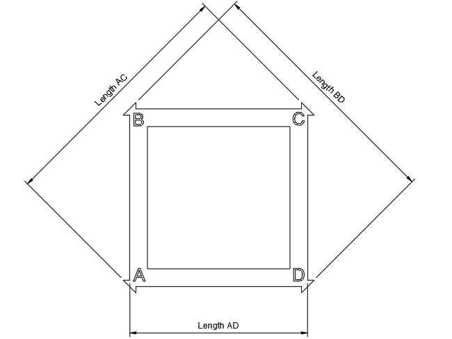

<a id="skew-correction"></a>
# Correção de inclinação

[English](../Skew_Correction.md) | **Português brasileiro**

A correção de inclinação baseada em software pode ajudar a resolver imprecisões dimensionais resultantes de uma montagem de impressora que não está perfeitamente em esquadro. Observe que se sua impressora estiver significativamente inclinada, é fortemente recomendado primeiro usar meios mecânicos para deixar sua impressora o mais em esquadro possível antes de aplicar a correção baseada em software.

<a id="print-a-calibration-object"></a>
## Imprima um objeto de calibração

A primeira etapa na correção de inclinação é imprimir um [objeto de calibração](https://www.thingiverse.com/thing:2563185/files) ao longo do plano que você deseja corrigir. Há também um [objeto de calibração](https://www.thingiverse.com/thing:2972743) que inclui todos os planos em um modelo. Você deve orientar o objeto de modo que o canto A fique em direção à origem do plano.

Certifique-se de que nenhuma correção de inclinação seja aplicada durante esta impressão. Você pode fazer isso removendo o módulo `[skew_correction]` do printer.cfg ou emitindo um G-code `SET_SKEW CLEAR=1`.

<a id="take-your-measurements"></a>
## Faça suas medições

O módulo `[skew_correction]` requer 3 medições para cada plano que você deseja corrigir; o comprimento do canto A ao canto C, o comprimento do canto B ao canto D e o comprimento do canto A ao canto D. Ao medir o comprimento AD, não inclua os chanfros nos cantos que alguns objetos de teste fornecem.



<a id="configure-your-skew"></a>
## Configure sua inclinação

Certifique-se de que `[skew_correction]` esteja no printer.cfg. Você agora pode usar o G-code `SET_SKEW` para configurar skew_correction. Por exemplo, se suas medidas ao longo de XY forem as seguintes:

```
Length AC = 140.4
Length BD = 142.8
Length AD = 99.8
```

`SET_SKEW` pode ser usado para configurar a correção de inclinação para o plano XY.

```
SET_SKEW XY=140.4,142.8,99.8
```
Você também pode adicionar medições para XZ e YZ ao G-code:

```
SET_SKEW XY=140.4,142.8,99.8 XZ=141.6,141.4,99.8 YZ=142.4,140.5,99.5
```

O módulo `[skew_correction]` também suporta gerenciamento de perfis de maneira semelhante ao `[bed_mesh]`. Após definir a inclinação usando o G-code `SET_SKEW`, você pode usar o G-code `SKEW_PROFILE` para salvá-la:

```
SKEW_PROFILE SAVE=my_skew_profile
```
Após este comando, você será solicitado a emitir um G-code `SAVE_CONFIG` para salvar o perfil no armazenamento persistente. Se nenhum perfil se chamar `my_skew_profile`, um novo perfil será criado. Se o perfil nomeado existir, ele será sobrescrito.

Depois de ter um perfil salvo, você pode carregá-lo:

```
SKEW_PROFILE LOAD=my_skew_profile
```

Também é possível remover um perfil antigo ou desatualizado:

```
SKEW_PROFILE REMOVE=my_skew_profile
```
Após remover um perfil, você será solicitado a emitir um `SAVE_CONFIG` para tornar essa alteração persistente.

<a id="verifying-your-correction"></a>
## Verificando sua correção

Após skew_correction ter sido configurado, você pode reimprimir a peça de calibração com a correção habilitada. Use o seguinte G-code para verificar sua inclinação em cada plano. Os resultados devem ser menores do que os relatados via `GET_CURRENT_SKEW`.

```
CALC_MEASURED_SKEW AC=<ac_length> BD=<bd_length> AD=<ad_length>
```

<a id="caveats"></a>
## Ressalvas

Devido à natureza da correção de inclinação, recomenda-se configurar a inclinação no seu G-code inicial, após o homing e qualquer tipo de movimento que se desloque próximo à borda da área de impressão, como purga ou limpeza do bico. Você pode usar os G-codes `SET_SKEW` ou `SKEW_PROFILE` para fazer isso. Também é recomendado emitir um `SET_SKEW CLEAR=1` no seu G-code final.

Tenha em mente que é possível que `[skew_correction]` gere uma correção que mova a ferramenta para além dos limites da impressora nos eixos X e/ou Y. Recomenda-se posicionar as peças longe das bordas ao usar `[skew_correction]`.
