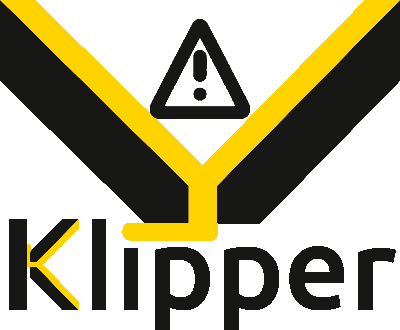

---
hide:
  - toc
title: Boas-vindas
---

{ .center-image }

[English](../index.md) | **Português brasileiro**

O firmware Klipper controla impressoras 3D. Combina a capacidade de um
computador de uso geral com um ou mais microcontroladores. Veja os
[recursos](Features.md) para saber por que usar o Klipper.

Comece pela [instalação do Klipper](Installation.md).

O Klipper é Software Livre. Leia a [documentação](Overview.md), consulte a
[licença](../../COPYING) ou [baixe o software](https://github.com/Klipper3d/Klipper).
Dependemos do apoio generoso dos nossos [patrocinadores](Sponsors.md).
